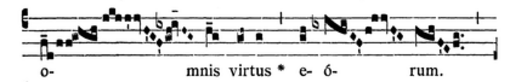
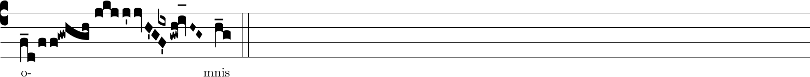

# Stage 8D historical placement gate — stopped

Date: 2026-11-11. This is an investigation record, not implementation or
engraving acceptance. The branch was fetched and checked out with a clean
working tree. No application code, native format, Accepted ADR or bundled
example was changed.

## Owner resolution

The owner subsequently approved option 2, a narrow earlier-note placement
extension. [Accepted ADR 0021](../../adrs/0021-author-b-accidentals-at-neume-boundaries.md)
and the [Stage 8D plan](../../plans/stage-8d-b-accidentals.md) now authorize
implementation on this branch. The sign retains stable B-note ownership
but may be written above an eligible earlier note; invalidated placement
returns to the default before-owner-neume position. The historical gate
is resolved for this specimen, not waived. The remaining comparison
matrix, actual editor engraving and feature verification are recorded in the
[implementation and comparison record](implementation.md).
See also the [owner-review revisions](review-revisions.md) for corrected contracts,
regressions and current verification.
The original investigation, alternatives and baseline results below
describe the state at the stop.

## Verified printed placement

The plan requires comparing [Beata gens, GregoBase 1044](https://gregobase.selapa.net/chant.php?id=1044).
The relevant unexpected case is **o- of omnis**, later than the planned
natural cancellation within Domini. It is visible in the linked
[Graduale Romanum (1961), p. 366 scan](https://gregobase.selapa.net/sources/2/408.png).
The retained crop below comes from that actual scan, not GregoBase's generated
score image. It was cropped at `420x68+40+571` and enlarged four times.



Under C4, GABC `i` is B. The scan places the flat vertically over the last,
lowest descending diamond, before the following rising quilismatic group.
The next B is the subsequent separate virga. The groups between the printed
flat and that B contain no B. In the transcription, the relevant exact suffix is:

```text
jkjj'jvH'G/[-0.5]{ix}F0'gwh!iv_[oh:h]H~G~
```

The `{ix}` alteration is aligned over `F`, followed by `gwh` and then `iv`.
At C4 these pitches are F, G–A, then B. This is evidence of a written flat
placed earlier than the whole neume containing its first affected B. It is
not evidence against the owner-approved register-specific interpretation.
The full downloaded transcription is retained byte-for-byte as
[beata-gens-reference.gabc](beata-gens-reference.gabc), including its source and
transcriber headers. Its reuse follows GregoBase's
[CC0 transcription policy](https://gregobase.selapa.net/?page_id=2).
The scan crop is retained as a focused historical comparison excerpt; the
transcription's CC0 policy is not asserted to license the printed edition.

Downloaded source SHA-256:

```text
sources/2/408.png:
0a0cc2fd8fae11d3aec3902275d5d621e68103fcc1e2ef09c2666f9f704b232b
download.php?elem=1&format=gabc&id=1044:
5a9c865255fda1e5915344e06769b490ecbb2e3aeace568b22bb67ce9bf704b3
```

## Actual Gregorio probe

[placement-probe.gabc](placement-probe.gabc) copies the entire o-/mnis fragment;
only the title and surrounding score were replaced. Its
[TeX wrapper](placement-probe.tex) sets staff size 24 and suppresses an initial.
Gregorio 6.0.0 compiled the input successfully. LuaHBTeX 1.17.0 (TeX Live
2023/Debian), GregorioTeX 6.0.0 and Greciliae produced the following image after
two successful LuaLaTeX runs:



This independently reproduces the transcription's placement over the terminal
diamond. It corroborates the scan; generated GABC is not treated as proof of
historical placement or exact print fidelity. No editor geometry was finalized,
and no scale-normalized editor-versus-reference measurement is claimed.

To reproduce, copy the GABC and TeX files into a temporary directory with
GregorioTeX and Greciliae available, then run:

```sh
gregorio placement-probe.gabc
lualatex -interaction=nonstopmode -halt-on-error placement-probe.tex
lualatex -interaction=nonstopmode -halt-on-error placement-probe.tex
pdftoppm -r 180 -png -singlefile placement-probe.pdf gregorio-placement
convert gregorio-placement.png -trim +repage beata-gens-gregorio-omnis.png
```

The system TeX installation initially failed because `gregoriotex.sty` and
`luaotfload-main` were absent from its default search tree. Both successful
runs used the existing extracted tree documented by Stage 8C:
`TEXMFHOME=/tmp/chant-custos-tex/usr/share/texlive/texmf-dist` and
`TEXMFVAR=/tmp/chant-custos-tex-cache`. These are environment prerequisites,
not new repository dependencies. The package warned that its `autocompile`
option was ignored; the GABC was explicitly compiled beforehand.

## Why the affected work stopped

[Accepted ADR 0021](../../adrs/0021-author-b-accidentals-at-neume-boundaries.md)
in its original pre-amendment form required a B owner and placement
immediately before that owner's containing
neume. There is no B owner in the preceding F or G–A groups. Moving the flat
to the later B virga would preserve its effect on that B but would change this
verified written placement. Combining all these notes into one owning neume
would require unsupported kinds/cardinalities. Attaching the sign to F would
violate the B-owner invariant. No such workaround was implemented.

The plan explicitly says: “If an actual printed score requires unsupported
note-internal or floating signs, retain the evidence and stop that affected
design decision; do not silently extend the vocabulary.” This is a placement
limitation of the agreed vocabulary, not a reason to revisit octave scope.

Concrete alternatives presented to the owner at the stop (option 2 accepted):

1. Retain ADR 0021 and explicitly accept that this printed placement cannot be
   transcribed exactly. Amend the plan to permit proceeding with the B-neume
   placement subset, deferring this specimen's exceptional placement. This
   keeps the agreed model and adds no new notation vocabulary.
2. Require faithful placement here. Discuss and approve a separate placement
   anchor/model and its interaction with B ownership, wrapping, selection,
   deletion and native v5 before updating the plan and ADR. This is a material
   scope change; no schema or implementation is proposed as implicitly approved.

## Remaining work and verification

The required broader probe matrix, the other three printed comparisons,
glyph contour/spacing measurements, application implementation, strict v5,
automated feature tests and Chromium/Firefox production browser verification
remain unperformed. No new feature is claimed. Foreground accessibility,
print acceptance and owner visual review also remain open. The plan's state
now records the stop instead of implying that implementation is complete.

Actual repository checks for this evidence-only change:

- `npm run lint`: passed.
- `npm test`: 78 files, 1,577 tests passed.
- `npm run build`: passed.
- `git diff --check`: passed.
- `npm run format:check`: failed on ADR 0021 and the committed task plan.
  Checking independent `git show HEAD:<path>` copies with Prettier reproduced
  both failures in the original handoff files. Their existing formatting was
  retained. The new evidence README passes its focused Prettier check.
- Browser feature drivers: not run; no application feature was implemented.

Successful baseline checks cannot establish Stage 8D acceptance.
