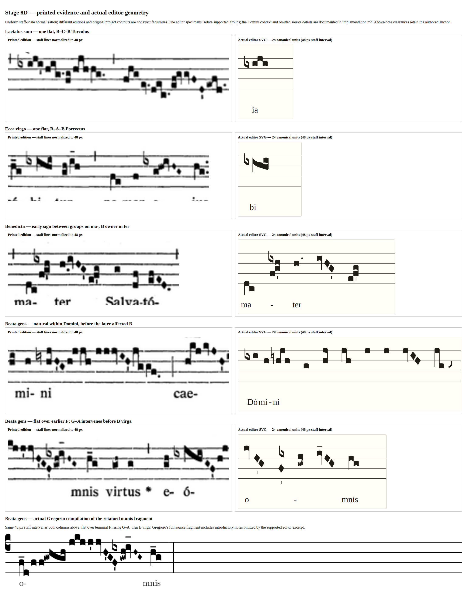

# Stage 8D implementation and reference comparison

Date: 2026-11-11. Implementation for [PR #72](https://github.com/OceanOSdev/gregorian-chant-editor/pull/72).
The [original gate record](README.md) is historical. The owner-approved amendment
to [ADR 0021](../../adrs/0021-author-b-accidentals-at-neume-boundaries.md) resolves
that gate by separating stable B ownership from optional earlier-note placement.
It was implemented, rather than waived. Owner visual acceptance remains pending.

## Printed evidence and supported editor excerpts

`render-comparison.mjs` composes actual browser-captured SVG and retained scan
crops. It does not draw replacement notation. [Normalization metadata](comparison-normalization.json)
records measured scan staff intervals, crop offsets and uniform scale factors;
the printed/editor columns and retained Gregorio excerpt use 48 pixels between staff lines (editor 2× canonical geometry).
The board was inspected as an image. Scan resolution, edition differences and
original project contours preclude an exact facsimile claim.

| Specimen                                                                   | Verified printed evidence                                                                                                                                 | Editor comparison and interpretation                                                                                                                                                                                                                                                            |
| -------------------------------------------------------------------------- | --------------------------------------------------------------------------------------------------------------------------------------------------------- | ----------------------------------------------------------------------------------------------------------------------------------------------------------------------------------------------------------------------------------------------------------------------------------------------- |
| [Laetatus sum, 292](https://gregobase.selapa.net/chant.php?id=292)         | [Liber Usualis p. 18 scan](https://gregobase.selapa.net/sources/4/18.png), `340x70+75+530`, enlarged 4×; `ixiji`                                          | [B–C–B Torculus](laetatus-torculus.chant.json): one prefix flat, earliest B owner; no duplicate sign on final B.                                                                                                                                                                                |
| [Ecce virgo, 1144](https://gregobase.selapa.net/chant.php?id=1144)         | [Liber Usualis scan](https://gregobase.selapa.net/sources/16/183.png), `260x55+150+192`, enlarged 4×; `ixihi`                                             | [B–A–B Porrectus](ecce-porrectus.chant.json): one prefix flat on the complete group.                                                                                                                                                                                                            |
| [Benedicta, 392](https://gregobase.selapa.net/chant.php?id=392)            | [Graduale Romanum scan](https://gregobase.selapa.net/sources/2/802.png), `235x65+112+343`, enlarged 4×; `ma(dc/[1]{/[-3]ix}fg'h)ter(h.0/[-0.5]ivHG'ef'g)` | [Supported ma-/ter groups](benedicta-mater.chant.json): flat associated with earlier F, B owner in later ter. Clearance shifts ink left of the rising group without moving the semantic anchor.                                                                                                 |
| [Beata gens, 1044](https://gregobase.selapa.net/chant.php?id=1044), Domini | [Retained scan](https://gregobase.selapa.net/sources/2/408.png), `420x62+40+444`, enlarged 4×; `ni(iyhjH'Gh!jjh//jjjvIH'jggf.0)`                          | [Supported Domini context](beata-natural.chant.json): explicit natural at earlier A, later B owner, with preceding flat context. This is an isolated supported excerpt, not a full source transcription.                                                                                        |
| Beata gens, omnis                                                          | Original crop, exact suffix and source hashes retained in [gate record](README.md).                                                                       | [Actual editor excerpt](beata-editor.chant.json): flat above terminal F, G–A intervening, first following B owner. The supported C–A–G / F / G–A / B–A–G / A–G groups isolate the placement; omitted introductory repeated notes and source grouping are not claimed to be transcribed exactly. |

These printed cases verify placement and repeated-B engraving. They do not prove
all synthetic combinations or justify additional regional scope rules. The
register-specific interpretation is the approved editorial policy. None of these
cases required new note kinds, arbitrary floating signs or ownerless signs.

## Actual Gregorio compilation

[Probe input](cases.gabc) and [TeX wrapper](comparison.tex) were compiled with
Gregorio 6.0.0, GregorioTeX 6.0.0, Greciliae 6.0.0 and LuaHBTeX 1.17.0
(TeX Live 2023/Debian), using the extracted TeX environment described in the gate
record. Run `gregorio cases.gabc`, then `lualatex -interaction=nonstopmode
-halt-on-error comparison.tex` twice, and `pdftoppm -r 130 -png comparison.pdf
gregorio-matrix`. Both TeX runs exited successfully. Retained actual raster pages:
[page 1](gregorio-matrix-1.png), [page 2](gregorio-matrix-2.png).

The matrix includes flat/natural on all seven supported groups, noninitial B,
repeated B, line/space positions, C3/F3/F4, two registers, close preceding groups,
system starts, earlier compound anchors, and synthetic clef/system crossings.
Synthetic probes are extrapolation, not newly verified historical examples.
The original Beata compilation remains alongside the printed crop. TeX reported
underfull boxes at forced breaks and approximately 9–12 pt overfull probe rows;
the pages are glyph/placement evidence, not justified-page fidelity evidence.
The ignored `autocompile` option is harmless here because GABC was explicitly
compiled first. No TeX/application dependency was added to the repository.

Greciliae's normalized flat/natural dimensions were approximately 12.34 × 28.11
and 8.23 × 38.67 at the editor's 12-unit staff step. Final original editor ink is
12 × 28 and 8 × 39. [Actual browser path/hit metrics](reference-metrics.json)
confirm those dimensions. Prefix advance is 20; above-note placement clears
neighboring ink and lyrics in shared layout. Gregorio's default
`gre@hidealtlinesfalse` leaves staff strokes visible; the editor follows it.
The existing unsigned heads, stems, diamonds, quilismata and rhythmic marks
retain their geometry. The natural/flat shape and visual balance still need
owner review; compilation alone is not approval.

## Implementation and browser evidence

Authored entities, register interpretation, repair and strict v5 validation live
in pure domain/command/persistence seams. Layout measures ID-free signs; SVG
provides independently selectable glyphs. Earlier targeting is cancellable and
atomic. Keep pitches checks degree plus alteration and authored sign identity;
Keep note positions warns only when final repair removes written signs. No
bundled example, manifest or lockfile was regenerated or changed.

The production driver uses isolated headless Chromium 157 (CDP) and Firefox 146
(BiDi), Linux, desktop and 320px viewports. Actual v4 build `39bbe46` was built
from `git archive` and served on the same disposable origin as the current
production build. Both browsers passed authoring, repeated-B canonical controls,
native keyboard property changes, glyph selection/deletion, pointer targeting,
Escape cancellation, same-anchor no-op, restore default, anchor deletion,
word/division placement restoration, exact undo/redo/cache/refresh,
export/import, cross-system placement, counted clef-loss Cancel/confirm,
Keep pitches and unchanged sign paths during browser PDF printing. File/select
setup uses DOM events; key and pointer cases use browser input protocols. These
are scripted real-browser checks, not human foreground testing.

Representative captures: [default](lower-default.png),
[earlier anchor](lower-anchored.png), [320px](anchored-320.png),
[targeted warning](clef-loss-warning.png), [separate placement/owner systems](cross-system.png).
The last is deliberately synthetic and demonstrates that wrapping does not keep
the whole anchor-to-owner span together.

Both browsers also passed the actual v2/current storage-review driver: unchanged
legacy hydration, meaningful v5 save, old-build refusal to overwrite v5,
two-tab conflicts in both directions, 12 immediate-save/refresh cycles and
injected storage failure preserving prior bytes. Existing extreme safe-integer
positions still produce impractically tall/clipped viewports in v2 and v5;
cache bytes and New remain available. This pre-existing limitation was reproduced,
not fixed or reclassified as supported engraving.

## Final verification and acceptance limits

Final local gate used Node **24.18.0**, matching `.nvmrc` (the initially installed
24.12.0 also passed). No dependency changes were needed.

| Check                                                                                                       | Actual result                                                                  |
| ----------------------------------------------------------------------------------------------------------- | ------------------------------------------------------------------------------ |
| `npm run format:check`                                                                                      | Pass, including the original handoff Markdown failures.                        |
| `npm run lint`                                                                                              | Pass, no diagnostics.                                                          |
| `npm test`                                                                                                  | Pass: 80 files, 1,677 tests; 100 focused new accidental/domain/geometry cases. |
| `npm run build`                                                                                             | Pass: TypeScript and production Vite bundle.                                   |
| `git diff --check`                                                                                          | Pass.                                                                          |
| Bundled `*.chant.json`, package manifest/lockfile                                                           | No diff.                                                                       |
| Production accidental driver                                                                                | Chromium/Firefox pass, including actual v4 upgrade/refusal and PDF paths.      |
| Existing vertical episema, contextual properties, note modifiers/forms, local persistence, bundled examples | Chromium/Firefox pass.                                                         |
| Existing mid-score clef/custos and division drivers                                                         | Chromium/Firefox pass on the real development fixture.                         |
| Existing initial-clef driver                                                                                | Chromium pass; this driver has no Firefox transport.                           |
| Actual v2/current storage review                                                                            | Chromium/Firefox pass, including cross-tab/write-failure protection.           |

The final production bundle is `index-BhumhlfL.js`; the reference captures use the
same engraving geometry as that bundle. Feature runs retained disposable output
in `/tmp/chant-b-accidentals-GJLgM5` (Chromium) and `/tmp/chant-b-accidentals-y3Wi8R` (Firefox); repository captures retain the representative evidence rather than
all temporary exports. Existing regressions run sequentially per browser.

Legacy driver expectations were updated for the empty hydrated
accidentals collection/current writer; their old source envelopes remain exact.
The disposable development fixture explicitly clears its test session so recovery
cannot override a requested fixture. The initial-clef driver now traverses the
current document header controls when tabbing from Help to the score.

Remaining foreground checks: owner visual approval of signs and historical
placement; spoken screen-reader output; physical keyboard/IME and real touch or
pinch behavior; native OS print dialog/printer output. Browser PDF checks do not
stand in for those checks. No material architectural deviation or new
unrepresentable historical case was found after the approved amendment.
