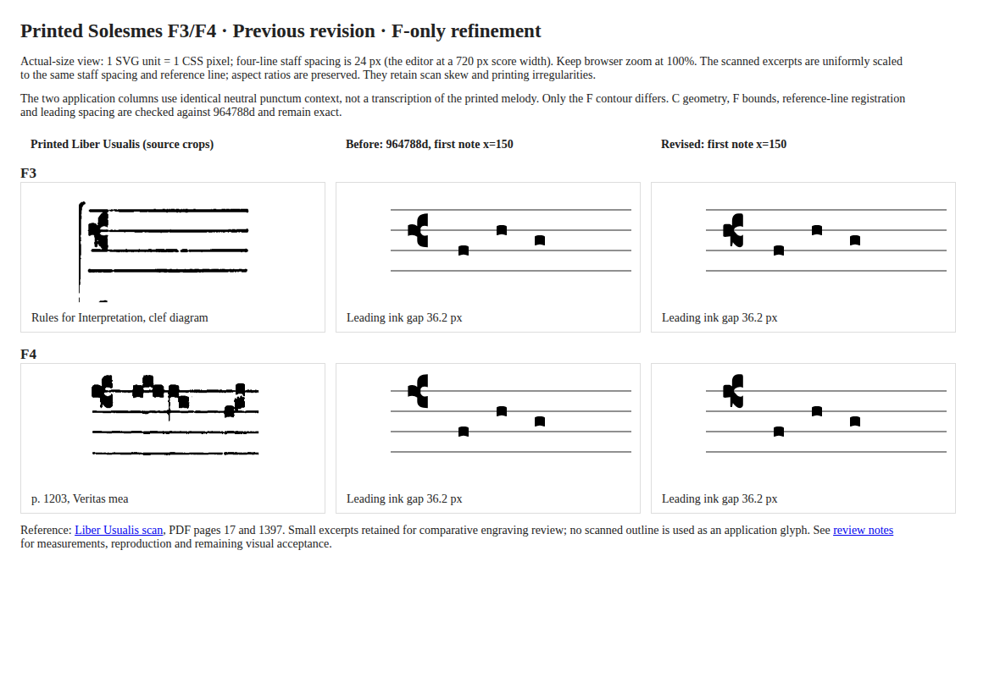

# F-clef silhouette follow-up

2026-11-04. This revision changes only the production F path in
`clef-geometry.ts`. The improved C path, clef bounds and padded targets, first
note x=150, leading gaps, semantic pitch transform and editing behavior remain
unchanged from `964788d`.

[Actual-size comparison](f-actual-size.png) · [Native-size HTML](f-actual-size.html)



## Source observations and contour changes

The existing [F3 crop](reference-f3.png) is the upper FAH staff in the printed
_Liber Usualis_ clef diagram (PDF page 17); the [F4 crop](reference-f4.png) is a
continuation staff in _Veritas mea_, printed p. 1203 (PDF page 1397).
[Source, extraction commands and provenance](review.md#printed-source-and-extraction)
are unchanged. No additional source or replacement reference image was used.

I inspected both crops at enlarged pixel scale to distinguish the body from
staff-line ink, then compared the revised contour at native score size. The
printed diagram has a more oblique shoulder than the musical specimen; the
musical F4 example guides the shoulder curvature and body proportions.

- **Left element:** The printed element is substantial and has a nearly flat
  lower edge, a straight left side and a modest rounded upper corner. The
  previous contour's curved top and scooped bottom made it read as a rounded
  protrusion. The new block spans y=−0.60s…+0.67s at its outside edges, with
  a short chamfer where it enters the upper axis and a defined base.
- **Upper portion:** A narrower rising axis leads to a rounded crown and a
  straight right face. The crown now turns into the right face rather than
  ending in the previous tall, square corner. Its inner lip is shorter and
  directed toward the reference-line aperture.
- **Lower portion:** The source has a short descending stroke beside the lower
  body, visible particularly clearly in the F4 crop. The previous uniformly
  rounded heel erased that distinction. A slim axis now descends almost to
  the bottom, with an undercut separating its foot from the lower heel. The
  heel turns down and right into a fuller rounded base; it is not a mirrored
  upper lobe. This redistribution of ink, rather than general angularization,
  gives the glyph its more distinctive form.
- **Opening and staff:** The mouth extends from −0.32s to +0.43s at the right
  face and narrows asymmetrically toward the axis. The reference staff line
  still passes through its opening at y=0. Curved returns, straight block edges,
  the short diagonal shoulder junction and the descending foot have separate
  jobs; none changes the musical registration.

Here s=12. Occupied bounds remain x=−1.30s…+0.65s and
y=−1.64s…+1.68s, or 23.40 × 39.84 units, exactly as before. The F leading
ink gap remains 36.2 units. Shape changes stay inside that envelope; no layout
or interaction target is enlarged to accommodate them.

## Comparison and scope checks

The board uses the same F3/F4 crops without resampling them into new files.
Each is uniformly scaled by its measured staff space (42 and 44 source pixels)
to 24 CSS pixels and aligned to the same reference line as both application
columns. The application columns use the same neutral punctum context and
x=150 first anchor. The before column comes from `964788d`; the after column
uses the current builder. Open the raw PNG or HTML at 100%, rather than fitting
it to a narrow pane, to judge the actual-size form.

Generate the board explicitly:

```sh
node docs/verification/clefs/refinement/comparison.mjs --f-only
```

Before writing it, this mode checks exact C geometry on all four lines, exact
F geometry except the path (including occupied/padded bounds), and byte-identical
staff metrics against `964788d`. No previous comparison image is overwritten.
The headless Chromium capture is 1180 × 800 at device scale 1; both reference
images loaded and no runtime exceptions were recorded. This is visual
inspection evidence, separate from the geometric tests, and remains subject to
owner typographic review.

Production edits are confined to `faPath`. No command, semantic model, renderer
event handler, selection/history reducer, staff metric or wrapping algorithm
changed. Existing outside-staff and small responsive-notation limitations
remain. Foreground Firefox, OS zoom/IME and spoken screen-reader checks are
not claimed by this headless visual review.

## Recorded verification

On Node 24.18.0: `npm run format:check`, `npm run lint`, `npm test`
(53 files / 1,029 tests), `npm run build`, and `git diff --check` passed.
The real-editor clef browser driver passed all 16 type/line/viewport specimens,
actual SVG bounds, pointer/keyboard/focus, history, draft preservation, empty
scores and placement checks. Its selected new editor screenshots are
[F3](f3-followup-editor.png), [F4](f4-followup-editor.png), and
[F4 at 320px](f4-followup-narrow.png).

The F-only comparison generator passed its exact C/F-metadata/staff-metric
preservation assertions. This revision did not change layout capacity or
composition policy, so the earlier full corpus and unrelated browser results
remain historical; they were not rerun or presented as fresh checks here.
No dependency or lockfile changed.
