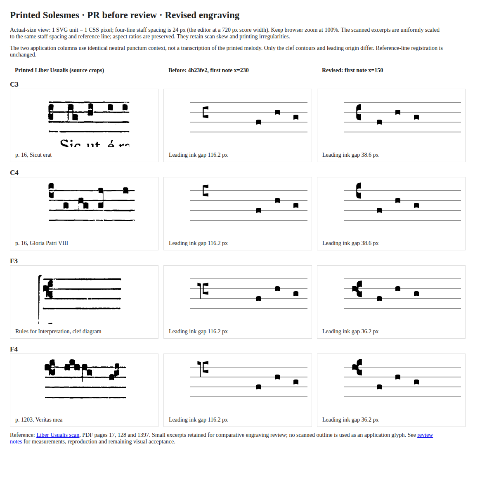

# Clef refinement after PR #54 visual review

The F contour was subsequently refined in the [F-only follow-up](f-review.md).
The C contour and horizontal spacing from this record are retained exactly;
the screenshots below preserve the prior F contour for comparison.

2026-11-03. This follow-up supersedes the initial glyph silhouettes and leading
spacing in commit `4b23fe2`. Semantics, the relative-pitch transform, history and
editing interactions are unchanged. ADR 0014 remains Proposed. This refinement
uses the existing engraving/derived-layout boundary; no new ADR is warranted.

[Actual-size before/reference/after board](actual-size.png) ·
[HTML board at native scale](actual-size.html)



## Printed source and extraction

The primary source is the actual printed _Liber Usualis_ in the
[Archive.org scan, item TheLiberUsualis1961](https://archive.org/download/TheLiberUsualis1961/liberusualis.pdf),
not a Unicode glyph, a modern five-line bass clef, or a software font sample.
The matching [GregoBase source index](https://gregobase.selapa.net/source.php?id=3&images=1)
credits the Church Music Association of America scans. Its small page images
help locate examples; the retained excerpts were rendered from the full PDF
at 500 dpi for silhouette study. The archive's PDF metadata says “1962”; the
item/source index identifies 1961. Page identifiers below refer to the printed
pages and explicit one-based PDF page numbers, avoiding that metadata ambiguity.

| Example | Printed location                                                | PDF page | Retained crop          |
| ------- | --------------------------------------------------------------- | -------- | ---------------------- |
| C3      | p. 16, opening Sicut erat, and Kyrie I continuation             | 128      | [C3](reference-c3.png) |
| C4      | p. 16, Gloria Patri VIII opening                                | 128      | [C4](reference-c4.png) |
| F3      | Rules for Interpretation, opening clef diagram, upper FAH staff | 17       | [F3](reference-f3.png) |
| F4      | p. 1203, Veritas mea offertory, continuation staff              | 1397     | [F4](reference-f4.png) |

F3's retained example is explicitly a printed instructional diagram, rather
than a musical phrase. F4's musical example corroborates its body and weight.
The do forms were checked on both opening and continuation staffs on p. 16;
additional C3 forms appear on p. 1203. The introductory diagrams place lobes
closer to adjacent staff lines than the musical printing, so musical specimens
supply body proportions, with the diagrams confirming reference-line placement.

The full PDF's SHA-256 is
`a3d5fdb3308dcabc0474eb99d2f8a5509e52c76380ae41ec373ab3aa3e7db6b9`.
These small excerpts are retained solely for comparative engraving review.
Application paths are independently drawn Bézier contours; no scan tracing,
notation font, or external outline is distributed as production ink.

Reproduce the crops using Poppler (`liberusualis.pdf` is the downloaded source):

```sh
pdftoppm -f 128 -l 128 -r 500 -x 180 -y 245 -W 400 -H 230 -singlefile -png liberusualis.pdf reference-c3
pdftoppm -f 128 -l 128 -r 500 -x 425 -y 805 -W 400 -H 230 -singlefile -png liberusualis.pdf reference-c4
pdftoppm -f 17 -l 17 -r 500 -x 1440 -y 2485 -W 430 -H 230 -singlefile -png liberusualis.pdf reference-f3
pdftoppm -f 1397 -l 1397 -r 500 -x 40 -y 570 -W 400 -H 230 -singlefile -png liberusualis.pdf reference-f4
```

## Separate visual findings

- **Silhouette:** The printed do is narrow and predominantly vertical, with two
  heavy lobes and rounded left shoulders. Its small right-facing aperture
  straddles the reference line. The original PR's broad diagonal flags and thin
  bracket had the opposite visual emphasis. The revision closes that width,
  lengthens the body and introduces curved shoulders and inner returns.
- **Fa construction:** Printed fa has a compact left block at the reference
  line and a fuller, asymmetrical right body. It does not have the old PR's
  detached-looking, long left virga. Its new path has its own shoulder, waist,
  block and lower heel; it contains no reused do contour.
- **Proportions/weight:** In the musical crops, a do body is roughly one ordinary
  head wide and about 1.6 staff spaces tall; fa is roughly two heads wide with
  similar height. New occupied sizes are 11.16 × 38.88 and 23.40 × 39.84 units
  against 12-unit heads and 24-unit staff spaces. Fine waists connect solid
  lobes; the reference slit stays visible around the staff stroke. These are
  optical readings of a scan, not precise font metrics. Scan bleed and skew
  are not replicated as artificial roughness.
- **Alignment:** Every contour is registered by its aperture, not its overall
  vertical midpoint. C3/C4/F3/F4 use exactly the existing staff-line anchors.
  The fa body is intentionally slightly bottom-heavy. The comparison normalizes
  printed staff spacing uniformly and aligns the reference line without
  stretching either axis independently.
- **Leading space:** The original ordinary ink gap was 116.2 units, almost ten
  staff steps. The new first anchor x=150 gives 38.6 units after C and 36.2
  after F, near the existing 33-unit independent-neume gap. The clef x=100,
  staff extents and 720-unit canvas stay unchanged. The source's ordinary
  continuation gaps are around two to three staff steps; the revision retains
  a little more room to respect existing musical target/clearance conventions.

The actual-size board uses 1 SVG unit per CSS pixel, corresponding to a score
rendered 720 px wide; its reference staff spaces are normalized to 24 px.
It must be viewed at 100% rather than fitted to a narrow panel. Both application
columns use the same neutral punctum context, not a transcription of the source
melody. The 1180px-wide PNG was captured at device scale 1, with all four
reference images loaded and no runtime exceptions. Zooming into the source
crops supported shoulder/waist review; the native-size board separately checked
that these details read as traditional clefs in score context.

## Editor and invariant verification

Real-editor specimens: [C3](c3-editor.png), [C4](c4-editor.png),
[F3](f3-editor.png), [F4](f4-editor.png), [F4 at 320px](f4-narrow.png).
The ordinary first note moves left by 80 units; internal neume ink/anchors,
33-unit inter-neume minima, vowel alignment, word/continuation clearances,
melismas, division ordering and the measured wrapping algorithm are unchanged.
More music fits before automatic wrapping: a music-only system now holds twelve
ordinary puncta instead of ten. Long first-syllable bearings can still increase
the first anchor, and oversized progress/local scrolling still apply.

Wrapping fixtures were adjusted to exercise their original seams in the larger
musical region. In particular, interval-growth specimens still fit exactly at
x=656 before the edit and wrap after growth; the et-lux split fixture uses a
synthetic wider prefix to retain its cross-system syllable span. The browser
spacing driver extends its normal-wrap phrase by two letters and targets s8,
an interior word boundary, rather than s10, which now starts a system. Its
font-readiness check focuses s10, which still crosses measured/provisional
system groups. The word-composition driver likewise lengthens its near-edge
source to keep checking a real outgoing reservation at the staff end. No original
neume-outline recipe or musical interval assertion was relaxed. Clef bounds
tests now enclose Bézier controls/extrema; actual SVG `getBBox()` independently
verifies the resulting curves on all eight type/line combinations. Leading
ink gaps are bounded below by 33 and above by four staff steps.

The reproducible board is generated explicitly from the original PR commit and
current `clef-geometry.ts`, using the documented 12-unit staff step:

```sh
node docs/verification/clefs/refinement/comparison.mjs
```

Then open `actual-size.html` through Vite at 100% and capture it at native size.
The generator deliberately changes a review artifact; it is not a test, a
production glyph source, or an automatic screenshot refresher. The original
Stage 6A images remain historical and were not overwritten.

Final owner judgement of typography is still required. Headless visual
inspection and geometric tests are distinct from foreground interaction,
spoken screen-reader output and publication-quality acceptance. Existing
outside-staff/ledger-line and small responsive-notation limitations remain.

## Recorded checks on this revision

On Node 24.18.0, formatting, Oxlint, all 1,029 Vitest tests (53 files), the
TypeScript/production build and `git diff --check` passed. No dependency changed.
All seven standalone headless Chromium drivers passed: clefs, divisions,
continuous lyrics, lyric moves, vowel/manual alignment, measured spacing and
word composition. The geometry/interaction driver covers all eight C/F × line
combinations at 1440px and 320px. Capacity-dependent driver fixtures were
adapted as described above; their original clearance, reparenting, history,
wrapping and outgoing-mark assertions still execute.

The 47-case real-font composition corpus also passed at desktop and 320px
widths with no invariant errors (77 joined, 39 hyphenated, 9 outgoing and 17 word-boundary
classifications at each width). The comparison board loaded all four source images and
rendered without runtime exceptions.

These are headless Chromium results. Foreground Firefox/OS dropdowns, actual
browser zoom/IME and spoken screen-reader output were not run for this
refinement. The original semantic clef-transform/history/session tests are
unchanged and remain passing. Production changes are confined to clef paths,
derived leading-origin metrics and the measured clearance calculation.
