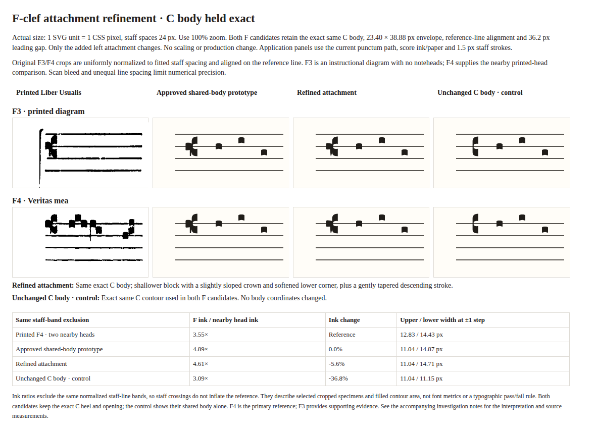

# Approved shared-body F clef

2026-11-04. Adopt the owner-approved shared C body and refined F attachment
without additional optical changes. The production F now uses the exact C
contour translated 0.20 staff step right, plus the approved shallow block and
gently tapered descending stroke. No C control points changed. Semantics,
pitch preservation, editing, first-neume spacing and lyric composition remain
unchanged. No new architectural boundary or ADR is required.

[Approved native-size comparison](shared-body-comparison.png)

The right-hand F candidate in the middle pair is the adopted design. Staff
spaces are 24 CSS pixels; view at 100%. The C-only column shows its exact shared
body. The source crops remain [musical F4](refinement/reference-f4.png), the
primary reference, and [instructional F3](refinement/reference-f3.png), supporting
evidence. See [printed source provenance](refinement/review.md#printed-source-and-extraction).
The previous independent production F is retained in historical records.

The attachment has a slightly sloped crown, a shallower block with softened
corners, and a gently tapering curved shaft. Against the earlier shared-body
prototype, the adopted glyph has 5.6% less staff-band-excluded ink (493.27 →
465.47 square CSS pixels), or 15.3% less attachment-added visible ink. The exact
C-only body accounts for 311.63. This reduction is concentrated centrally;
upper ink is unchanged. These descriptive measurements use 16× alpha sampling
and the same excluded staff bands as the printed F4 sample. Scan bleed and the
small printed sample limit claims of exact fidelity. Owner visual acceptance,
not a numerical threshold, determined adoption.

Occupied F width remains 23.40 units, with the same right extent and 36.2-unit
leading gap. Height changes from 39.84 to the approved C body's 38.88 units;
padded hit bounds follow that actual envelope. The aperture remains aligned
with the reference staff line. No whole-glyph scaling is applied.

## Production verification

The unit regression freezes the independently reviewed C and composite F paths,
checks shared-body identity and occupied size. Existing matrices cover C/F on
all four staff lines, wrapping, empty scores, accessible labels and leading
clearance. The real-editor Chromium driver passed 16 type/line/viewport specimens
with actual SVG bounds, controls, native pointer/keyboard, focus, history,
dirty lyric drafts, empty scores and placement at desktop and 320px.
An initial browser run was interrupted during edits; the complete final rerun
passed. The glyph regression also caught floating-point string differences in
the translation during development; the final path matches the approved
comparison exactly.

Production screenshots: [F3](shared-body-f3.png), [F4](shared-body-f4.png),
[F4 at 320px](shared-body-f4-narrow.png). These are actual editor captures,
separate from the illustrative comparison. No foreground browser or spoken
screen-reader verification is claimed.

On Node 24.18.0, `npm run format:check`, `npm run lint`, `npm test`
(53 files / 1,030 tests), `npm run build`, and `git diff --check` passed.
No dependencies changed. Stages 6B/6C remain deferred; the PR is not merged.
