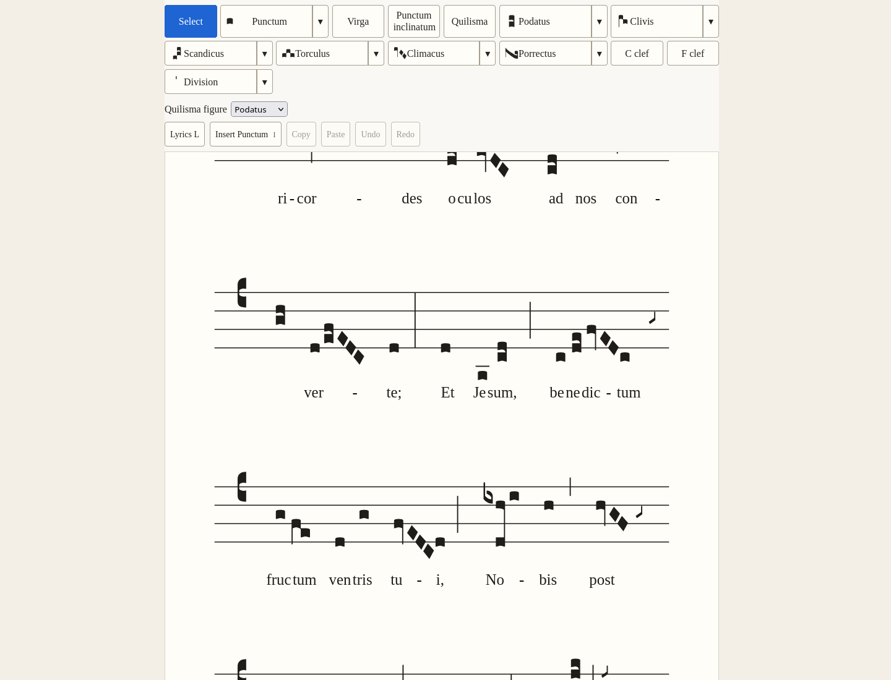

# Stage 11B — dynamic vertical system layout: implementation record

Branch `feat/dynamic-vertical-layout`, target `master`, base `3d5a93f`
(PRs #91 and #92 merged). Implements the
[Stage 11B plan](../../plans/stage-11b-dynamic-vertical-layout.md) under
[ADR 0028](../../adrs/0028-compose-before-vertical-lyric-clearance.md). The
contract is owned by
[layout and rendering](../../layout-and-rendering.md#dynamic-vertical-system-layout-stage-11b)
and [engraving metrics](../../engraving-metrics.md#vertical-system-metrics-stage-11b).

## Acceptance fixture

The bundled
[Dominican Salve Regina](../../../src/editor/examples/Salve-Regina-Dominican.chant.json)
(unchanged bytes). Its only off-staff note is the punctum at -3 on _Je_ of
_Et Jesum_ (ledger at -2). Before (Stage 11A, historical):
[`../neume-ledger-lines/et-jesum-1440.png`](../neume-ledger-lines/et-jesum-1440.png),
where the low A overlaps its lyric. After (this stage, Firefox 1440 px):

Je's system grows by 9 units to height 229 (local ink bottom 166 → local
lyric baseline 189 = 166 + 3 + 20); its staff does not move; every later
system moves down 9 units; every other system keeps height 220 and baseline 180. Kyrie XI and all other ordinary layout snapshots are unchanged. (An
earlier revision of this record and the PR said 10/167/190, taken from a
synthetic unit case; the layout itself was always 9/166/189, and unit and
driver tests now assert these exact values.)

## Implementation summary

- `src/editor/layout/system-vertical-layout.ts` (new, pure): vertical
  constants, `measureSystemVertical` (clamped musical extent, top expansion,
  shared baseline, bottom) and `stackSystems` (score-absolute frames).
- `layout-chant.ts`: the walker composes every system in the canonical
  frame; `layoutChant` measures each system's complete musical ink
  (`positionedMusicInk`), stacks, then translates each composed system with
  `positionComposedSystem` (see [geometry rebuilding](#final-position-geometry-rebuilding)).
  Systems expose
  `bottomStaffY`, `lyricBaselineY` and the resolved `musicBand` (see
  [containment](#exceptional-geometry-and-system-containment)); lyrics and
  hyphens use the system baseline; the vertical canvas is the stacked
  systems.
- Removed lyric-dependent accidental exclusions: `AccidentalLyricBox` and its
  parameter (`neume-geometry.ts`, `accidental-geometry.ts`), the
  preceding-lyric accidental shift, `lyricBandAccidentals` reservations and
  `continuationHyphenLeft` obstacles (hyphens are now centred in the text
  gap). Musical clearance, ledger-stroke clearance, default prefixes,
  explicit placement and anchors are unchanged. No callers remained.
- `ScoreSvg.tsx`: per-system render band (`renderBandFor(system.musicBand)`)
  for ledger runs and outlines, a per-system `clipPath` on a new
  `.score__system-music` group (staff, clefs, custodes, neumes, signs,
  divisions, their pointer regions and in-system overlays; lyrics and
  hyphens stay outside), the range rectangle clamped to the band, lyric-move
  captions kept inside it (`moveCaptionBaseline`), the lyric keyboard-focus
  cue below the lyric (`lyric-focus-cue.ts`), the remote-placement caption 12
  units above the system bottom, and `data-system-top`,
  `data-system-height`, `data-bottom-staff`, `data-lyric-baseline`,
  `data-music-top`, `data-music-bottom` for drivers.
- `SyllableControls.tsx`: the floating lyric entry sits 24 units above the
  system's `lyricBaselineY` (formerly `system.y + 156`).

## Final-position geometry rebuilding

An earlier working revision re-ran the whole horizontal walker at the
resolved origins and threw if system membership differed. That check covered
membership only (system count, `startNeumeIndex`, group count), and it could
plausibly be triggered by a valid document: builders make y-overlap decisions
(sign versus ink, ledger strokes level with a sign) that can round
differently after translation at safe-integer coordinates, which could change
a width and then a wrap. It was replaced before commit:

- The walker runs **once**, in the canonical frame. Each composed system is
  then translated **independently** (`positionComposedSystem`): every neume
  group (with its signs, ledgers and modifiers) is rebuilt through
  `buildNeumeGeometry` at its composed `bounds.x`; custodes, clef changes and
  divisions through their builders at their composed x. A system already at
  the canonical origin is reused unchanged.
- `positionComposedSystem` lists every `PositionedSystem` field explicitly
  (no object spread), so a future geometric field fails to compile until it
  is translated or declared vertical-free; it receives the system's slice of
  geometry inputs.
- Membership, order and every horizontal decision are fixed by construction;
  there is no production invariant exception. Slots, hyphens and hit clips
  are derived once, afterwards, from the translated geometry.
- Horizontal geometry, not just membership, is tested: for every bundled
  example (measured and provisional fonts), every group rebuilt at the
  canonical origin has identical left edge, width, advance, lyric anchor,
  note anchors and sign ink x, and is displaced vertically by exactly the
  system's origin offset. Other tests show x and slots unchanged when extreme
  notes move further from the staff.
- Limitation: at safe-integer coordinates, a translated y may round so that
  a sign's collision column differs, changing that group's internal x (not
  membership). This falls under the existing extreme-coordinate policy.
- The invariant is one-way: vertical measurement and positioning never feed
  back into horizontal composition. Font measurements **can** affect
  vertical positioning indirectly: measured lyric widths take part in
  horizontal composition, so they can change which neumes share a system,
  and therefore each system's musical extent, height and baseline. Given a
  fixed composition, a system's vertical frame depends on its musical ink
  and on whether it carries lyrics (anchor presence, not measurement).

Performance (Vitest, Node 24.12.0, median of 7 × 100 layouts after warm-up,
deterministic test metrics): bundled Salve Regina 3.33 ms on `3d5a93f` versus
3.98 ms here; Kyrie XI 0.84 ms versus 1.07 ms (about +20%, one extra builder
call per element of a translated system). Layout already runs only on
document or measurement changes.

## Consumer audit

| Consumer                                     | Assumption found                                    | Result                                                    |
| -------------------------------------------- | --------------------------------------------------- | --------------------------------------------------------- |
| Walker / custodes / divisions / clefs        | `firstSystemBottomStaffY + i * 244`                 | Origin callback; canonical frame then resolved origin     |
| Lyric and hyphen placement                   | `180 + i * 244`                                     | System `lyricBaselineY`                                   |
| Canvas                                       | `220 + (n-1) * 244`, ink ±1,200                     | Stacked systems; horizontal 11A containment unchanged     |
| `resolveScoreSlot`                           | System `y`/`height`                                 | Already derived; tested on a later system after expansion |
| Graphical neume and clef placement           | Max of staff-line `y` as origin                     | `system.bottomStaffY` (review follow-up)                  |
| Tests and `inspect-corpus.ts` staff origins  | `124 + index * systemVerticalAdvance` / staff lines | `system.bottomStaffY` (review follow-up)                  |
| Range/neume selection outlines               | Bounds, staff lines, lyric `y`                      | Already derived; band-limited (range clamped to the band) |
| Render band (`render-band.ts`)               | Whole canvas                                        | Per-system resolved `musicBand`                           |
| Lyric-move captions                          | `bounds.y - 14`                                     | Lowered when needed to stay inside the band               |
| Lyric keyboard-focus cue                     | `lyric.y - 30` (above the baseline)                 | Below the lyric, in the bottom padding (review follow-up) |
| Floating lyric entry                         | `system.y + 156`                                    | `lyricBaselineY - 24`                                     |
| Remote placement caption                     | `system.y + 208`                                    | `system.y + system.height - 12`                           |
| Focus/reveal, scroll                         | DOM rects                                           | Unchanged; focus by ID verified through reflow and resize |
| Accessibility description                    | No geometry                                         | Unchanged                                                 |
| Print CSS                                    | No fixed heights                                    | Unchanged; PDF produced in both browsers                  |
| `canGraphicalNeumeFitNormalSystem`           | Canonical origin, width only                        | Unchanged (x is origin-independent)                       |
| Browser drivers (`mid-score-clefs`, 11A, 8D) | `244` advance, `-1200` canvas                       | Updated; see below                                        |

## Exceptional geometry and system containment

Measured extents are clamped to the canonical **maximum** band
(`canonicalMusicBand`, 1,200 units beyond the canonical 220-unit system,
the Stage 11A margin), so the tallest system is about 2,700 units; distant
pitches never allocate pitch-proportional height. Each system's resolved
`musicBand` is that band translated to the system's origin and intersected
with the system's own box `[y, y + height]` (review follow-up; it was
previously the whole translated canonical band, 2,620 units, whatever the
system's height). It equals the box for every ordinary or moderately
expanded system. The system's musical group (ink, ledgers, pointer regions,
outlines, placement-context and lyric-move rectangles and captions) is
clipped to it; the range rectangle, drawn outside that group, is clamped to
it; ledger runs/outlines are painted only within the band plus one ledger
space (compact runs, no per-level DOM). Adjacent bands are separated by at
least the 24-unit gap, so nothing painted or pointer-targetable in one
system, including a clipped distant target, reaches another. For unclipped
music the overlays fit inside the band without being cut (measured ink is
12 units inside the box; overlays reach at most 8.5 units beyond ink;
captions are lowered when needed), which unit tests and the driver assert
rather than rely on.

Before this follow-up the same separation held in practice (all measured
ink was inside the box, and the furthest overlay, a lyric-move caption,
reached about 11 units beyond it, inside the 24-unit gap), but only through
those padding relationships, untested; the
documentation claimed that the system reserved everything inside the
2,620-unit band, which was false.
Semantic pitches, history, clipboard and export are unchanged; distant notes
remain keyboard-editable; arbitrary safe-integer coordinates are not claimed
to engrave faithfully. Horizontal text-relative containment, uncapped text
and outgoing-hyphen containment (PR #91) are unchanged.

## Intentional changes to existing expectations

All in `accidental-geometry.test.ts` unless noted; each changed assertion is
commented in place. Unrelated coverage was retained.

- A low natural beside its own lyric keeps its music-only position (equal to
  the syllable-free layout); the baseline moves to `ink bottom + 3 + 20`.
- A later low sign after a preceding Sanctus/Benedictus/Sanctissimus lyric
  sits at the compact melisma minimum instead of shifting past (or wrapping
  after) the lyric.
- High flat/natural: room is added above the staff in the system (staff
  moves down) instead of a negative canvas origin; also `custos-geometry`
  position 14 and the `b-accidentals` browser driver.
- A later centred lyric passes beneath earlier low accidental ink instead of
  being pushed right.
- An intervening low natural no longer forces a hyphenated continuation:
  text edges equal the unsigned layout.
- Current-group hyphen: earlier-anchor case keeps the compact A-men join
  (formerly hyphen at [162, 182], men at [196, 256]); default-prefix case
  centres the hyphen at [173, 193] with men at [206, 266] (formerly
  [173.5, 193.5] and [219, 279]). Same change in the `b-accidentals` driver.
- Hyphens below both preceding and current low signs: the split
  continuation now first occurs with 9 fillers (formerly 8); 8 fillers stay
  on one system.
- `ledger-lines.test.ts` Et Jesum: the system now grows (was fixed 220).

## Automated verification

Run on Linux x64, Node 24.12.0, Chromium 157.0.8103.38 (snap), Firefox 146.0.
Final results are recorded below in [review follow-up results](#review-follow-up-results) and [initial results](#results-initial-submission).

- Unit: `system-vertical-layout.test.ts` (40 tests, including per-example x-invariance and containment) covers measurement
  formulas and exact clearance boundaries (157 → 180, 157.5 → 180.5),
  top-padding boundary, lyricless/empty systems, band clamping, stacking,
  ordinary multi-system and Kyrie XI geometry, a single expanded system and
  its successors, high ink, x/slot/membership invariance when extreme notes
  move further away, custodes/clefs/divisions in their frames, provisional
  lyrics, later-system hit mapping, slot ownership of the gap, graphical
  placement and reflow after transposition, opposing extreme systems, and the
  bundled Salve Regina (measured and provisional, exact 166/189/229).
  Review follow-up additions: resolved bands equal the box for ordinary and
  moderately expanded systems and the translated canonical band inside the
  box for extreme ones, adjacent bands at least 24 apart; for every bundled
  example and an opposing-extremes fixture, each neume's body ink, complete
  ink, accidental ink and ledger runs (with stroke) lie inside its
  authoritative `bounds`, and the note, modifier, accidental, clef and
  division pointer regions, whole-neume outline, placement-context/lyric-move
  rectangle, lyric-move caption and range rectangle of unclipped music lie
  inside the resolved band; a pure model of clipped note targeting (hit
  bounds, ownership clip, band clip) shows every visible note's centre
  reaches exactly that note, beside opposing safe-integer systems. The
  x-invariance test is named for what it compares (already-expanded systems
  expanding further; an unexpanded reference would differ through ledger
  overhangs). `lyric-focus-cue.test.ts` reproduces the former triangle
  overlapping Je's low A and asserts the cue now lies below the lyric
  descent and inside the system for every lyric of every bundled example;
  `render-band.test.ts` covers caption lowering.
  `vertical-clearance.test-cases.ts` (renamed from `.testing.ts` to the
  existing `*.test-cases.ts` convention) holds the shared invariants.
- Browser driver `dynamic-vertical-layout` (Chromium and Firefox, 1440 and
  320 px), against the real bundled Salve Regina: actual lyric font metrics
  within the 20/5 band (accented capitals ascent 19, descenders 5); stacked
  measured systems and clipped music groups; every lyric/hyphen on its
  system baseline and below all painted ink (real text boxes); Je's ledger
  and clearance; only Je's system expanded; every neume and syllable,
  three _O_ syllables, final _ia._, the anchored _Nobis_ flat above the row;
  pointer selection and nine-step keyboard transposition on the following
  system (expands it, moves later systems, earlier systems unchanged), focus
  retained by ID through reflow and viewport resize, Undo restores bytes and
  frames; real-pointer graphical placement on that system at pitch 4 with
  ghost on its resolved staff and Undo; export equals the bundled document
  and re-import restores identical frames; print-media emulation (Chromium)
  leaves frames unchanged and a PDF is produced in both browsers. Section 7
  covers 150% CSS zoom with a clef on an expanded later system (see below).
  Review follow-up additions: Je's exact local 166/189/229; the Je keyboard
  focus cue (real `focus()` on the lyric; triangle and caption boxes below the
  Je text box and below every painted ink box of the system, inside the
  system; `:focus-within` visibility asserted where the document has focus);
  the resolved lyric face ([below](#lyric-font-evidence)); and section 8,
  two adjacent extreme systems (a safe-integer low note on the first system, a safe-integer high note on
  the second) at 1440 and 320 px: each clip rect
  equals the resolved band inside its box; real `elementFromPoint` hit
  testing at 6-unit steps over the first three systems along the extreme and
  neighbouring columns (2,124 samples each in ordinary mode and with lyric-move
  targets on every neume) never returns an element of a system other than
  the one whose box holds the point; real pointer presses select notes beside
  both extremes; and the whole-neume outline, range rectangle, placement
  context, lyric-move targets and pointer rectangles and captions are inside
  their system's band (captions by their full, unclipped text box).

### Updated existing drivers

- `neume-ledger-lines`: section 9 asserts the Stage 11B containment
  contract instead of the 11A canvas origin (review follow-up: each resolved
  band lies inside its system box and is no larger than the canonical
  maximum band); other sections unchanged.
- `b-accidentals`: high-sign, current-group hyphen and narrow-join
  expectations as listed above; all non-overlap checks retained.
- `mid-score-clefs`: note y relative to each system's `data-bottom-staff` (was
  `systemIndex * 244`); `click()` adds a page-scroll fallback after
  `scrollIntoView`. Evidence: with a `MAX_SAFE_INTEGER` note in the system,
  Firefox 146 scrolled the clef-control `<g>` to 59 although its client rect
  required ~1,514 (its ink path and the staff line scrolled correctly; with
  the clip disabled the result was the same). Clean master passed 4/4 runs
  and the branch failed 2/2 before the fallback. The application's focus
  reveal uses client rects and `scrollBy`, not `scrollIntoView`.
- Runner: manifest entry and the pinned full-preset pair count (44 → 46).

### Firefox `mid-score-clefs`: driver scrolling versus production behaviour

The branch-only Firefox failure was in the driver's generic `click()`, which
relies on native `scrollIntoView`. A temporary probe (identical script, run
on this branch and a detached `3d5a93f` worktree, both browsers, 1440 and
320 px, 100% and 150% CSS zoom, ordinary/high/safe-integer fixtures with a
clef change on a later system) established:

- Firefox's native `scrollIntoView` on the clef-control `<g>` already fails at
  1440 px on `3d5a93f` for ordinary systems. On the branch's tall
  safe-integer system it also fails at 320 px. Its client rect is correct in
  every case (ink path and staff-line `scrollIntoView` scroll correctly).
- The application's reveal (`focusin` → next frame → `focusAndReveal`, client
  rects and `scrollBy`; it never calls `scrollIntoView`) reveals the clef in
  expanded, high and safe-integer systems at both zooms in Chromium, on both
  trees.
- Headless Firefox never has document focus (`document.hasFocus()` false):
  focus moves (`activeElement` is the clef) but **no `focusin` is
  dispatched** (Chromium: one), so the application's reveal cannot run there
  on either tree. Firefox results in that mode reflect native focus
  scrolling only. Foreground Firefox reveal remains an owner check.
- With the clef brought into view from its client rect, a real pointer
  press at its rendered location selects it, an Arrow draft keeps focus on
  it, a transposition on its expanded system restores focus to the note by
  ID, and Undo restores the stored bytes. All of these pass in Chromium and
  Firefox, at 1440 and 320 px, at 150% zoom, for all three fixtures (driver
  section 7).

The `mid-score-clefs` fallback (page scroll from the element's client rect
after `scrollIntoView`) therefore changes only how the driver reaches its
target; production pointer targeting and focus behaviour are covered above.
The temporary probe was removed and is not committed.

#### Why the probe fails on master while `mid-score-clefs` passes there

Three mechanisms are distinct: native `scrollIntoView` (browser), the
driver's `click()` scrolling (the native call plus, on this branch, a
page-scroll fallback) and production focus reveal (`focusin` → client rects
→ `scrollBy`; never `scrollIntoView`). To check whether the two scenarios
need different scrolling, `click()` was temporarily instrumented, identically
on this branch (with its fallback) and a clean `3d5a93f` worktree (without),
to record for every call whether the target was in view before scrolling,
after native `scrollIntoView`, and finally (Firefox 146, one run each; the
instrumentation was then removed):

| Tree      | Calls (1440 / 320 px) | Already in view | Needed scrolling (native succeeded) | Native moved a visible target out |
| --------- | --------------------- | --------------- | ----------------------------------- | --------------------------------- |
| `3d5a93f` | 113 / 102             | 210             | 5 (5), none a clef `<g>`            | 0                                 |
| branch    | 113 / 100             | 210             | 3 (3), none a clef `<g>`            | 1 (`unsafe-edit` clef, 1440 px)   |

The scenarios do differ. `mid-score-clefs` clicks targets that are almost
always already visible, and the few it must scroll to are toolbar, dialog
and radio controls, never a clef-control `<g>`, so on master it never meets
the case that fails. The probe deliberately starts at scroll 0 with a
clef-control `<g>` on a later system below the fold, at 150% CSS zoom:
exactly that case, which native Firefox `scrollIntoView` mishandles at
1440 px on both trees. The single branch failure is a different trigger of
the same native behaviour: the `unsafe-edit` clef `<g>` on the tall
safe-integer system was already in view at 1440 px (100% zoom), and native
`scrollIntoView({block:'center'})` moved it out of view (on master that
system is 220 units high and the call left it visible); the fallback
returned it from its correct client rect, and the click succeeded. The
instrumented branch run then stopped at the documented intermittent 150%
zoom pointer insertion (`browser-check.mjs:1047`, the manifest's known
issue), unrelated to `click()`; that is why it has fewer 320 px calls. The
uninstrumented driver then passed in both browsers, and again in the full
run below. No application behaviour depends on native `scrollIntoView`.

### Firefox stale scroll range under 150% CSS zoom (Audio 1 follow-up)

Found while verifying Audio 1 (PR #101), Firefox 146, headless, 320 px. In
section 7, Firefox reported the zoomed `scrollHeight` but clamped page
scrolling to a smaller, stale extent. The driver's `scrollBy` was then undone
by a native scroll event, with no script involved: an instrumented run logged
only the driver's call, then two scroll events, the second back to the start.
Measured by scrolling to the end and waiting:

- **`master` (`f033976`), ordinary case:** reachable maximum 1433 vs reported 2185.
- **Audio 1 branch, all three cases:** for example safe-integer, 1565 vs
  2751, which left the safe-integer clef below the reachable page.
- **Without zoom on both trees:** the ranges matched and the clef was
  reachable.
- **Toggling the zoom off and on** restored a correct range.

Focusing the clef changes the page height and can make the range stale again.
This is test-environment behaviour, not an application interaction
regression: it requires CSS `zoom` on `main` and does not occur at 100%.

The driver now applies the zoom through `applyZoom()`. It re-applies the zoom
until the reachable extent equals `scrollHeight − innerHeight` and fails
explicitly after three attempts. It checks again just before the
rendered-location scroll, and records `staleRangeAfterFocus` in the `zoom`
evidence. The hit-testing, pointer, keyboard and focus assertions are
unchanged.

With the patched driver, both trees pass in both browsers. Firefox reported
`staleRangeAfterFocus` for ordinary and high at 320 px on `master`, and for
all three cases on the branch. Chromium never reported it.

### Lyric font evidence

The lyric stack is `Georgia, 'Times New Roman', serif`. The driver now
identifies the face it resolves to (a candidate is installed when, with a
monospace fallback, it measures differently from monospace; it is the
resolved face when its advance equals the stack's), and Chromium also
reports the platform face that rendered a real lyric node
(`CSS.getPlatformFontsForNode`):

| Browser (Linux host)    | Georgia       | Resolved face                                                      | Accented capitals ascent | Descender descent |
| ----------------------- | ------------- | ------------------------------------------------------------------ | ------------------------ | ----------------- |
| Chromium 157 (headless) | not installed | Liberation Serif (platform font; `Times New Roman` alias, = Tinos) | 19                       | 5                 |
| Firefox 146 (headless)  | not installed | Liberation Serif (`Times New Roman` alias)                         | 19                       | 5                 |

Host fontconfig maps `Georgia` to Noto Serif and `Times New Roman` to the
metric-compatible Liberation Serif; neither browser used Noto Serif.
Other installed serifs, measured individually but not used: Noto Serif
(ascent 19, descent 5) and DejaVu Serif (ascent 20, descent 4), both inside
the 20/5 band. The verified claim is therefore only: on this Linux host,
the resolved face (Liberation Serif) fits the 20/5 band, with no descent
margin (the Je text box ends exactly 5 units below the baseline). Real
Georgia (typical on macOS and Windows) and Microsoft Times New Roman were
not measured; no cross-platform font coverage is claimed. No supported face
measured here exceeds the band, so no collision needed addressing.

### Pre-existing failures (reproduced on clean base `3d5a93f`)

Run with the unchanged runner on a detached worktree of `3d5a93f`:
`lyric-move` (Chromium, "Missing button Move syllable"), `lyric-spacing`
(Chromium), `lyric-spacing-selection-cue` (Firefox) and `word-composition`
(Chromium and Firefox, "punctum selected whole-neume cue must be clipped")
fail identically there. They are not fixed or waived here.

## Review follow-up (Giga Review of PR #93)

Fixes, all within the accepted Stage 11B architecture:

1. Je measurements corrected here, in engraving metrics and in the PR
   (9 units; 166 → 189; height 229), and asserted exactly by unit and driver
   tests.
2. `musicBand` contract: canonical maximum band versus resolved band (inside
   the system box), enforced by the clip and range clamp, captions kept
   inside, and tested (see [containment](#exceptional-geometry-and-system-containment)).
3. Fixed-frame assumptions: `firstSystemBottomY` and the
   `firstSystemLyricBaselineY` alias removed, `systemHeight`/`systemGap`/
   `offStaffCanvasMargin` imported only from `system-vertical-layout.ts`, the
   walker's constant `bottomY()` replaced by `firstSystemBottomStaffY`;
   graphical neume and clef placement, nine test files and
   `inspect-corpus.ts` use `system.bottomStaffY`; `systemVerticalAdvance`
   is documented as the ordinary advance only.
4. Lyric keyboard-focus cue moved below the lyric (reproduced on Je: the
   former triangle spanned local 159–165, over the head of Je's low A (ink
   bottom 166); now 196 to
   about 218, below the 194 text bottom, inside the 229 box), with no added
   system height; visibility, `aria-hidden` and the lyric's accessible name
   are unchanged.
5. `positionComposedSystem` lists every field explicitly.
6. Tests strengthened as listed under [automated verification](#automated-verification).
7. Font evidence qualified ([above](#lyric-font-evidence)).
8. Firefox `scrollIntoView` evidence clarified ([above](#why-the-probe-fails-on-master-while-mid-score-clefs-passes-there)).
9. The font-measurement claim corrected ([geometry rebuilding](#final-position-geometry-rebuilding)).
10. Roadmap's Stage 11A containment wording put in the past tense with the
    Stage 11B per-system form.
11. Cleanups: unnecessary casts removed; shared `AccidentalSpec`,
    `VerticalBand` (`RenderBand` is now an alias of it) and
    `ChantSystemLayout` types; redundant `SystemFrame` annotation removed;
    `scoreId` (was `ledgerId`) prefixes clip and pattern IDs, including
    ownership hit clips; the repeated ownership-clip expression and the
    placement-system lookup are shared; `lyricRowTop` replaces three copies
    of the row-top formula and `expectLyricRowClearsSigns` reuses
    `systemViolations`; `inputFor` replaced by an input slice.

ADR 0028 already requires a consistent per-system clip; this follow-up
tightens its implementation without changing the decision, so no ADR
change was made.

### Review follow-up results

Linux x64, Node 24.12.0, Chromium 157.0.8103.38 (snap), Firefox 146.0, on
the follow-up working tree (committed unchanged as the follow-up commit).

Standard gate: `format:check`, `lint`, `npm test` 104 files / 2,414 tests,
`build`, `git diff --check`, and `test:verify-runner` 28/28 passed.

Targeted: `dynamic-vertical-layout`, `neume-ledger-lines`, `b-accidentals`
and `mid-score-clefs` passed in Chromium and Firefox.

Full regression, rerun because the clip now applies to every score
interaction and the cue to every lyric:
`npm run verify:browser -- --preset full --browser both -j 4`
(`.verification-runs/run-2026-11-17T05-24-17-815Z-53BNyH/`, ignored):
**40 passed, 6 failed, 6 unsupported**, 349.4 s, cleanup with no errors.
The six failures are the same jobs at the same points as below
(`lyric-move` Chromium "Missing button Move syllable", `lyric-spacing`
Chromium `closeNoteProperties`, `lyric-spacing-selection-cue` Firefox
`_assertInViewPort`, `word-composition` both "punctum selected whole-neume
cue must be clipped", `note-modifiers` Chromium null `text`), and each
failed identically when rerun on a clean `3d5a93f` worktree during this
follow-up. Those drivers stop within seconds, so their lyric-move and
lyric-cue sections do not exercise this change; section 8 of
`dynamic-vertical-layout` covers lyric-move overlays, and the Je check
covers the cue.

`dynamic-vertical-layout` recorded the Je cue at local triangle top 196 and
caption bottom about 218 (box 229, Je text bottom 194 in Chromium, 193.4 in
Firefox). `:focus-within` showed it in Chromium; in headless Firefox it did
not match because the document had no focus, so there the cue geometry was
checked with the cue forced visible.

## Results (initial submission)

Implementation revision `f1b144b` (clean tree; later commits change only
this record and its screenshot). Linux x64, Node 24.12.0, Chromium
157.0.8103.38 (snap), Firefox 146.0.

Standard gate on `f1b144b` bytes: `format:check`, `lint` (no warnings),
`npm test` 103 files / 2,390 tests, `build`, `git diff --check`, and
`test:verify-runner` 28/28 passed.

Full regression: `npm run verify:browser -- --preset full --browser both -j 4`
(`.verification-runs/run-2026-11-16T07-50-25-353Z-mIrZCz/`, ignored):
**40 passed, 6 failed, 6 unsupported**, one 0.3 s build, 346.8 s wall clock,
cleanup with no errors.

| Driver                      | Chromium     | Firefox      |
| --------------------------- | ------------ | ------------ |
| contiguous-selection        | passed       | passed       |
| musical-passage-clipboard   | passed       | passed       |
| continuous-lyrics           | passed       | unsupported  |
| lyric-move                  | failed (pre) | unsupported  |
| vowel-alignment             | passed       | unsupported  |
| lyric-spacing               | failed (pre) | unsupported  |
| lyric-spacing-selection-cue | unsupported  | failed (pre) |
| word-composition            | failed (pre) | failed (pre) |
| clefs                       | passed       | unsupported  |
| mid-score-clefs             | passed       | passed       |
| divisions                   | passed       | passed       |
| liquescent-notation         | passed       | passed       |
| neume-ledger-lines          | passed       | passed       |
| dynamic-vertical-layout     | passed       | passed       |
| compound-directional-neumes | passed       | passed       |
| extended-scandicus-climacus | passed       | passed       |
| pes-subpunctis              | passed       | passed       |
| repeated-note-neumes        | passed       | passed       |
| note-modifiers              | failed (int) | passed       |
| note-shapes                 | passed       | passed       |
| b-accidentals               | passed       | passed       |
| b-accidentals-acceptance    | passed       | passed       |
| local-persistence           | passed       | passed       |
| bundled-example             | passed       | passed       |
| vertical-episemata          | passed       | passed       |
| vertical-episemata-context  | passed       | passed       |

(pre) fails identically on clean `3d5a93f` (see below). (int)
`note-modifiers` Chromium is intermittent at `browser-check.mjs:719`
(`window.exported` still null when reading the downloaded cached source): on
the branch it failed 2 of 3 standalone reruns; on clean `3d5a93f` it failed
4 of 6 at the same line. Not fixed or waived here.

`dynamic-vertical-layout` recorded, in both browsers: lyric font ascent 19
(accented capitals) and descent 5 (descenders); Je's system baseline 2,385
score units at 1440 and 320 px; all checks (`lyric-font-band, et-jesum,
whole-score, later-system-edit-undo-resize, later-system-placement,
export-import, print, zoom-150-reveal-pointer-keyboard`).

## Not verified / remaining owner acceptance

No foreground browser, spoken screen-reader or physical print inspection was
performed; PDFs were generated but not visually reviewed. The lyric focus
cue's visibility in Firefox (needs document focus) and Georgia or Microsoft
Times New Roman metrics on macOS/Windows were not verified. Owner steps: load
the Salve Regina, inspect Et Jesum and its neighbours at desktop and narrow
widths, resize, insert/select/transpose/Undo on a later system, compare
the normal score with print preview, and Tab to the _Je_ lyric in a
foreground Firefox and Chromium window to see the focus cue below it.
