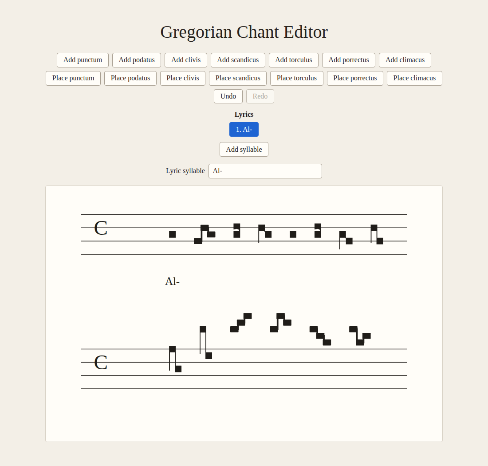
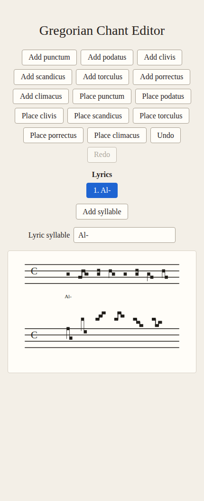

# Initial engraving browser verification

Verified locally on 2026-10-17 with Vite and headless Chromium. The temporary
driver used Chromium's DevTools Protocol and existing tooling; no browser test
dependency, application test route, or semantic fixture override was added.
The score in these screenshots was built through existing editor commands.

| Capture                        | Viewport width |                    SVG scale | Purpose                                                                    |
| ------------------------------ | -------------: | ---------------------------: | -------------------------------------------------------------------------- |
| [Desktop](desktop.png)         |        1100 px |                  about 1.244 | Normal editor with engraved and placeholder neumes across two systems      |
| [Near native](near-native.png) |         760 px | about 1.011 including border | Approximately one display pixel per layout unit                            |
| [Responsive](responsive.png)   |         430 px |                  about 0.553 | Fractional scaling, Pes opening/contact readability, and two-system height |

The score shows sharp Puncta, adjacent Pes and Clivis, wider Clivis forms, and
the unchanged four placeholder types. Some notes are above the staff because
the existing toolbar uses the selected reference pitch. Ledger lines and
vertical collision handling remain outside this milestone. The images are
actual editor output, not the earlier design specimens.

## Checks performed

- Real pointer clicks selected both stacked Pes heads independently, at desktop
  and responsive size. Tab moved between their separate accessible controls.
- Enter selected a note; arrow movement changed the interval; undo/redo restored
  the exact committed ink. The moved note retained focus and identity.
- Both adjacent Clivis heads were individually clickable. Whole-neume selection
  produced an outline around all ink, whole movement restored focus, and note
  deletion normalized to Punctum while retaining the surviving IDs. Undo restored
  the original Clivis.
- Punctum, Podatus, and Clivis placement tools removed ordinary controls from
  the tab order and marked them disabled. Real pointer placement produced
  committed ink identical to the preview and focused the first inserted note.
  Escape restored Select mode and ordinary note controls.
- Mixed engraved/placeholder notation wrapped into two systems with unique,
  stable IDs. An exact-fit Clivis interval change reparented the note controls
  onto a second system; focus and identity survived the edit and undo/redo.
- A placement ghost on a hypothetical new final system remained inside the
  expanded viewBox and matched its committed second-system ink. Pure tests also
  compare prospective height with the post-insertion layout over interval and
  insertion-boundary matrices.
- Production adjacent contours were rasterized by Chromium without staff or
  overlays at scales 1, 0.75, 0.55, and 0.5 with fractional translation. Each
  retained one connected foreground component (alpha threshold 32/255, eight
  neighbors). This is a targeted connectivity check, not a general image-quality
  metric. The screenshots were also visually inspected for seams and clipping.
- No uncaught browser exceptions were observed. Structured results are in
  [browser-results.json](browser-results.json).

This is local Chromium verification, not cross-browser or hosted CI coverage.
The temporary browser driver is not part of the maintained Vitest suite.
ADR 0007 was Proposed at the time of this verification; it is now Accepted.

# Subsequent contour reviews

See the [integrated calligraphic compound verification](compound-contours.md)
for the refined Podatus and Clivis screenshots and checks, and the
[Variant C Punctum verification](punctum-c.md) for standalone Punctum.
