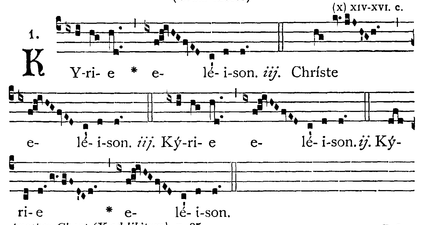
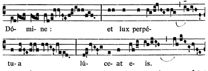
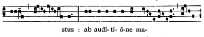
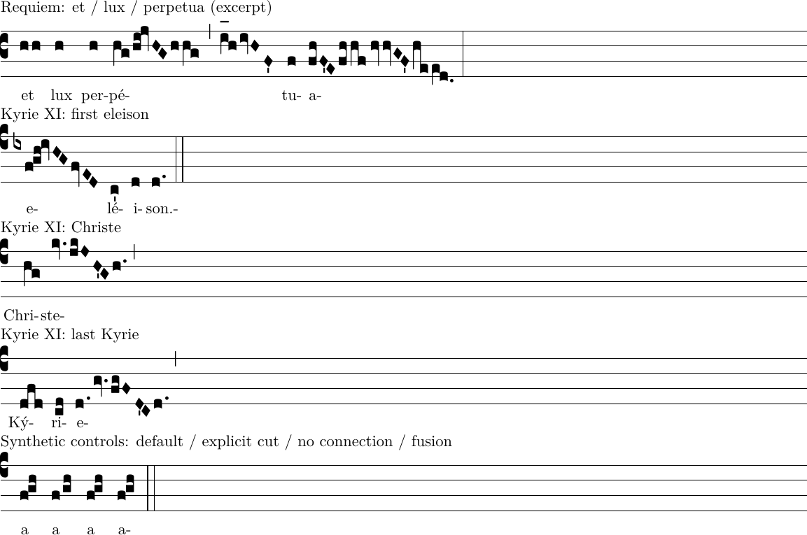

# Stage 9C: intra-syllable spacing decision record

2026-11-14. **Research complete; owner Gates A–D accepted after review at
`d1665bb`.** This record retains the research findings; current checkpoint
implementation and verification are recorded in [9C-1](checkpoint-9c-1.md). Read with the [handoff plan](../../plans/stage-9c-intra-syllable-grouping.md)
and [Accepted ADR 0026](../../adrs/0026-derived-intra-syllable-spacing.md).

## Architecture findings

Inspected baseline `eb3dd67` and the design branch's committed plan. Relevant
contracts are ADRs 0002–0004, 0007–0013, 0015–0016 and 0018–0025; the
[domain](../../domain-model.md), [commands](../../commands-and-history.md),
[interaction](../../editor-interactions.md), [layout](../../layout-and-rendering.md)
and [persistence](../../persistence.md) guides remain authoritative.

| Concern     | Actual seam and finding                                                                                                                                                                                                                                                                                                        |
| ----------- | ------------------------------------------------------------------------------------------------------------------------------------------------------------------------------------------------------------------------------------------------------------------------------------------------------------------------------ |
| Membership  | [lyrics.ts](../../../src/editor/domain/lyrics.ts): `findSyllableForNeume` selects the nearest preceding anchor in ordered music. Multiple independent neumes already belong to one syllable. Before the first anchor is lyricless; the last span reaches document end.                                                         |
| Spacing     | [layout-chant.ts](../../../src/editor/layout/layout-chant.ts): `placeNeumeSequence` uses 33-unit ordinary ink gaps. Its `compact` condition requires consecutive **syllable anchors**, continuation metadata and no division; its 2-unit minimum is not intra-syllable spacing. Clef/event geometry also constrains placement. |
| Geometry    | [neume-geometry.ts](../../../src/editor/layout/neume-geometry.ts): complete bounds include signs, prefix accidentals and left-tick normalization (ADR 0025). Internal geometry and `lyricAnchorX` have separate responsibilities.                                                                                              |
| Interaction | `layoutChant` clips external hit padding at tight-gap midpoints, currently inside the complete-text/hyphen-measurement path. Reuse this ownership rule; do not assume merely reducing advances also makes pointers safe. Slots and ghosts use committed layout.                                                                |
| Authoring   | [lyric-entry.ts](../../../src/editor/state/lyric-entry.ts), [editor-session.ts](../../../src/editor/state/editor-session.ts): Skip/underscore, ordered anchor creation and explicit anchor reassignment already exist. Draft recovery and history guards are independent of grouping.                                          |
| Persistence | [native-document.ts](../../../src/editor/persistence/native-document.ts): current version is **9**, with strict historical readers. No grouping field or stored span is needed for membership.                                                                                                                                 |

Historical wording needs care: ADR 0025's rejected alternative says “there is
no intra-syllable grouping model.” That cannot mean missing syllable membership:
ADR 0008 and actual code establish it. Read it as missing contextual engraving
and loss of a single named figure when decomposed. Likewise, the persistence
guide's opening v8 summary is stale relative to its later v9 material and code.
Neither discrepancy authorizes a domain change; accepted records are unedited here.
The old et/lux and auditione reports describe ADR 0011 as Proposed at the time;
it is now Accepted.

## Printed evidence and matched references

Images below are **actual print crops**, not generated reconstructions. Retrieved
2026-11-14 from the source images linked by GregoBase:

- [Kyrie XI, id 2982](https://gregobase.selapa.net/chant.php?id=2982),
  _Liber Usualis_, Solesmes 1961, printed p. 46,
  [source image](https://gregobase.selapa.net/sources/3/157.png).
- [Requiem gradual, id 1261](https://gregobase.selapa.net/chant.php?id=1261),
  _Graduale Romanum_, Solesmes 1961, printed p. 95*,
  [source image](https://gregobase.selapa.net/sources/2/972.png).







Pitch letters below are **staff locations**, not absolute pitches. Uppercase
GABC letters indicate diamond heads. Decompositions name existing ChantPad
kinds; a syllable's entire sequence is not a new neume kind. Transcription is
cross-checked against print, with exact letter readings aided by Andrew
Hinkley's GregoBase GABC and subsequent database revisions.

| Printed location / syllable                                    | Pitch sequence and decomposition                                                                                                                                                                                  | Supported versus approximate                                                                                                                                                                                                                   |
| -------------------------------------------------------------- | ----------------------------------------------------------------------------------------------------------------------------------------------------------------------------------------------------------------- | ---------------------------------------------------------------------------------------------------------------------------------------------------------------------------------------------------------------------------------------------- |
| Requiem, second system, **et**                                 | `hh`: Punctum(h) + Punctum(h), one anchor; next **lux(h)** starts another word.                                                                                                                                   | Exact ordinary shapes/membership; do not turn the pair into Bistropha.                                                                                                                                                                         |
| Same system, **pé** of perpetua                                | `hg / hi ! jvHG hhg`, division, `i_[oh:h]hivHF'`. Pitches `h g h i j h g h h g; i h i h f`; supported split: Clivis(hg), Podatus(hi), Climacus(jHG), Punctum(h), Clivis(hg), division, Clivis(ih), Climacus(iHF). | Pitch/membership reconstruction matches the existing et/lux fixture. Exact episema placement and compound partition after the division are approximate. The division does not start **tu**; **tu(f)** starts the next system.                  |
| Kyrie XI, first system, **e** of eleison (also repeated later) | `ix fgh ! ivHG fvED`: pitches `f g h i h g f e d`; Scandicus(fgh) + Climacus(iHG) + Climacus(fED), with a flat written before the first group for the later B.                                                    | Nine-note melisma uses current kinds and ADR 0021 earlier-note placement; no unsupported shape needed. Exact historical proportions are not asserted. The `!` separates the rising figure from the following virga without a fused connection. |
| Same system, **ste** of Christe                                | `kv. / jkJH'G h.` (slash here shows our analysis; source has `kv.jkJH'Gh.`): pitches `k j k j h g h`; dotted Virga Punctum(k) + Pes subtripunctis(jkJHG) + dotted Punctum(h).                                     | All three kinds/forms/signs supported. Wide J→H tail spacing and H ictus are internal to the existing five-note kind, not a new boundary field.                                                                                                |
| Kyrie XI, third system, final Kyrie **e**                      | `d. gv. fgFD'C d.`: pitches `d g f g f d c d`; dotted Punctum(d) + dotted Virga Punctum(g) + Pes subtripunctis(fgFDC) + dotted Punctum(d).                                                                        | Eight notes, four independent neumes, all supported. D ictus and the wide F→D tail belong to the Pes. No need to fuse the dotted neighbors.                                                                                                    |
| Requiem, sixth system, **au-di-ti-ó-ne**                       | `h / h / h / h / hi` across five distinct syllables, final Podatus(hi).                                                                                                                                           | Exact supported control for existing same-word spacing, not a melisma. **ab(hh)** before it and **ma** after it are different words.                                                                                                           |

The Requiem **a** of perpetua, retained in the matched excerpt, contains repeated
virgae `hvv` and source-specific partition/spacing. The old
[et/lux fixture](../word-composition/et-lux.ts) preserves its pitches with
ordinary supported decompositions, but does not reproduce those forms or marks.
Do not promote this full phrase to an exact facsimile fixture. Its **et** pair
is exact. The earlier [et/lux analysis](../word-composition/et-lux-review.md)
and [auditione analysis](../word-composition/auditione-review.md) remain useful;
this research does not rerun their historical browser results.

### Measurements and interpretation

At original scan resolution, dark head interiors on Requiem row y=168 occupy
x=243…248 and 251…256 (threshold gray <128). Treating pixels as cells gives
6-pixel heads, an 8-pixel center distance and a 2-pixel clear gap: about
**1.33 head widths center-to-center / 0.33 widths clear**. Neighboring rows
change this by roughly a pixel. The same row's lux head is x=272…276:
roughly 15 pixels clear after et, about **2.5 head widths**, a word control.
These are raster estimates, not engraving constants.

The prior actual reference SVG gave et **1.46 widths center-to-center**
(about 0.46 clear), versus editor **3.75** (2.75 clear, 33/12).
Its measured e center aligned with the first head within 0.018 pt, rather than
the pair midpoint. This agrees with the current print and the
[Gregorio alignment rules](https://gregorio-project.github.io/graphy.html).
Retain first-kind anchors and vowel/manual alignment; do not center a melisma.

The Kyrie crop confirms visibly separate dotted puncta/virgae around the Pes,
and detached diamond tails with interval-sensitive spacing. At this 480-pixel
page resolution, fine inter-group gaps and dot envelopes cannot support a
reliable numerical ranking across all pairs. The existing
[Pes print investigation](../pes-subpunctis/README.md) supplies the same two
Kyrie tail examples at larger scale. No numerical all-kind rule is inferred
from et alone.

### Encoding controls and reference reproduction



The first four rows match the selected source music, not the source's line
justification or font proportions. The last row is **synthetic**, not printed
evidence: `fgh`, `f/gh`, `f!gh`, `f@gh`. Gregorio 6.0.0 emits respectively a
Scandicus glyph; Punctum + Pes separated by `GreEndOfElement`; Punctum + Pes
with `GreEndOfGlyph{1}`; and a changed first glyph plus `GreFuse` before Pes.
Parser partition, authored separation, zero-space nonconnection and fusion
are different operations even when small renderings look similar.

The official [GABC details](https://gregorio-project.github.io/gabc/details.html)
distinguish `/`, `//`, `!` and `@`; source parentheses identify sung syllables,
not ChantPad's neume tuples. The [structure essay](https://gregorio-project.github.io/structure.html)
even uses “neume” for a whole syllable and describes varying neumatic cuts.
Its vocabulary is not a requirement to replace our domain. Some editorial
spacing distinctions would need author intent for facsimile fidelity; that
requirement is deferred, not solved by pretending all cuts are equivalent.
None of the selected independent-neume boundaries requires cross-neume fusion
for the initial legibility milestone. Existing internal joins stay intact.

Reproduce in a temporary directory, copying the committed `.gabc` files and
[render.tex](render.tex), using Gregorio 6.0.0, GregorioTeX/Greciliae 6.0.0,
LuaHBTeX 1.17.0 (TeX Live 2023) and Poppler:

```sh
for f in requiem-excerpt kyrie-eleison kyrie-christe kyrie-last controls; do
  gregorio "$f.gabc"
done
lualatex -interaction=nonstopmode -halt-on-error render.tex
lualatex -interaction=nonstopmode -halt-on-error render.tex
pdftoppm -scale-to 1600 -png -singlefile render.pdf matched-reference
convert matched-reference.png -trim +repage matched-reference.png
```

Both TeX passes and rasterization completed here. The system installation
lacked GregorioTeX; the run used the previously extracted TeX tree through
`TEXMFHOME=/tmp/chant-custos-tex/usr/share/texlive/texmf-dist`, with
`TEXMFVAR=/tmp/stage9c/tex-cache`. No dependency was installed or changed.

Print crops are unscaled ImageMagick `-crop … +repage`: Kyrie
`430x225+45+120` from 480×774; Requiem perpetua `405x138+33+148` and auditione
`405x75+33+416` from 480×753. Original SHA-256:

```text
Kyrie  8fe5954efba656624af77989df2b1cb352690864d0dc33a3c8bce8724f60282a
Requiem bf4694fcfc920c3df366e085817ff220e02117d2bfc651697f98cfc24b2ed67e
```

Limits: only two printed pages and selected melismas, no complete Kyrie
transcription, no manuscript comparison, no claim of universal Roman practice
or semantic equivalence between every decomposed shape and original figure.
Gregorio's generated hyphen after a single-letter excerpt lyric and truncated
phrase endings are reference-tool typography, not proposed editor behavior.

## Gate A — retain membership and native v9

Recommend approach 1: derive spacing from equal, **non-null** syllable IDs.
Add no semantic field, collection, group ID, tuple relaxation or schema version.
Keep strict v1–v8 decoding/recovery, v9 encoding and the existing cache key;
no startup source rewrite. Two lyricless neumes must not qualify because both
lookups returned null.

Approach 2 (explicit boundary intent) could later distinguish a deliberate
large cut such as Requiem `//` from a normal cut. This corpus establishes that
such distinctions exist, not that Stage 9C needs an authoring UI. Do not add a
field now. A future proposal must specify endpoints, insertion/deletion and
stale-reference rules, actual authoring need, and strict migration before it
can justify v10. Approach 3 (explicit ownership collections) provides no new
capability for these examples and duplicates ADR 0008's existing spans while
complicating music-first entry. Reject it for this milestone.

## Gate B — close, independent, conservatively eligible

Recommend a **6-unit clear complete-ink minimum** initially (0.5 of the current
12-unit head); inspect **5–8 units** for the plain et pair. The 0.33–0.46-width
et evidence supports this order of magnitude; 6 is an engineering starting
value, not a recovered historical universal. For general kinds review a
6–12-unit exploration range only if signs/interaction require it. Prefer one
safe minimum plus complete ink clearance initially; avoid an invented
pitch-dependent or kind-pair table from this small sample.

| Boundary                                                     | Proposed initial behavior                                                                                                                                                                                                                                                                                              |
| ------------------------------------------------------------ | ---------------------------------------------------------------------------------------------------------------------------------------------------------------------------------------------------------------------------------------------------------------------------------------------------------------------- |
| Adjacent independent neumes, same non-null span, same system | Close but separate complete ink; no new connector, inferred repeated-note kind or internal geometry change. Require complete valid text/hyphen measurements as today.                                                                                                                                                  |
| Distinct syllables, same word                                | Existing ADR 0011 eligibility/2-unit rule and measured text/hyphens unchanged. A melisma's last neume followed by the next syllable remains ineligible for that consecutive-anchor exception.                                                                                                                          |
| New word / lyricless music                                   | Ordinary 33-unit rule plus existing measured word clearance.                                                                                                                                                                                                                                                           |
| Intervening division or explicit clef                        | Block the new compaction; retain measured event spacing, insertion slots and ADR 0013 musical/linguistic independence. Do not infer a new syllable.                                                                                                                                                                    |
| Written accidental prefix or separate earlier-note placement | Conservatively block new compaction at boundaries touching a neume carrying written accidental ink; effective carried alteration alone is not a barrier. Use written location, not only B owner. Preserve ADR 0021 scope/resets and complete sign/text bounds. More permissive spacing needs a later measured example. |
| System break                                                 | Each neume remains indivisible; restart normal leading-clef spacing. Long spans may cross systems with no duplicate lyric or internal hyphen. No whole-syllable keep-together rule.                                                                                                                                    |

Preserve exact-fit/oversized progress, custodes, left ink origin, sign bounds,
measured text and font fallback. Missing measurements retain today's ordinary
music-only placement; when ready, use one layout snapshot for rendering,
midpoint hit clips, selection outlines, slots, focus and previews. Preserve
constituent-note ownership and hover's local ghost rather than speculative reflow.

When a later **distinct** syllable continues the word after a melisma, retain
ADR 0011's current mark on the source lyric's system and its reservation;
intermediate melisma systems do not gain marks. Changing this potentially
unusual placement is a separate linguistic-continuation decision. No incoming
mark, fabricated syllable or automatic hyphen at the internal Requiem division.

This would narrowly qualify ADR 0010's 33-unit minimum and ADR 0011's exclusion
of melismas from compaction, without extending its same-word text-joining rule.
Extend ADR 0013's division barrier to the new case. ADRs 0007/0008/0015/0021
and existing internal fusion recipes remain unchanged. A future cross-neume
join needs a separately reviewed pair/interval eligibility rule, connector ink
owner and disjoint note targets preserving both neume IDs; none is proposed now.

## Gate C — use existing editing operations

Concrete independent examples start from neumes `[n0,n1,n2,n3,n4,n5,n6]`,
`A@ n1` (word), `B@ n4` (continuation), `C@ n6` (word):
A owns n1–n3, B n4–n5, C n6; n0 is lyricless. Notes can be named
`q0…q6` for one-note examples. These are contract walkthroughs, not executed tests.
The first two rows construct the anchors on existing lyricless music; all other
rows independently start from the stated anchored baseline.

| Action from that baseline                | Exact resulting ownership                                                                                                                                                                                                        |
| ---------------------------------------- | -------------------------------------------------------------------------------------------------------------------------------------------------------------------------------------------------------------------------------- |
| Music first                              | Insert all seven neumes without lyrics, then create A/B/C at n1/n4/n6. All neume/note IDs survive.                                                                                                                               |
| Continuous entry                         | Start free target n1, enter A then `_`: commit A, skip n2, target n3; `_` on empty n3 targets n4 retaining continuation. Enter B there. Occupied targets pause for Edit/Skip; reaching end waits for music without placeholders. |
| Insert x before n1                       | `[n0,x,n1,…]`: x is lyricless, anchors unchanged.                                                                                                                                                                                |
| Insert x between n2/n3                   | A owns n1,n2,x,n3; B/C unchanged.                                                                                                                                                                                                |
| Insert x immediately after n3, before n4 | x still belongs to A. “After the span” is not a separately authored endpoint.                                                                                                                                                    |
| Insert x after n4 / append after n6      | Former belongs to B; latter belongs to C. No explicit lyricless tail exists.                                                                                                                                                     |
| Create X@n3, continuation                | A n1–n2; X n3; B n4–n5; C n6. No musical split command needed.                                                                                                                                                                   |
| Reassign B to n5                         | A n1–n4; B n5; C n6. B keeps its ID/text. n1/n6 occupied destinations and crossing neighbors reject.                                                                                                                             |
| Delete non-anchor n2                     | A n1,n3; B/C unchanged; q2 removed.                                                                                                                                                                                              |
| Delete anchored n1                       | A and q1 removed atomically; n0,n2,n3 now lyricless; B becomes first/word, still n4–n5.                                                                                                                                          |
| Delete anchored n4                       | B and q4 removed; A expands to n1,n2,n3,n5; C stays n6/word. No automatic B reassignment.                                                                                                                                        |
| Delete lyric B only                      | Music untouched; A expands through n5; C remains n6/word. Deleting word-start A instead promotes B to word start.                                                                                                                |
| Preserve A before removing n1            | Explicitly reassign A to n2, then delete n1: A n2–n3. These are two deliberate history actions; Undo restores n1 first, then A@n1; Redo repeats each.                                                                            |

Accepted create/delete/reassign edits already record one semantic history entry;
no-op/rejected operations add none. Undo restores exact IDs, words and anchors;
layout re-derives spacing. Normalizing a multi-note neume retains its ID/anchor
and surviving note marks; deleting its final note follows anchored deletion.
Divisions/clefs retain mixed-event order through existing reanchoring; accidental
reconciliation still applies to changed word/reset/placement contexts.

Recommend **no new command or UI** initially. Existing reassignment offers the
non-destructive path before anchor deletion. Potential discoverability of long
span ownership is a usability question for owner acceptance, not evidence for
a group selection hierarchy, reorder, group-wide pitch move or grouping tool.
Preserve one-click entry, I/T/L, independent note/neume selection, focus and all
draft/IME/history safeguards.

## Gate D — small implementation handoffs after approval

Recommend **one implementation PR with two reviewable commits**, rather than
manufacturing domain and UI stages:

1. Pure contextual spacing classification/placement and focused independent
   oracles; thread derived membership into the existing walker, preserve the
   14 kinds and codec unchanged. No dependency on a new semantic API.
2. Integrated ownership/reference acceptance and guide/ADR updates only after
   the chosen behavior is approved. Adjust hit clipping if needed; do not add
   UI unless a concrete failure demonstrates the need. Commit evidence at
   this integrated checkpoint. Stop if ordinary safe spacing cannot preserve
   constituent ownership, rather than quietly introducing fusion.

Future verification (not run for this documentation): use an independent
ordered-anchor interval oracle, including both-null negatives, and an explicit
boundary eligibility table rather than calling the production classifier.
Extend `et-lux.test.ts`'s current 33-unit expectation only on eligible pairs;
retain first-note alignment, no internal mark and split-span checks. Add exact
supported Christe/last-Kyrie fragments and the nine-note eleison with written
flat; label full perpetua as approximate. Measure complete ink/text/sign gaps,
modifier overhangs, exact-fit/oversize, many-system spans, event barriers,
next-syllable/outgoing reservations, word/lyricless controls and missing fonts.
Retain internal geometry and historical fixtures for all 14 kinds.

At integrated acceptance, extend existing word-composition corpus/pointer checks
and affected runner drivers: `word-composition`, `lyric-spacing`,
`vowel-alignment`, `continuous-lyrics`, `lyric-move`, `divisions`,
`mid-score-clefs`, `b-accidentals`, plus relevant note/sign and persistence
regressions (IDs checked against the current runner manifest). A new driver is not
needed unless the current corpus cannot exercise a required interaction.
Both browsers at 1440px/320px should check painted-point ownership, selection
clipping, insertion caret/ghost and focus after reflow; verify existing
insert/delete/reassign/history and native round trips with unchanged v9/legacy
recovery. Run the standard gate and one integrated affected-browser matrix;
leave comprehensive regression to owner-run acceptance, without repeated full
runs or a benchmark.

## Closeout checks

Reference generation and visual inspection are evidence work, not application
verification. Passed: `npm run format:check`, `git diff --check`, and a read-only local
Markdown file-link existence check (60 links across four changed documents).
External source pages/images were retrieved during research; no general web
link crawler was run. No application,
test, runner, CI, dependency or schema change; no browser matrix or benchmark.
The owner subsequently accepted Gates A–D and ADR 0026 and authorized 9C-1
only. The recommendations and research-only checks above describe the original
deliverable; they do not claim integrated visual acceptance.
