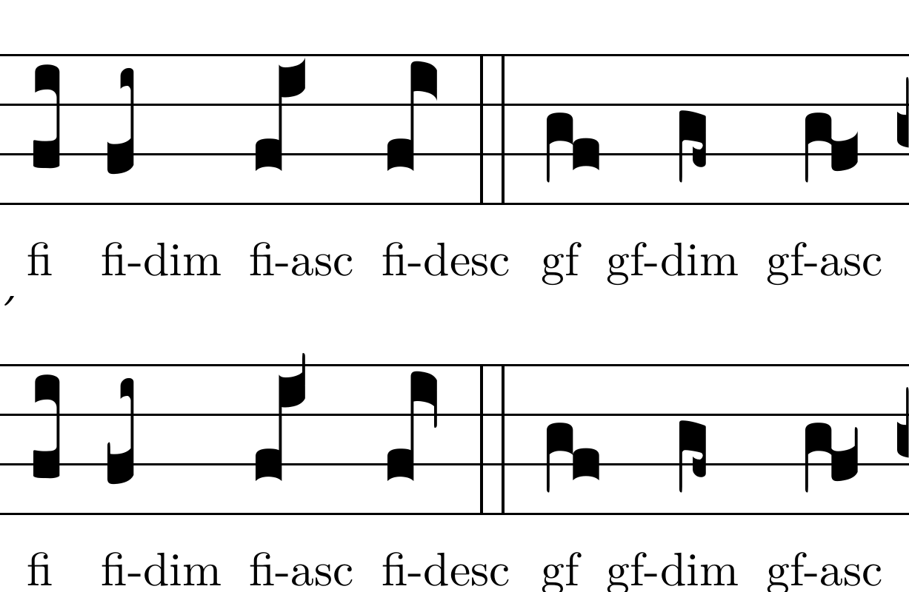
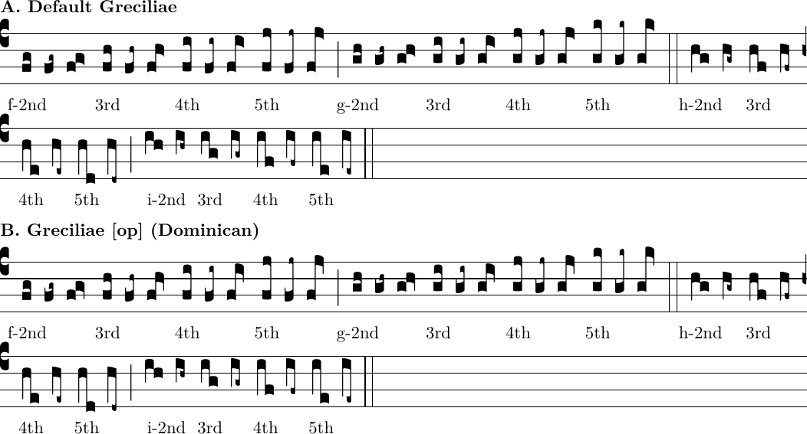
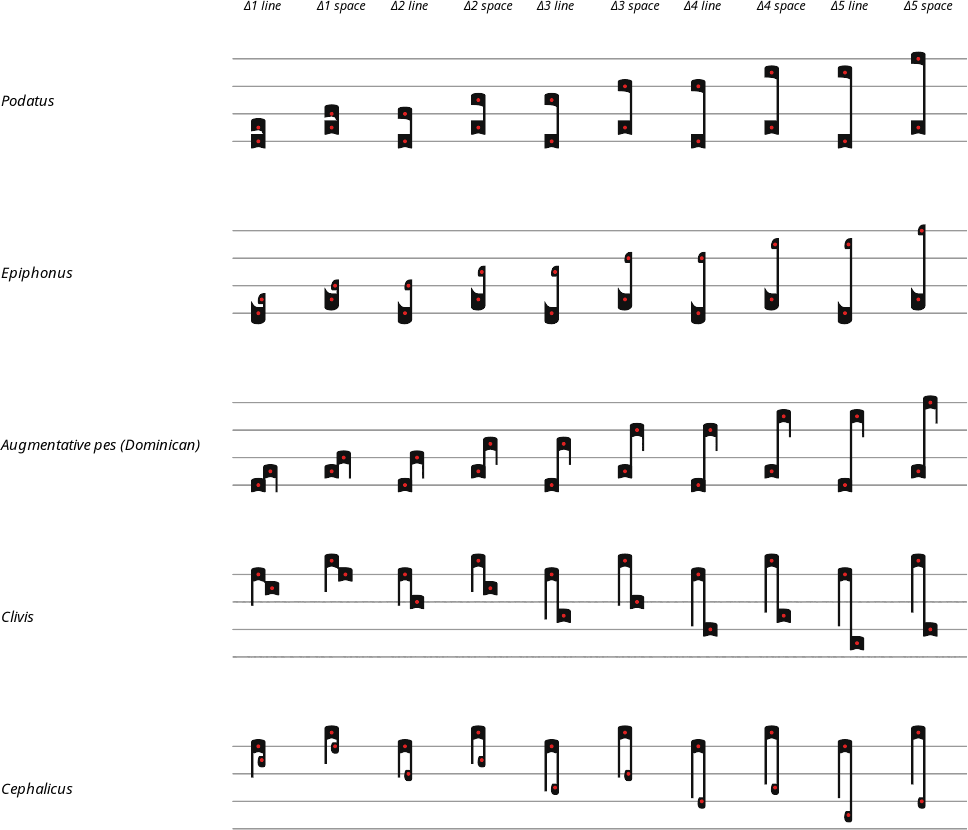
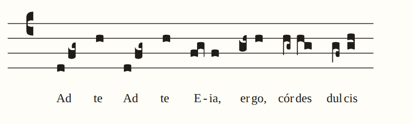

# Stage 10A — Liquescent notation research record

2026-11-15. Branch `research/liquescent-notation`, target `master` (base
`aea861d`, research plan `260dfe5`). This is a research-and-design gate under
[the Stage 10A plan](../../plans/stage-10a-liquescent-notation.md). It changes
no production code or schema. The research gate was completed at `88e15fe`;
the owner subsequently approved [the Stage 10B plan](../../plans/stage-10b-liquescent-podatus-clivis.md)
and [Accepted ADR 0027](../../adrs/0027-neume-level-liquescence.md) on
2026-11-15. Implementation remains pending.

Evidence labels used throughout:

- **[print]** observed in a printed chant book (scan inspected directly);
- **[rubric]** a printed book's own prose about its notation;
- **[renderer]** Gregorio/GregorioTeX behaviour or font design (a modern
  convention, not historical evidence);
- **[secondary]** a third party's published reading of the sources;
- **[inference]** this record's own reasoning.

## 1. Sources

| ID  | Source                                                                                                                                            | Locator                                                                                                                                        | Use                                                                                                                                          |
| --- | ------------------------------------------------------------------------------------------------------------------------------------------------- | ---------------------------------------------------------------------------------------------------------------------------------------------- | -------------------------------------------------------------------------------------------------------------------------------------------- |
| P1  | _Completorium O.P._ (Suarez), Rome 1949, scan on GregoBase                                                                                        | pp. 119–120; [p. 119](https://gregobase.selapa.net/sources/13/132.png), [p. 120](https://gregobase.selapa.net/sources/13/133.png) (480×675 px) | Primary engraving witness                                                                                                                    |
| P1a | Same two pages, ≈1.6× resolution, annotated with red circles                                                                                      | [Gregorio issue #1, opening comment image](https://github.com/gregorio-project/gregorio/issues/1) (1514×1108 px)                               | Higher-resolution copy of P1 used for crops                                                                                                  |
| G1  | GregoBase #4577 GABC                                                                                                                              | [entry](https://gregobase.selapa.net/chant.php?id=4577), [GABC](https://gregobase.selapa.net/download.php?format=gabc&id=4577)                 | Transcription, cited as `book: Completorium O.P. (Suarez), 1949, p. 119`                                                                     |
| L1  | _Liber Usualis_ (Desclée), Archive.org scan already used by Stage 8B                                                                              | [PDF](https://archive.org/download/TheLiberUsualis1961/liberusualis.pdf), printed p. xxij (PDF 22) table E.1; printed p. xxiv (PDF 24) § IV.10 | Roman/Solesmes print and rubric baseline                                                                                                     |
| R1  | Gregorio GABC documentation                                                                                                                       | [details.html#liquescences](https://gregorio-project.github.io/gabc/details.html)                                                              | Meaning of `~`, `<`, `>`                                                                                                                     |
| R2  | Gregorio 6.0.0 release: `GregorioRef.pdf` appendix A.1 (pp. 276, 280) and A.2 “Dominican Score Font Glyphs” (pp. 292, 296); `CHANGELOG.md` 4.0.0  | [release v6.0.0](https://github.com/gregorio-project/gregorio/releases/tag/v6.0.0)                                                             | Glyph names and Roman vs `op` font shapes                                                                                                    |
| R3  | Gregorio issue #1 “Missing some Dominican neumes” (2014–2015) and implementation [PR #542](https://github.com/gregorio-project/gregorio/pull/542) | [issue thread](https://github.com/gregorio-project/gregorio/issues/1)                                                                          | [secondary] contributor analysis of exactly P1, citing Dominican rubrics; [renderer] 2015 `op` render of #4577                               |
| D1  | Cormier, _Processionarium O.P._ (1913), Regulae Cantus p. 340; Harrison, _How to Sing Plain Chant_ p. 31                                          | As quoted in R3 (2014-08 comment); originals linked there on media.musicasacra.com                                                             | [rubric, via secondary] Dominican single-note liquescents. **Not inspected directly**: that host currently fails TLS certificate validation. |

Unavailable: no higher-resolution scan of the 1949 _Completorium_ was found
(the musicasacra.com Dominican page could not be fetched; no Archive.org copy
located). Each P1 notehead is ≈6 px tall at 480 px and ≈10 px in P1a, so
**fine stroke curvature is not resolvable**; topology, direction, relative
width and terminal-stroke presence are.

Rights: P1/P1a crops are **not committed** (the 1949 scan's redistribution
status is unknown). [`regenerate.sh`](regenerate.sh) downloads them and makes
every crop below at fixed coordinates. Committed images are Gregorio renders,
Gregorio's own reference-manual table cells, and a small L1 excerpt (the
repository already retains L1 excerpts for Stages 8B/9B).

## 2. Repertoire inventory (R1 of the plan)

GABC pitch letters map to this editor's staff positions as `d=0 … j=6`
(C4 clef, `j` = do). All six GABC liquescences are **two-note neumes standing
alone** as a GABC element (own syllable or separated by `/`), at a **second**.

| #   | Text (syllable)      | Local GABC           | Pitches → positions   | GABC type                    | P1 location                             | Printed shape [print]                                                                                                                                                                                                                           | Status                                                                               |
| --- | -------------------- | -------------------- | --------------------- | ---------------------------- | --------------------------------------- | ----------------------------------------------------------------------------------------------------------------------------------------------------------------------------------------------------------------------------------------------- | ------------------------------------------------------------------------------------ |
| L1  | **Ad** te clamámus   | `Ad(d/fg~)`          | d, then f→g: 0, [2,3] | `~` diminutive pes           | p. 119 sys 2, last figure               | Punctum on d; then one stacked column: full lower head on f with a narrow vertical terminal stroke rising from its right half to g, small hook at its base. No second full head.                                                                | **Confirmed epiphonus**                                                              |
| L2  | **Ad** te suspirámus | `Ad(d/fg~)`          | 0, [2,3]              | `~`                          | p. 119 sys 3, after the double bar      | Same as L1.                                                                                                                                                                                                                                     | **Confirmed epiphonus**                                                              |
| L3  | **E**-ia             | `E-(fg>)ia,(f)`      | f→g: [2,3]            | `>` augmentative, descending | p. 119 sys 4, last figure               | Two full heads **not stacked**: f, then g offset to the right and overlapping; the upper head extends below its body on the right (a descending tail), visibly unlike the stacked ordinary pes elsewhere on the page (e.g. _la-_crimárum `gh`). | **Confirmed augmentative pes, descending terminal** (not inferred from the interval) |
| L4  | **er**-go            | `er(gh~)go`          | g→h: [3,4]            | `~`                          | p. 119 sys 5, first figure              | Same construction as L1 on g→h.                                                                                                                                                                                                                 | **Confirmed epiphonus**                                                              |
| L5  | miseri**cór**-des    | `cór(fv/ixghih/hg~)` | final h→g: [4,3]      | `~` diminutive clivis        | p. 119 sys 5, last figure before custos | Upper full head on h with a long left stem; reduced, narrow lower terminal on g on the right. Narrower than the neighbouring two-head figures.                                                                                                  | **Confirmed cephalicus** (last element of the syllable’s group)                      |
| L6  | **dul**-cis          | `dul(gf~)cis`        | g→f: [3,2]            | `~`                          | p. 120 sys 3, after _O_                 | As L5 on g→f; visibly narrower and lighter than the stacked pes `gh` on _-cis_ beside it.                                                                                                                                                       | **Confirmed cephalicus**                                                             |

Hypotheses from the plan: all five leads (`Ad` ×2, `Eia fg>`, `ergo gh~`,
`misericordes hg~`, `dulcis gf~`) are confirmed with exact syllables. Note
that the cephalicus in _misericórdes_ is on **cór**, not _-des_ (`des(hg)`
is an ordinary clivis), and _dulcis_’s is on **dul**.

### Other markings checked

| Text                           | GABC           | Print                                                                      | Classification                                                                                                                                                                                                                                                                                                                                                                                                                                                                                                              |
| ------------------------------ | -------------- | -------------------------------------------------------------------------- | --------------------------------------------------------------------------------------------------------------------------------------------------------------------------------------------------------------------------------------------------------------------------------------------------------------------------------------------------------------------------------------------------------------------------------------------------------------------------------------------------------------------------- |
| os-**tén**-de                  | `tén(c)`       | A single head on c with thin upward strokes on **both** sides (“U” shape). | **Single-note liquescent in Dominican usage** [rubric, via secondary D1]: Cormier’s Regulae Cantus names exactly _osténde_ and _Virgo_ in this antiphon: “Si tamen epiphonus et cephalicus punctulo caruerint … uti nota una simplex figura talis habetur” — an epiphonus/cephalicus lacking its small final point is sung as **one** note. GABC transcribes it as a plain punctum; the GregoBase contributor’s remark (“punctum with the upward tails on ‘ten’ … cannot be reproduced using GABC”) agrees it is unencoded. |
| **Vir**-go                     | `Vir(d)`       | Single head on d with thin **downward** strokes on both sides (“∩”).       | Same as above (descending). **Unencoded in GABC.**                                                                                                                                                                                                                                                                                                                                                                                                                                                                          |
| _tra_ (nostra), _cla-má-_ etc. | `gf{gh}`       | Compound grouping                                                          | Not liquescence. Out of scope (fixture approximation).                                                                                                                                                                                                                                                                                                                                                                                                                                                                      |
| _sal-_, _di-_                  | `defEDC`       | Pes subpunctis variants                                                    | Not liquescence. Out of scope.                                                                                                                                                                                                                                                                                                                                                                                                                                                                                              |
| `;1`, `;3`, `;6`               | Dominican bars | Modified divisions                                                         | Not liquescence. Out of scope.                                                                                                                                                                                                                                                                                                                                                                                                                                                                                              |

**GABC discrepancies** (independent of this milestone): (1) _tén_ and _Vir_
lose their single-note liquescent figures; (2) GABC `>` names a terminal
direction, but nothing in GABC records that the Dominican print draws that
terminal as a thin plica-like stroke rather than a Solesmes auctus head —
that is a font choice (R2 `op`). No other liquescent figure was found in the
print that GABC omits.

## 3. Shapes: print, rubric and renderer comparison (R2 of the plan)

### Roman/Solesmes baseline [print, rubric: L1]

- Table E.1 labels the two-note forms **“Epiphonus or liquescent Podatus”**
  and **“Cephalicus or liquescent clivis”** — the book treats liquescence as a
  qualification of the ordinary two-note neume, alongside liquescent torculus,
  porrectus, scandicus and climacus (“ancus”).
- Epiphonus: one stacked column. The lower note is a full-width body with a
  curved/hollowed upper-left and rounded underside; a right-side stroke rises
  to a **small hooked terminal**, not a second square head. The modern
  transcription beside it writes the second note as a small note.
- Cephalicus: a full upper head with a left descending stem; the second note
  is a **reduced terminal hook** on the right, not a second head.
- The table shows **no augmentative (auctus) two-note forms**.
- § IV.10 (p. xxiv): “Liquescent notes: these are printed in smaller type but
  this does not affect their duration nor their execution, except in that they
  must be sung lightly. They occur when two vowels form a diphthong (autem,
  euge), or at the junction of certain consonants (Hosanna, tollis, mundi,
  etc.) or to introduce the semi-consonants j or i (ejus, alleluia).”

So the source itself both (a) describes the liquescent note as “smaller” and
(b) prints it as a **different connected construction** (curved body, hooked
terminal, stem side), not a scaled-down square. Rendering liquescence as a
small ordinary notehead would contradict the printed shapes.

### Dominican witness [print: P1] versus the baseline [inference]

- **Epiphonus (L1, L2, L4)**: same topology as L1-Liber: single column, full
  lower body, right rising stroke, reduced terminal. A Gregorio contributor
  reviewing exactly this page concluded it “is actually an epiphonus …
  as represented in Solesmes editions” [secondary R3]. At this scan resolution
  any difference in curvature is not observable. **No material conflict with
  the Roman profile.**
- **Cephalicus (L5, L6)**: same topology as the Liber cephalicus. Gregorio's
  default and Dominican fonts also share one cephalicus glyph [renderer R2].
  **No material conflict.**
- **Augmentative pes (L3, Eia)**: an offset (non-stacked) pes whose upper
  head carries a **thin descending tail**. The Liber table provides no Roman
  counterpart. Gregorio draws `>`/`<` on a pes as `PesQuadratum…Descendens/
Ascendens` (offset construction) in both fonts, but the default font ends it
  with a rounded auctus head while the Dominican `op` font substitutes the thin
  plica-like stroke [renderer R2], matching P1. **This is the one materially
  Dominican construction in scope.**
- **Single-note liquescents (tén, Vir)**: plica-like strokes on one head
  [print]; Dominican-specific per R3/D1; out of this milestone.

### Gregorio renderer comparison [renderer: R1, R2]

Fixtures: [`pairs.gabc`](pairs.gabc) (ordinary/`~`/`<`/`>` at 2nd, 2nd on
line/space, 4th rising; 2nd, 2nd, 4th falling) and
[`salve-excerpt.gabc`](salve-excerpt.gabc), compiled by
[`comparison.tex`](comparison.tex) with GregorioTeX 6.0.0 (log: “gregoriotex
2021/03/13 v6.0.0”), default Greciliae then `\gresetgregoriofont[op]{greciliae}`.

Observed [renderer]:

| GABC          | Glyph (`.gtex`)                       | Construction                                                                                                                                                                          | Interval behaviour                                                                         |
| ------------- | ------------------------------------- | ------------------------------------------------------------------------------------------------------------------------------------------------------------------------------------- | ------------------------------------------------------------------------------------------ |
| `fg~`         | `PesOneDeminutus`                     | One column; lower body with curved top-left and rounded bottom; right stem; small hooked terminal at upper pitch. Same column width as the ordinary pes.                              | Stem lengthens with interval (`fi~` = `PesThreeDeminutus`).                                |
| `gf~`         | `FlexusOneDeminutus`                  | Upper head, left stem descending below it, right stem down to a small terminal hook. **Narrower** than the ordinary clivis (one head + stroke vs two heads).                          | Stems lengthen (`Longqueue` variants when the upper head is on a line at wider intervals). |
| `fg<` / `fg>` | `PesQuadratumOneAscendens/Descendens` | Offset: lower punctum, upper head to its right joined by a stem, upper head with an up/down auctus end; default = rounded auctus, `op` = thin stroke. **Wider** than the stacked pes. | Stem lengthens.                                                                            |
| `gf<` / `gf>` | `FlexusOneAscendens/Descendens`       | Clivis with auctus second head (default) or thin stroke (`op`).                                                                                                                       | —                                                                                          |
| `gwi~`        | `QuilismaPesTwoDeminutus` exists      | Quilismatic epiphonus is encodable.                                                                                                                                                   | Not evidenced in print here.                                                               |

The CHANGELOG for 4.0.0 states the `op` fonts “replace the epiphonus and the
augmented liquescents with corresponding figures from Dominican liturgical
books”. In the 6.0.0 render the `op` epiphonus is visually indistinguishable
from the default at these sizes; the augmentative difference is clear.
Gregorio does **not** document a duration, and neither does this record:
no claim that diminutive means half or augmentative double duration (L1 § IV.10
explicitly denies a duration change).

### Geometry implications [inference]

| Figure           | Column structure                       | Width vs ordinary        | Note anchors                                                                       | Notes                                                                         |
| ---------------- | -------------------------------------- | ------------------------ | ---------------------------------------------------------------------------------- | ----------------------------------------------------------------------------- |
| Epiphonus        | Stacked, like Podatus                  | ≈ same                   | Lower: full head centre. Upper: centre of the reduced terminal at the upper pitch. | Lower body silhouette changes too; not a terminal-only swap.                  |
| Cephalicus       | Upper head + right descending terminal | **Narrower** than Clivis | Upper: head centre. Lower: terminal centre at lower pitch, right of head.          | Changes advance, compaction and lyric centring; needs its own measured width. |
| Augmentative pes | Offset, like a pes quadratum           | **Wider** than Podatus   | Two full-pitch heads; tail beyond the upper head.                                  | Only figure whose topology changes horizontally.                              |

A reduced terminal still needs an ordinary-sized hit/focus target; ink
bounds alone would be too small for pointer and keyboard selection.

## 4. Architecture audit (R3 of the plan)

Checked on base `aea861d` (+ fixture/plan commits only).

| Path                                                                                                           | Behaviour with a hypothetical neume-level `liquescence` on podatus/clivis                                                                                                                                                                                                                                                   |
| -------------------------------------------------------------------------------------------------------------- | --------------------------------------------------------------------------------------------------------------------------------------------------------------------------------------------------------------------------------------------------------------------------------------------------------------------------- |
| `domain/neume.ts` `mapNeumeNotes`                                                                              | Podatus/Clivis/Punctum/Bistropha/three-note fixed kinds and Pes subpunctis spread `{ ...neume, notes }` → **preserved**. Compound four-note kinds and Scandicus/Climacus rebuild `{ id, kind, notes }` → would **drop** any neume field (latent hazard if liquescence is ever extended to those kinds; make explicit then). |
| `commands/move-note.ts`, `move-neume.ts` (`transposeNeume`), `update-note-modifiers.ts`, `update-note-form.ts` | All go through `mapNeumeNotes` → **preserved**; contour still validated by `isValidNeume`.                                                                                                                                                                                                                                  |
| `commands/edit-clef-change.ts` / clef translation                                                              | `transposeNeume` → **preserved**; positions only.                                                                                                                                                                                                                                                                           |
| `domain/neume.ts` `normalizeNeumeAfterNoteDeletion`                                                            | Podatus/Clivis → fresh `PunctumNeume { id, kind, notes }` → would **silently drop** the field. Needs an explicit policy. Three-/four-/five-note reductions to Podatus/Clivis build fresh objects → never introduce liquescence (correct).                                                                                   |
| `commands/musical-passage-clipboard.ts`                                                                        | Copy: `{ ...mapped, id: '' }`; paste: `mapNeumeNotes` + `{ ...mapped, id }` then `isValidNeume` → **preserved** with fresh IDs. Clipboard is in-memory only (no serialized payload to validate).                                                                                                                            |
| `persistence/native-document.ts`                                                                               | `shape(value, ['id','kind','notes'])` is strict, and each case rebuilds `{ id, kind, notes }` → v1–v9 **reject** an unknown key (good) but a v10 reader must add the key per kind.                                                                                                                                          |
| `domain/note-forms.ts`                                                                                         | Form whitelist is note-level by kind/index/count; liquescence combination checks belong in `isValidNeume` alongside it.                                                                                                                                                                                                     |
| Fixture                                                                                                        | v9, 35 neumes / 62 notes / 24 syllables / 6 divisions, C4; neumes carry only `id/kind/notes`, notes only `id/staffPosition`. Unchanged by this branch.                                                                                                                                                                      |

## 5. Verification performed in this research PR

- Downloaded GABC is byte-identical across two independent fetches.
- `regenerate.sh` was run end-to-end into a scratch directory (GregorioTeX
  6.0.0 via an existing extracted TeX tree in `TEXMFHOME`) and reproduced every
  crop and the Gregorio render; GregorioTeX's “gregorio-6_0_0: not found” probe
  message is harmless (it falls back to `gregorio`).
- All crops and renders were visually inspected. No browser, unit test or
  application run is claimed: no application code changed.
- Fixture unchanged: `git diff aea861d -- docs/verification/liquescent-notation/fixtures` shows only its original addition.

## 6. Unresolved historical questions and owner resolution

1. **Eia (L3)**: a Roman/Solesmes printed counterpart for an augmentative pes
   was not located (L1 has none). The owner selected the sourced Dominican thin descending tail for Stage
   10B (D2). The absence of a located Roman witness remains a research limit,
   not evidence that no such witness exists.
2. **Single-note liquescents** at _osténde_/_Virgo_: confirmed as Dominican
   liquescents by rubric (via R3), but out of scope and unencoded in GABC.
3. Fine curvature of the Dominican epiphonus vs Solesmes cannot be resolved
   from the 480 px scan; a higher-resolution witness of the 1949 book would be
   needed before claiming a Dominican-specific epiphonus silhouette.
4. Direct inspection of Cormier 1913 and Harrison (D1) is pending host
   availability; their wording is quoted here only through R3.

## 7. Owner gate and review corrections (2026-11-15)

The owner approved D1–D12; see the accepted plan and ADR above. Include all
six two-note occurrences (three epiphonus, two cephalicus, one Dominican
augmentative pes). The single-note forms remain deferred. Keep the original
v9 WIP unchanged. This approval does not claim new historical evidence or
completed implementation.

Interval evidence correction: the committed pairs.gabc samples seconds and
fourths (Δ1 and Δ3 in staff steps), not every Δ1–Δ4. Stage 10B must extend the
comparison to thirds/fifths and explicitly document extrapolation for wider
valid intervals. Existing renderer and scan evidence remains as recorded.
The native v10 plan preserves existing save boundaries: accepted import or
replacement and committed semantic edits autosave; cache hydration alone does
not force a migration. Export writes the current version.

## Stage 10B implementation and verification

Implemented on `research/liquescent-notation` under
[Accepted ADR 0027](../../adrs/0027-neume-level-liquescence.md) and the
[approved plan](../../plans/stage-10b-liquescent-podatus-clivis.md) (D1–D12,
including the owner's D2 choice of the Dominican augmentative pes).

### Interval evidence (correction to §3)

[`intervals.gabc`](intervals.gabc) / [`intervals.tex`](intervals.tex) extend
the Gregorio comparison to seconds, thirds, fourths and fifths from a line (f,
h) and a space (g, i) start for ordinary, diminutive and (Podatus)
augmentative-descending figures, in both fonts. The generated `.gtex` uses
`PesOne…FourDeminutus`, `FlexusOne…FourDeminutus` (with `Longqueue` variants)
and `PesQuadratumOne…FourDescendens`: **renderer** evidence now directly
covers Δ1–Δ4 for all three appearances. **Print** evidence remains the
seconds of P1 and the _Liber_ table examples. Wider intervals are a
documented geometric extrapolation (§ engraving metrics), with no arbitrary
interval cap (D6).

### Editor engraving

The editor's own shared builder (rows: Podatus, Epiphonus, Augmentative pes
(Dominican), Clivis, Cephalicus; columns Δ1–Δ5 from a line and a space; red
dots are constituent anchors), regenerated by
[`render-editor-geometry.mjs`](render-editor-geometry.mjs):

The six inventory figures in the production editor (Chromium, 1440 px,
[acceptance fixture](fixtures/salve-regina-liquescent-acceptance.chant.json)):

### Sourced comparison

| Construction                 | Primary reference                                                       | Secondary                                                     | Editor                                                                                                     |
| ---------------------------- | ----------------------------------------------------------------------- | ------------------------------------------------------------- | ---------------------------------------------------------------------------------------------------------- |
| Epiphonus                    | _Liber_ p. xxij ([crop](liber-pxxij-liquescent-table.png)); P1 L1/L2/L4 | Gregorio `PesDeminutus` (both fonts)                          | One column, curved lower body, reduced right terminal at the upper pitch                                   |
| Cephalicus                   | _Liber_ p. xxij; P1 L5/L6                                               | Gregorio `FlexusDeminutus` (identical in both fonts)          | Upper head with Clivis left stem, right stroke to a reduced terminal; 12 units wide vs 23.6 for the Clivis |
| Augmentative pes (Dominican) | P1 L3 (Eia, p. 119 sys. 4)                                              | Gregorio `[op]` `PesQuadratum…Descendens`; issue #1 op render | Offset full heads (10.5), left join, constant thin descending tail; 22.5 units wide vs 12                  |

`regenerate.sh` builds `print-vs-editor.png` locally: the P1 crops above the
matching editor figures. It is not committed (scan rights unknown, §1). On
inspection at the scan's resolution:

- **Epiphonus (Ad ×2, ergo):** same topology (full lower body, no second
  head, reduced terminal at the upper pitch on the right). The print terminal
  reads as a narrower upright stroke; the editor draws the rounded
  left-pointing flag of the _Liber_ and Gregorio. The D3 Roman/Solesmes
  silhouette was approved; finer Dominican curvature remains unresolvable
  (§6.3).
- **Eia:** matches the print's offset upper head and thin descending tail.
- **Cephalicus (cór-, dul-):** matches: upper head, long left stem, narrow
  lower terminal on the right.

Matching pitches or a Gregorio rendering is not treated as acceptance; the
owner's foreground comparison against the print remains required.

### Implementation decisions and deviations for review

- **Shared validation site:** `hasValidLiquescence` (kind/value, no first-note
  form, no second-note episemata) plus the liquescence-aware `moraChoices`
  (None/First) inside `isValidNeume`; controls derive availability from it via
  `allowsNotePatch`.
- **Engraving discriminator:** a derived `GeometryKind` (semantic kind or
  liquescent figure) reaches the shared builders; nothing derived is persisted.
- **Augmentative head offset:** 10.5 units at every interval (a shared left
  edge, as the ordinary wider Clivis) rather than Gregorio's abutting heads at
  a second, whose rounded corners would otherwise meet only at a point. The
  print shows a connected figure.
- **Toolbar placement:** the Appearance selector / Liquescent toggle follows
  the existing per-note controls so the established first-control focus and
  Shift+Tab behaviour are unchanged; whole-neume selection opens the same
  toolbar with only that control (Tab from a note of the selected neume).
- **Successful engraving edits now clear a displayed form/appearance error**
  (`noteFormError`), so a stale rejection does not persist after a valid edit.
- **Narrow palette (UX regression found and fixed):** adding the Clivis split
  control made the 320 px sticky toolbar exceed half the viewport height, which
  by design makes it static (`bundled-example` sticky assertion). At ≤ 22rem the
  palette now uses six columns (single buttons span 2, families 3), reducing
  it from 9 rows to 7 without reordering. Verified by `bundled-example` and the
  new driver in both browsers.
- **Legacy draft-v2 pre-check** now reports the same version-specific message
  for the new field; behaviour (rejection) is unchanged.
- **Existing tests and drivers updated only for intentional contract changes:**
  current-write version 9 → 10 assertions; "unknown future version" probes
  10 → 11; the palette menu list (seven families, `clivis-menu`); the Podatus
  menu End item; the runner's runnable-pair count (40 → 42).

### Verification results (revision `dfa5a63`)

Linux x64, Node 24.12.0, Chromium 157.0.8103.38 (snap), Firefox 146.0.

- `npm run format:check`, `npm run lint`, `npm run build`, `git diff --check`:
  passed. `npm test`: 99 files, 2282 tests passed (new: `liquescence.test.ts`,
  `persistence/liquescence.test.ts`, `liquescent-geometry.test.ts`).
  `npm run test:verify-runner`: 28 passed.
- Ordinary geometry: `existing-geometry-baseline.mjs aea861d` — 194,830 cases,
  identical hashes, no exceptions.
- Browser runner, `--browser both -j 3`, 33 passed and 1 unsupported
  (`vowel-alignment` Firefox), 307.7 s, cleanup ok: `liquescent-notation`,
  `compound-directional-neumes`, `pes-subpunctis`, `repeated-note-neumes`,
  `extended-scandicus-climacus`, `note-shapes`, `note-modifiers`,
  `vertical-episemata`, `vertical-episemata-context`, `b-accidentals`,
  `b-accidentals-acceptance`, `local-persistence`,
  `musical-passage-clipboard`, `contiguous-selection`, `bundled-example`,
  `divisions` (both browsers) and `vowel-alignment` (Chromium).
- `liquescent-notation` covers, at 1440 px and 320 px in both browsers:
  - **Palette:** the families and the owner's v9 WIP hydrated without a write.
  - **Ad te continuation:** added after the final division through the real
    contextual Insert, remembered-variant I insertion, pitch moves and lyric
    entry. "Ad" is on the punctum, the epiphonus carries no syllable, and "te"
    is on the following punctum. The save is v10 and the 35 WIP neumes are
    unchanged.
  - **Inventory figures:** all six engraved with labels, and the score
    description counts them.
  - **Appearance editing:** Podatus Appearance transitions with stable IDs;
    second-note marks are disabled with an explanation; the Clivis toggle
    works; a rejection is visible and announced with no autosave; the
    whole-neume toolbar works, with undo.
  - **D5 deletion:** announcement, and undo restores the bytes exactly.
  - **Clipboard:** copy/paste of the augmentative pes.
  - **Persistence:** v10 reload, export and import; the same file tagged v9
    is rejected.
  - **Placement:** one-click graphical placement of all three variants, with
    ghosts.
  - **Layout:** no horizontal overflow.
- **Not run:** the full historical matrix. `word-composition`, `lyric-spacing`
  and `lyric-spacing-selection-cue` were not re-run; they are unrelated to
  this change.
- **Intermittent:** one intermediate Chromium `note-modifiers` run failed
  reading the captured export (`__download` null) and passed on every rerun,
  including the final run. Recorded as unexplained.

### Remaining foreground owner acceptance

- Compare the editor figures with the print (`regenerate.sh` →
  `print-vs-editor.png`), especially the epiphonus terminal, the Eia tail
  length and the cephalicus width. Do this at normal zoom and on a real
  screen.
- Continue the WIP at Ad te in a foreground browser using pointer and
  keyboard, and check the sticky toolbar and focus visibility at a narrow
  width.
- Use a screen reader to check the appearance labels, the toggle's pressed
  state and the rejection and deletion announcements. Headless runs cannot
  verify spoken output.

### Review follow-up (PR #89 at `087f6c1`)

Two interaction findings were fixed in `5d8c1c5`; no representation,
engraving, marks, persistence or clipboard rule changed (geometry untouched).

1. **Duplicate rejection feedback.** Appearance and second-note mark
   rejections set only the toolbar's `role="alert"` reason (keyed so repeats
   are re-announced) instead of also writing the polite live region, and the
   bottom fallback alert is suppressed while the whole-neume toolbar is
   available. The existing note-form deletion rejection path is unchanged.
2. **Focus return.** The whole-neume toolbar remembers the constituent it was
   entered from; Escape and Shift+Tab return there with whole-neume selection
   and visible focus retained.

Verification at `5d8c1c5`: format, lint, build, `git diff --check`, 2283 unit
tests (new whole-neume rejection regression) and 28 runner tests passed;
`liquescent-notation` and `note-shapes` passed in Chromium and Firefox. The
new driver checks (one visible alert with no live duplicate for note and
whole-neume rejection; focus return from the second constituent on Escape and
Shift+Tab) were confirmed to fail with each fix reverted individually. Other
drivers were not re-run: the change is limited to these feedback and focus
paths.
