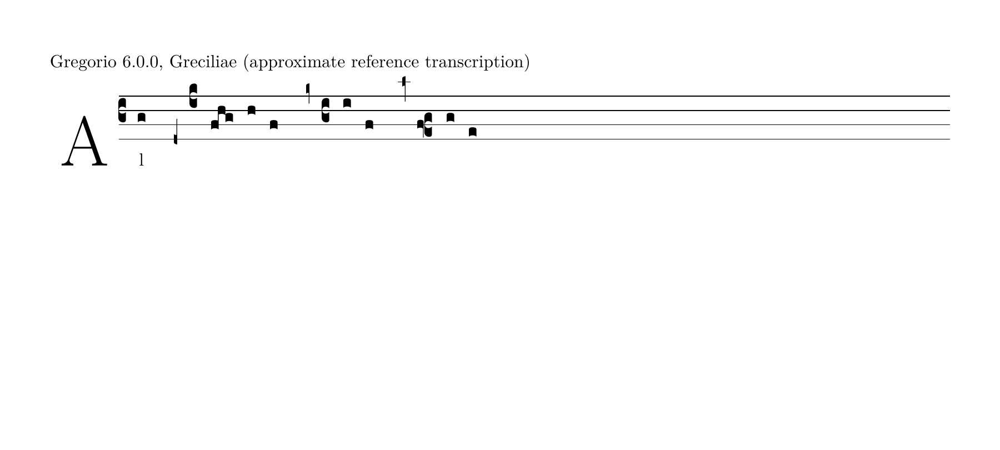

# Custos ledger-line engraving

This follow-up is limited to derived custodes. It preserves ADR 0015's guide
pitch formula, semantic identities, clef editing, guide suppression and measured
whole-neume wrapping policy. It adds no neume ledger lines or persisted entities.

## Reference investigation

The owner-supplied [approximate GABC](custos-reference.gabc) is reconstructed
from a screenshot, not an export or authoritative transcription. It is used
only as a visual regression scenario. The editor fixture uses the corresponding
staff-relative notes and C3 → C4 → C3 → F2 changes; its guide positions remain
**0, 7, 8** (bottom line = 0, top line = 6). Only 8 needs a ledger. The
editor wraps before the final note and also derives its ordinary outgoing guide
at position 1; the wider Gregorio reference stays on one staff. Break locations
are not expected to match.

The official Gregorio source was inspected at
[`b63f074`, `gregoriotex-signs.tex`](https://github.com/gregorio-project/gregorio/blob/b63f074253bd2f6b837f9f9778bba299ac139ec0/tex/gregoriotex-signs.tex#L461).
`GreCustos` and `GreNextCustos` test beyond the adjacent outside spaces before
adding a staff-thickness short line. The inline variant overhangs both sides;
the end-of-line variant has asymmetric right-edge clearance. The macros draw
the first additional staff line for Gregorio's supported pitch range. The editor
extends the same staff lattice to multiple required ledgers for more distant
positions; that generalization is not claimed to reproduce every Gregorio case.
`gre@pickcustos` selects up/down and long/short/middle forms by pitch. The
[default spacing](https://github.com/gregorio-project/gregorio/blob/b63f074253bd2f6b837f9f9778bba299ac139ec0/tex/gregoriotex-gsp-default.tex#L98)
provides a dedicated additional-custos-line overhang.

A real **Gregorio 6.0.0 / Greciliae / LuaHBTeX 1.17.0** rendering was generated
from the supplied GABC, using fonts and TeX support extracted into temporary
storage from Ubuntu's `texlive-music` and `texlive-luatex` packages. No dependency
was installed in the project. This is actual Gregorio output, not a recreated
font drawing. The [TeX wrapper](custos-reference.tex) and GABC are retained for
reproduction: run `gregorio custos-reference.gabc`, then run LuaLaTeX twice with
GregorioTeX available, then rasterize the PDF for inspection.

## Derived geometry and scope

The staff has line positions 0, 2, 4, 6. Positions -1 and 7 are the adjacent
outside spaces and get no ledger. Above the staff, draw 8, 10, … through the
last even position not higher than the guide. Below it, draw -2, -4, … through
the last even position not lower than the guide. Thus 8/9 need one line,
10/11 need two; -2/-3 need one, -4/-5 need two. No lines are added inside the
staff or merely because the guide's shaft crosses a staff boundary.

`custos-geometry.ts` derives a compact regular ledger run, not an array proportional
to unbounded safe pitch values. SVG renders the run as a tiled 1.5-unit horizontal
rule every 24 units, behind the glyph, without selectable/hit/semantic entities.
The 16-unit rule includes a 3-unit overhang on each side of the existing 10-unit
glyph allocation; guide positions and glyph outline/stem remain unchanged.
Ledger thickness is in score coordinates, like filled notation ink.

The existing measured walker reserves this actual ledger-bearing width for
mid-staff and outgoing guides. Replacing a guide during wrapping reclaims its
actual width, including ledgers. Bounds include the complete ledger run and
its thickness, so staff extension, lyric/hyphen clearance and insertion-caret
clearance share the same authoritative geometry. Ledger-free guides retain
their existing width and wrapping. Guides needing extra width can wrap earlier;
no new break policy is introduced.

A derived canvas Y origin and height include exceptional guide ink above/below
the normal canvas, with the existing 12-unit edge margin. Staff positions and
system coordinates are never moved to hide a guide. This does not introduce
vertical system collision avoidance, pagination, or general neume ledger lines.

## Verification

Passed: `npm run format:check`, `npm run lint`, `npm test` (**61 files / 1,255
tests**), `npm run build`, and `git diff --check`. The original 1,231 regressions
remain passing. New pure cases cover within-staff/adjacent-space omissions,
one/multiple ledgers on both sides, exact lattice/alignment and translated
bounds, compact extreme pitch runs, unchanged guide pitch/wrapping order,
exceptional vertical canvas extents, oversized staff/width reservation and
reachable caret clearance against full ledger bounds.

The extended real-editor driver passed Chromium and Firefox at 1440px/320px:
15 guide positions spanning no/one/multiple ledgers above/below, actual glyph
SVG bounds inside measured bounds, ledger dimensions/count, inert ownership,
canvas containment and the approximate excerpt's unchanged mid-staff guide
positions 0/7/8. The first reference assertion counted the separate outgoing
position-1 guide; it was corrected to distinguish guide roles, and both complete
drivers were rerun successfully. The full insertion/shared-mode/edit/deletion,
history/draft/focus, wrapped mixed-slot, keyboard and 150% CSS-zoom regressions
also passed. Chromium includes native HTML keyboard activation; Firefox retains
the documented background HTML activation limitation and uses pointer activation
for two native buttons, while native score/radio/navigation keys pass.

Additional regressions passed: Chromium initial-clef, division and measured
lyric-spacing drivers; Firefox division driver. Production Chromium smoke
passed project-subpath assets, experimental notice, graphical insertion,
desktop/320px containment and refresh reset, with no observed runtime or
asset-loading errors. Broader lyric/corpus suites were not rerun for this
custos-only follow-up; earlier records remain historical.

Actual editor screenshots (reviewed, not golden images):

- [Approximate excerpt, including the high ledger](custos-editor-excerpt.png)
- [Adjacent upper space: no ledger](custos-adjacent-space.png)
- [Two ledgers above](custos-two-above.png)
- [Two ledgers below](custos-two-below.png)
- [Firefox 320px excerpt](custos-firefox-320.png)

The source/Gregorio reference is visual evidence, not a pixel-matching oracle.
Neumes in extreme test specimens may still lack their own ledger lines; only
the custos ink is included in this follow-up's exceptional vertical bounds.

## Remaining visual differences and owner checks

Gregorio's Greciliae custos has a narrower, more upright head and pitch-dependent
stem direction/length; our existing small rising silhouette is unchanged. Its
ledger overhang also varies between inline and outgoing use, whereas this
follow-up uses one measured symmetric overhang. These are remaining contour/
spacing differences, not evidence of a pitch error. A contour redesign or
pitch-dependent glyph family is deferred to an explicit engraving review.

Compare the high guides at equal staff spacing, inspect narrow-screen/actual
browser zoom legibility and top/bottom guide clearance, and check realistic
multi-system scores for vertical collisions. Headless geometry and screenshots
do not establish publication-quality engraving, spoken screen-reader output or
foreground OS/browser behavior. Neume ledger support remains out of scope.
