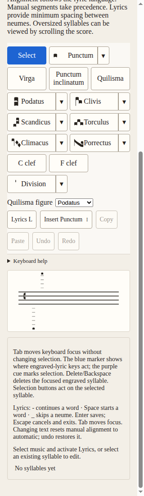
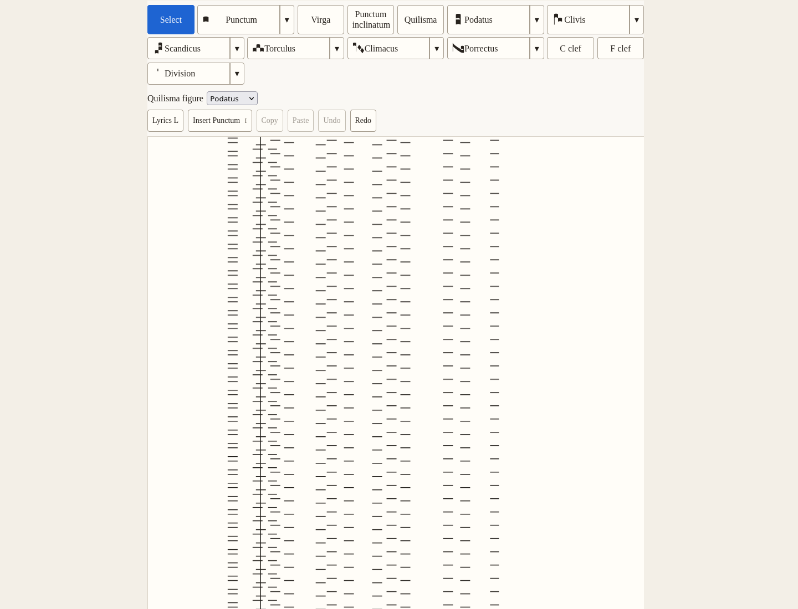

# Stage 11A — derived neume ledger lines: implementation record

Branch `feat/neume-ledger-lines`, target `master`. Implements
[the Stage 11A plan](../../plans/stage-11a-neume-ledger-lines.md) (planning
commit `12d1247`); current `master` (`fef1d33`, PR #90 neume default
contours) was merged into the branch first. The contract is owned by
[layout and rendering](../../layout-and-rendering.md#neumes-stage-11a) and
[drawing metrics](../../engraving-metrics.md#ledger-lines-stage-11a).

## Repertoire fixture

[`et-jesum.chant.json`](et-jesum.chant.json) (native v10) is a limited pitch
transcription of _Et Jesum_ from the Dominican Salve Regina, not the full
printed chant: C4, `Et(d) Je(a)sum(cd)` from
[GregoBase #4577](https://gregobase.selapa.net/chant.php?id=4577)
(_Completorium O.P._, Suarez, 1949, pp. 119–120), i.e. Punctum 0, Punctum -3
and Podatus [-1, 0] with syllables Et/Je/sum. The Je Punctum has exactly one
ledger at -2; Et and sum have none. The original
[Salve Regina WIP fixture](../liquescent-notation/fixtures/salve-regina-dominican-wip.chant.json)
is unchanged. The low A still overlaps its lyric: that is the Stage 11B
acceptance case, not an 11A failure.

## Implementation summary

- `src/editor/layout/ledger-lines.ts` (new): the shared ledger rule
  (generalized from custodes), compact `LedgerRun`s, per-neume band merge,
  analytic stroke queries, pitch-bearing columns and `addLedgerLines`.
- `custos-geometry.ts` uses the shared rule; its output is unchanged
  (existing tests plus an explicit regression).
- `neume-geometry.ts` adds ledgers after the authored body and before signs;
  the `staffless` option / `buildNeumeBodyGeometry` serves palette icons and
  recipe-contour tests. A left overhang shifts the body inside its box so
  `leftX` stays the complete left edge.
- `note-modifiers.ts` and `accidental-geometry.ts` treat ledger strokes as
  analytic obstacles and include runs in bounds.
- `graphical-placement.ts` keeps the ghost's first head on the pointer with
  the measured offset.
- `layout-chant.ts`: the outer canvas includes every neume's complete bounds.
- `NeumeInk.tsx` renders runs behind body ink (one rect per run, tiled
  pattern for several levels, `useId`); `ScoreSvg.tsx` passes runs for
  committed neumes and the ghost; `NeumeFamilyMenu.tsx` uses body geometry.

### Choices and deviations for review

- **Representation**: a separate `NeumeGeometry.ledgers` field rather than
  new `InkShape`s, so no consumer can mistake a multi-level run's envelope
  for filled ink. All `ink` consumers were audited; bounds-based consumers
  (spacing, wrapping, fit, selection/range outlines, canvas, insertion
  midpoints, lyric-band) receive ledgers through `bounds`.
- **Pitch-bearing column**: the head contour when at most 14 units wide;
  wider selection regions (only Porrectus-family ribbons) use the 12-unit
  endpoint cell about the anchor. Diamonds give 20-unit ledgers; reduced
  liquescent terminals use their own narrower contour.
- **Touching overhangs merge** (as specified): repeated notes 18 units apart
  give one continuous stroke.
- **Horizontal episema near a ledger** (owner-accepted, no exception): the
  existing above-then-below order at each distance now sees ledger strokes,
  so an episema over a note just below a ledger (e.g. -3) moves to the same
  16-unit distance below rather than further above.
- **Prefix accidentals** keep their 20-unit advance to the ledger edge (the
  head moves 3 units right), rather than letting the ledger close the gap.
- **First neume of a system**: a first-column ledger moves its head 3 units
  right of `firstNeumeCenterX` (the ink box still starts at the usual left
  edge); no clef clearance changes.
- **Canvas containment (owner-accepted policy)**: all musical ink grows the
  outer canvas by at most `offStaffCanvasMargin` (1,200 units, 50 ledger
  levels) beyond its system, vertically and (beyond the 720-unit width)
  horizontally; there is no marked/unmarked distinction. Painted ledger
  runs (neume and custos) and bounds-derived outlines are limited to the
  canvas plus one ledger space; derived geometry is unchanged. See
  [what is clipped and what remains supported](../../layout-and-rendering.md#canvas-containment-and-extreme-pitches-owner-accepted).
- Pointer entry cannot start below -1, so the ghost's measured-offset path is
  exercised by a unit test calling the preview layout directly; the browser
  checks a default Climacus extending to -2.

### Existing tests changed

Tests asserting approved body recipes over off-staff interval matrices now
use `buildNeumeBodyGeometry` (Climacus/Porrectus contours, Podatus/Clivis
stems and bounds, Scandicus/Torculus intervals, extended Scandicus and Pes
subpunctis component reuse). Expectations that legitimately include ledgers
were updated with comments: repeated-note widths, prefix-accidental anchors
(now compared at equal ink edges), Porrectus mora right edge (measured from
body ink), a mora Punctum at 20 (width 24), a compound first-anchor check,
the committed-preview `leftX` (now `bounds.x`), the clef-transaction wrap
indexes (low Puncta are wider), and the exact-fit reflow fixture (tail
raised a third so it remains ledger-free). The runner manifest test now
expects 44 runnable pairs.

## Verification

Implementation revision `1a3f918` (2026-11-16), local Linux, headless
Chromium (CDP) and Firefox (BiDi) via `npm run verify:browser`.

| Check                                     | Result                                       |
| ----------------------------------------- | -------------------------------------------- |
| `npm run format:check`                    | Pass                                         |
| `npm run lint`                            | Pass                                         |
| `npm test`                                | Pass, 2333 tests (49 in `ledger-lines.test`) |
| `npm run build`                           | Pass                                         |
| `git diff --check`                        | Pass                                         |
| `npm run test:verify-runner`              | Pass, 28 tests                               |
| `neume-ledger-lines` Chromium and Firefox | Pass                                         |
| 16 affected existing drivers, both        | 31 pass (`clefs` is Chromium-only)           |

Affected drivers: mid-score-clefs, note-modifiers, vertical-episemata (+
context), b-accidentals (+ acceptance), contiguous-selection,
musical-passage-clipboard, liquescent-notation, compound-directional-neumes,
extended-scandicus-climacus, pes-subpunctis, repeated-note-neumes,
note-shapes, clefs, divisions. An earlier run (before the canvas bound
below) failed mid-score-clefs in both browsers at its
`Number.MAX_SAFE_INTEGER` scenario; that is the cause of the canvas-bound
deviation, not a baseline failure. The known Firefox mid-score-clefs
intermittency did not recur. Baseline note: the committed plan itself
failed `format:check` (list spacing); it was formatted here.

The focused driver covers, at 1440px and 320px: the Et Jesum ledger
(position, width, paint order, inert/aria-hidden, no new targets); export
(no ledger key), import and melody-preserving clef translation with
derived counts following the pitches, Undo; keyboard transposition -1 →
-2/-3/-4 and back with the same note ID and Undo/Redo; a specimen of stacked,
ribbon, repeated, liquescent and diamond figures with marks and a flat
(no mark overlaps any stroke, accidental still focusable); whole-neume
selection enclosing the ledger; copy/paste of a ledger neume; outer canvas
containing ledgers at -12 and 15 plus Chromium print-to-PDF; a real-mouse
Climacus ghost at the bottom line with the same ledger as its commit, the
first head on the pointer and the clamped ghost (with ledger) inside the
staff; no ledgers on palette icons; no horizontal page overflow.

Not run: the full browser matrix and the TeX/historical comparison (not
required for this milestone); foreground manual and screen-reader testing.

## Owner follow-up (canvas policy and modifier tests)

After the owner's review of `121d8b3` (decisions recorded in
[the plan](../../plans/stage-11a-neume-ledger-lines.md#owner-decisions-after-pr-91-review)):

- **Bounded containment for all musical ink**, vertically and horizontally
  (`layout-chant.ts`). On `master` a distant custos already made the
  canvas unbounded vertically, and a Porrectus ribbon reaching a distant
  pitch (width proportional to its interval, ~7 × 10^16) unbounded
  horizontally when a custos followed it. At `121d8b3` the latter was
  unbounded even without a custos, and the 7 × 10^16-unit SVG left the
  ordinary note with a 0 × 0 hit box in Chromium.
- **Investigation of rendering with a bounded viewBox**: with ±MAX_SAFE
  pitches, Chromium painted the ~10^17-unit tiled ledger rects across
  neighbouring systems, and Firefox painted only the first stroke or none
  (blank score area at 1440px). Painted ledger runs (neume and custos) and
  bounds-derived outlines are now limited to the canvas plus one ledger
  space, anchored exactly on the staff grid (`visibleLedgerRun`,
  `render-band.ts`); both browsers now paint identically.
  `ledgerStrokesInBand` uses the same exact anchoring; ordinary results
  are unchanged.
- **Tests**:
  - `ledger-lines.test.ts`: plain, marked, virga, inclinatum, quilisma pes,
    epiphonus, flat and distant-custos ink at ±MAX_SAFE and ±400, both
    sides; complete containment at -60 and 70; the ribbon width bound;
    painted sub-runs on the grid.
  - `ledger-modifiers.test.ts` (new): valid mark combinations on all 22
    entry families, including the three liquescent appearances, extended
    Scandicus/Climacus, Porrectus-family and compound neumes. At `b1ad10a`
    it used four episema masks per sign (none, all, even and odd notes),
    not every subset. It now enumerates every valid subset: each mora
    scope × every subset of horizontally episematized notes × every subset
    of vertically episematized notes × with and without an allowed form,
    filtered by `isValidNeume`. It uses first pitches -9..13 (twelve
    values), and four representative ones (-7, -3, 8, 11) for the
    five-note families, whose 1,024 sign subsets per scope would otherwise
    take ~6 s each. A one-off run with all twelve first pitches for every
    family also passed (22/22, 30.7 s, `--testTimeout=120000`). All
    authored marks are present, none touches a ledger stroke, and vertical
    episema placement never throws. A mutation check (disabling the ledger
    obstacle) fails 21 of 22 families.
  - No regression surfaced, so ordinary and modifier engraving is unchanged.
- **Driver scenario 9** (both browsers, 1440 and 320px): 24 neumes
  alternating between MAX_SAFE and -MAX_SAFE+8 (plain, marked, virga with a
  flat, epiphonus, quilisma pes), plus a Podatus and a Porrectus spanning
  from the staff to MAX_SAFE. It checks:
  - a bounded viewBox (-1,200 to systems + 1,200);
  - distant custodes present;
  - every painted ledger or outline inside the band and on the staff grid,
    with the full derived count retained;
  - real-pointer selection and transposition of an ordinary note;
  - keyboard selection and transposition of a distant note;
  - a whole-neume outline limited to the band;
  - Undo restoring the exact document and pitches.

Follow-up verification, final working tree (2026-11-16):

| Check                                                                                                                                           | Result                                         |
| ----------------------------------------------------------------------------------------------------------------------------------------------- | ---------------------------------------------- |
| format:check, lint, build, `git diff --check`                                                                                                   | Pass                                           |
| `npm test`                                                                                                                                      | Pass, 2361 tests                               |
| `npm run test:verify-runner`                                                                                                                    | Pass                                           |
| neume-ledger-lines, mid-score-clefs, Chromium and Firefox                                                                                       | Pass                                           |
| note-modifiers, vertical-episemata, contiguous-selection, b-accidentals, liquescent-notation, compound-directional-neumes, Chromium and Firefox | Pass                                           |
| lyric-move (Chromium only)                                                                                                                      | Fail, baseline: `Missing button Move syllable` |

The lyric-move failure reproduces identically on clean `master` (`fef1d33`)
at its third step, before any ledger content; it is a pre-existing driver
or UI mismatch, not caused by this branch. Modifier production geometry did
not change, so the remaining modifier drivers were not rerun.

## Second owner follow-up (outgoing hyphens)

Review of `b1ad10a` found that an outgoing continuation hyphen bypassed the
horizontal safeguard: it is placed after its system's musical ink, and
hyphens grew the canvas without limit. Reproduced with measured lyrics and
the native v10 fixture
[`extreme-ribbon-continuation.chant.json`](extreme-ribbon-continuation.chant.json):
"Do" on a Porrectus whose first pitch is MAX_SAFE_INTEGER (ribbon ~7.2 ×
10^16 wide) and "mi" 30 neumes later. At `b1ad10a` the canvas was
72,057,594,037,928,130 units wide.

Fix (`layout-chant.ts`): the horizontal limit for musical ink is now
relative to the text-derived extent (score width, widened by any oversized
lyric text) plus 1,200 units, and it also bounds hyphens. Lyric text
extents are never capped, so text overflow and horizontal scrolling are
unchanged. An outgoing hyphen can only exceed that limit through musical
displacement; it keeps its derived position and is clipped.

This also corrects the `608edc2` fixed limit (score width + 1,200), which
clipped ink displaced by oversized text. After a 4,000-unit continuation
word it cut 7 units of extended staff/custos (canvas 4,066 instead of
master's 4,073).

Evidence:

- `ledger-lines.test.ts`:
  - the extreme case (native fixture and an equivalent built document) is
    bounded at 1,920, with the hyphen still at ~7.2 × 10^16; it fails on
    `b1ad10a`;
  - the ordinary cross-system hyphen stays at its staff-end position on a
    720-unit canvas;
  - a 4,000-unit continuation word, and a 3,000-unit word ending a system
    before its custos, keep every neume, custos, staff line and hyphen
    inside an uncapped canvas.
- A probe of seven lyric layouts (ordinary and low continuation, long
  first/last/ending/continuation words, a 9,000-unit continuation)
  produced canvases identical to clean `master`. The only difference was
  the low case, where hyphen and custos sit 6 units further right because
  11A ledgers widen low neumes; its canvas is identical.
- Driver scenario 10 (Chromium and Firefox, 1440 and 320px) imports the
  native fixture and checks:
  - viewBox 0–1,920 and an SVG 1,920 px wide;
  - the outgoing hyphen rendered with its derived x ≈ 7.2 × 10^16;
  - both syllables rendered;
  - real-pointer selection and transposition of a note on a later system;
  - Undo.
- Firefox's `scrollIntoView` did not centre an SVG note inside the wide
  score viewport (Chromium did), so the driver's pointer helper now
  finishes with a page scroll when the target is still outside the
  viewport.

Results, final working tree (2026-11-16):

| Check                                                                     | Result                     |
| ------------------------------------------------------------------------- | -------------------------- |
| format:check, lint, build, `git diff --check`                             | Pass                       |
| `npm test`                                                                | Pass, 2363 tests           |
| `npm run test:verify-runner`                                              | Pass, 28 tests             |
| neume-ledger-lines, mid-score-clefs, divisions (Chromium and Firefox)     | Pass                       |
| continuous-lyrics, vowel-alignment (Chromium only)                        | Pass                       |
| word-composition (Chromium and Firefox)                                   | Fail, baseline (see below) |
| lyric-spacing (Chromium only), lyric-spacing-selection-cue (Firefox only) | Fail, baseline (see below) |

Baseline failures, reproduced identically on clean `master` (`fef1d33`) and
on `b1ad10a`, within their first seconds; not fixed here (unrelated):

- word-composition, both browsers: `punctum selected whole-neume cue must
be clipped`.
- lyric-spacing (Chromium): a strict-equality assertion.
- lyric-spacing-selection-cue (Firefox): BiDi `move target out of bounds`.
- lyric-move (Chromium, from the first follow-up): `Missing button Move
syllable`.

## Owner acceptance steps

1. `npm run build && npm run preview`, Import `et-jesum.chant.json`: one
   ledger at -2 under Je only (the lyric overlap is Stage 11B).
2. Select a Punctum and press ↓ from -1: none at -1, one at -2 and -3, two at
   -4; ↑ back removes them; Undo/Redo. Repeat above the staff (7 → 8/9/10).
3. Inspect stacked (Podatus [-4,-2]), offset (Clivis [-2,-5]), repeated
   (Tristropha at -3) and ribbon (Porrectus [-2,-5,-2]) figures, and a
   default Climacus placed on the bottom line (ghost and commit).
4. Check episemata, mora and a flat next to ledgers, and the 320px view.
5. Optionally import a score with a distant (e.g. ±9007199254740991) pitch:
   the editor stays usable; ink beyond 1,200 units is clipped.
