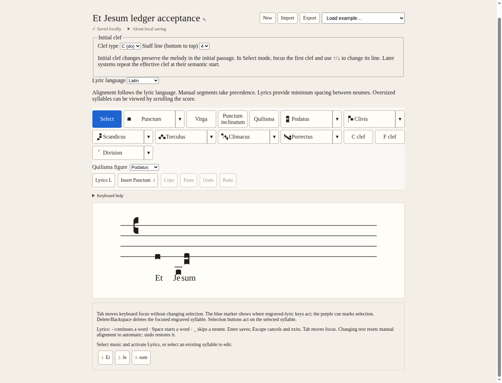
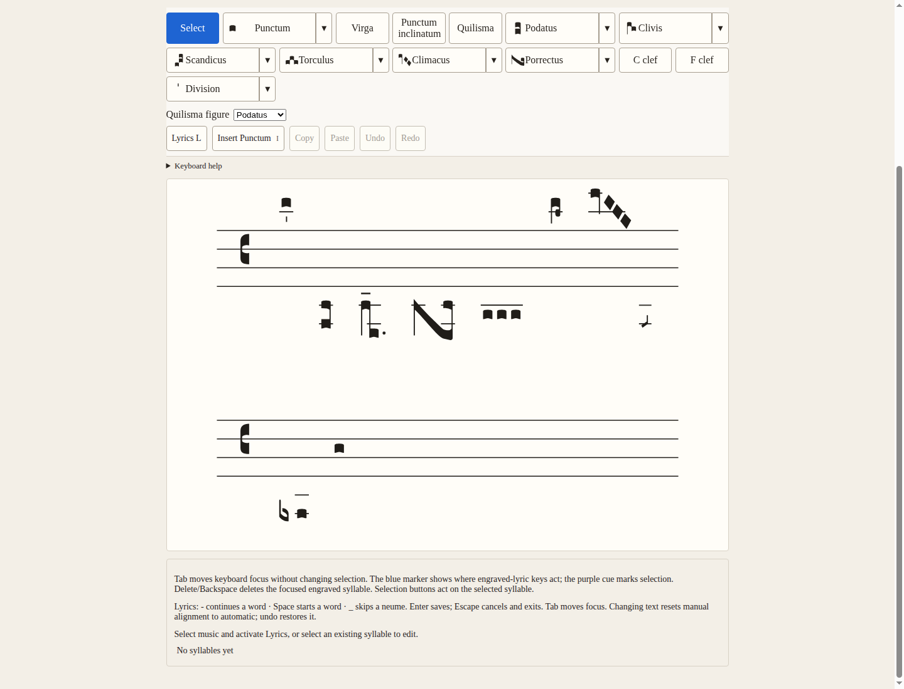

# Stage 11A — derived neume ledger lines: implementation record

Branch `feat/neume-ledger-lines`, target `master`. Implements
[the Stage 11A plan](../../plans/stage-11a-neume-ledger-lines.md) (planning
commit `12d1247`); current `master` (`fef1d33`, PR #90 neume default
contours) was merged into the branch first. The contract is owned by
[layout and rendering](../../layout-and-rendering.md#neumes-stage-11a) and
[drawing metrics](../../engraving-metrics.md#ledger-lines-stage-11a).

## Repertoire fixture

[`et-jesum.chant.json`](et-jesum.chant.json) (native v10) is a limited pitch
transcription of _Et Jesum_ from the Dominican Salve Regina, not the full
printed chant: C4, `Et(d) Je(a)sum(cd)` from
[GregoBase #4577](https://gregobase.selapa.net/chant.php?id=4577)
(_Completorium O.P._, Suarez, 1949, pp. 119–120), i.e. Punctum 0, Punctum -3
and Podatus [-1, 0] with syllables Et/Je/sum. The Je Punctum has exactly one
ledger at -2; Et and sum have none. The original
[Salve Regina WIP fixture](../liquescent-notation/fixtures/salve-regina-dominican-wip.chant.json)
is unchanged. The low A still overlaps its lyric: that is the Stage 11B
acceptance case, not an 11A failure.

## Implementation summary

- `src/editor/layout/ledger-lines.ts` (new): the shared ledger rule
  (generalized from custodes), compact `LedgerRun`s, per-neume band merge,
  analytic stroke queries, pitch-bearing columns and `addLedgerLines`.
- `custos-geometry.ts` uses the shared rule; its output is unchanged
  (existing tests plus an explicit regression).
- `neume-geometry.ts` adds ledgers after the authored body and before signs;
  the `staffless` option / `buildNeumeBodyGeometry` serves palette icons and
  recipe-contour tests. A left overhang shifts the body inside its box so
  `leftX` stays the complete left edge.
- `note-modifiers.ts` and `accidental-geometry.ts` treat ledger strokes as
  analytic obstacles and include runs in bounds.
- `graphical-placement.ts` keeps the ghost's first head on the pointer with
  the measured offset.
- `layout-chant.ts`: the outer canvas includes every neume's complete bounds.
- `NeumeInk.tsx` renders runs behind body ink (one rect per run, tiled
  pattern for several levels, `useId`); `ScoreSvg.tsx` passes runs for
  committed neumes and the ghost; `NeumeFamilyMenu.tsx` uses body geometry.

### Choices and deviations for review

- **Representation**: a separate `NeumeGeometry.ledgers` field rather than
  new `InkShape`s, so no consumer can mistake a multi-level run's envelope
  for filled ink. All `ink` consumers were audited; bounds-based consumers
  (spacing, wrapping, fit, selection/range outlines, canvas, insertion
  midpoints, lyric-band) receive ledgers through `bounds`.
- **Pitch-bearing column**: the head contour when at most 14 units wide;
  wider selection regions (only Porrectus-family ribbons) use the 12-unit
  endpoint cell about the anchor. Diamonds give 20-unit ledgers; reduced
  liquescent terminals use their own narrower contour.
- **Touching overhangs merge** (as specified): repeated notes 18 units apart
  give one continuous stroke.
- **Horizontal episema near a ledger**: the existing above-then-below order
  at each distance now sees ledger strokes, so an episema over a note just
  below a ledger (e.g. -3) moves to the same 16-unit distance below rather
  than further above. The rule itself is unchanged; review whether a
  "prefer above" exception is wanted.
- **Prefix accidentals** keep their 20-unit advance to the ledger edge (the
  head moves 3 units right), rather than letting the ledger close the gap.
- **First neume of a system**: a first-column ledger moves its head 3 units
  right of `firstNeumeCenterX` (the ink box still starts at the usual left
  edge); no clef clearance changes.
- **Canvas**: horizontal neume extents are also included, as the plan's
  "all ink" wording asks; ordinary scores keep their 720 × height canvas.
- **Canvas bound for absurd pitches (owner decision)**: including every
  neume's ink made a valid `Number.MAX_SAFE_INTEGER` Punctum produce a
  ~10^17-unit viewBox, which broke the existing `mid-score-clefs` unsafe-pitch
  scenario in both browsers (the clef became unreachable). Unmarked neume ink
  now grows the canvas by at most `offStaffCanvasMargin` (1,200 units = 50
  ledger levels) beyond its system; farther ink stays clipped, exactly as
  before 11A. Marked neumes and custodes keep their earlier unbounded rule
  (a pre-existing limitation, not changed here). Alternatives: a different
  margin, applying the bound to marked neumes and custodes too, or deferring
  extreme-coordinate policy to 11B.
- Pointer entry cannot start below -1, so the ghost's measured-offset path is
  exercised by a unit test calling the preview layout directly; the browser
  checks a default Climacus extending to -2.

### Existing tests changed

Tests asserting approved body recipes over off-staff interval matrices now
use `buildNeumeBodyGeometry` (Climacus/Porrectus contours, Podatus/Clivis
stems and bounds, Scandicus/Torculus intervals, extended Scandicus and Pes
subpunctis component reuse). Expectations that legitimately include ledgers
were updated with comments: repeated-note widths, prefix-accidental anchors
(now compared at equal ink edges), Porrectus mora right edge (measured from
body ink), a mora Punctum at 20 (width 24), a compound first-anchor check,
the committed-preview `leftX` (now `bounds.x`), the clef-transaction wrap
indexes (low Puncta are wider), and the exact-fit reflow fixture (tail
raised a third so it remains ledger-free). The runner manifest test now
expects 44 runnable pairs.

## Verification

Implementation revision `1a3f918` (2026-11-16), local Linux, headless
Chromium (CDP) and Firefox (BiDi) via `npm run verify:browser`.

| Check                                     | Result                                       |
| ----------------------------------------- | -------------------------------------------- |
| `npm run format:check`                    | Pass                                         |
| `npm run lint`                            | Pass                                         |
| `npm test`                                | Pass, 2333 tests (49 in `ledger-lines.test`) |
| `npm run build`                           | Pass                                         |
| `git diff --check`                        | Pass                                         |
| `npm run test:verify-runner`              | Pass, 28 tests                               |
| `neume-ledger-lines` Chromium and Firefox | Pass                                         |
| 16 affected existing drivers, both        | 31 pass (`clefs` is Chromium-only)           |

Affected drivers: mid-score-clefs, note-modifiers, vertical-episemata (+
context), b-accidentals (+ acceptance), contiguous-selection,
musical-passage-clipboard, liquescent-notation, compound-directional-neumes,
extended-scandicus-climacus, pes-subpunctis, repeated-note-neumes,
note-shapes, clefs, divisions. An earlier run (before the canvas bound
below) failed mid-score-clefs in both browsers at its
`Number.MAX_SAFE_INTEGER` scenario; that is the cause of the canvas-bound
deviation, not a baseline failure. The known Firefox mid-score-clefs
intermittency did not recur. Baseline note: the committed plan itself
failed `format:check` (list spacing); it was formatted here.

The focused driver covers, at 1440px and 320px: the Et Jesum ledger
(position, width, paint order, inert/aria-hidden, no new targets); export
(no ledger key), import and melody-preserving clef translation with
derived counts following the pitches, Undo; keyboard transposition -1 →
-2/-3/-4 and back with the same note ID and Undo/Redo; a specimen of stacked,
ribbon, repeated, liquescent and diamond figures with marks and a flat
(no mark overlaps any stroke, accidental still focusable); whole-neume
selection enclosing the ledger; copy/paste of a ledger neume; outer canvas
containing ledgers at -12 and 15 plus Chromium print-to-PDF; a real-mouse
Climacus ghost at the bottom line with the same ledger as its commit, the
first head on the pointer and the clamped ghost (with ledger) inside the
staff; no ledgers on palette icons; no horizontal page overflow.

Not run: the full browser matrix and the TeX/historical comparison (not
required for this milestone); foreground manual and screen-reader testing.

## Owner acceptance steps

1. `npm run build && npm run preview`, Import `et-jesum.chant.json`: one
   ledger at -2 under Je only (the lyric overlap is Stage 11B).
2. Select a Punctum and press ↓ from -1: none at -1, one at -2 and -3, two at
   -4; ↑ back removes them; Undo/Redo. Repeat above the staff (7 → 8/9/10).
3. Inspect stacked (Podatus [-4,-2]), offset (Clivis [-2,-5]), repeated
   (Tristropha at -3) and ribbon (Porrectus [-2,-5,-2]) figures, and a
   default Climacus placed on the bottom line (ghost and commit).
4. Check episemata, mora and a flat next to ledgers, and the 320px view.
