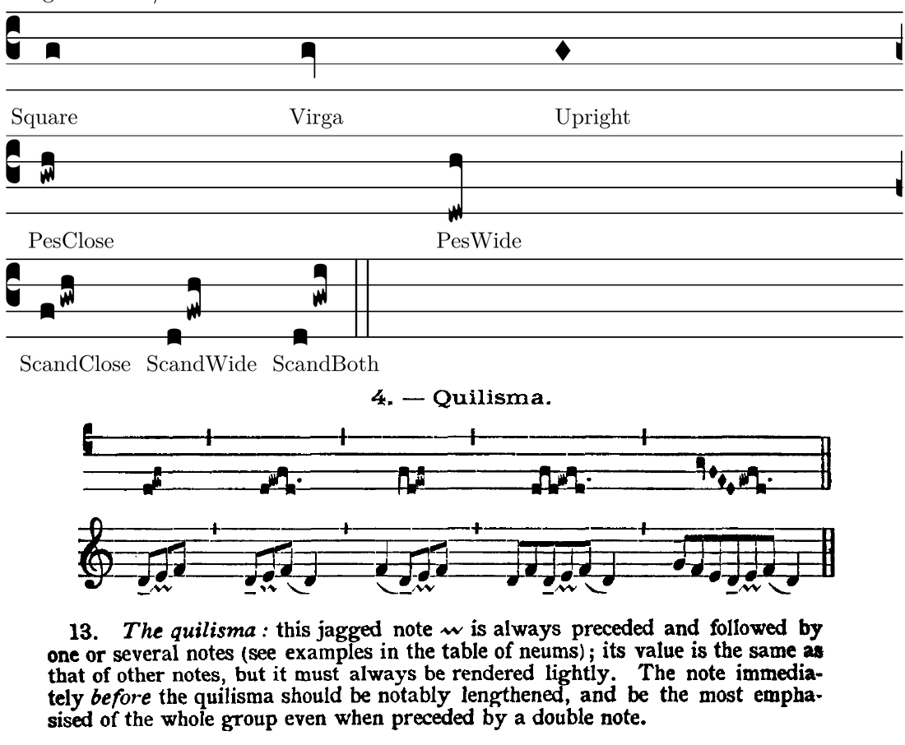

# Stage 8B reference investigation — historical, decisions resolved

2026-11-09. Branch `feat/stage-8b-note-shapes`, target `master`.
ADR 0019 remains Accepted. This investigation does not reopen its choice of
optional note forms, seven semantic kinds, one-click tools or native v3.
This is the retained historical investigation, not the current implementation status.
The owner resolved both questions after reviewing PR #65: independent quilisma-pes
is allowed without context validation, and Scandicus uses the traditional connected
construction. See [the implementation record](implementation.md) for current work.
The original evidence and options below are retained unchanged as research history.

## Stop condition encountered

The plan explicitly requires stopping for questionable historical conventions
and for materially conflicting reference contours. Two points need an owner
decision before finalizing the quilisma implementation:

1. **An independent two-note figure versus a component of a larger passage.**
   The traditional _Liber Usualis_ discussion says a quilisma is
   “always preceded and followed by one or several notes” (printed p. xxv,
   PDF page 25). Its preceding-note discussion and table put the quilisma
   inside longer passages. Gregorio nevertheless renders `gwh`, including as
   the first pitched figure. This confirms a renderable quilisma-pes glyph;
   it does not by itself establish the historical usage of an unpreceded
   quilisma. The approved lower-note Podatus form can currently be inserted
   at the beginning of a blank score, or become unpreceded through deletion
   of the preceding neume. The plan does not specify whether this is an
   intentional editorial allowance or whether musical context must constrain
   it. No new context restriction has been silently added.
2. **Connection of the preceding note.** Actual Gregorio output for `fgwh`,
   `dfwh` and `dgwi` is a separate initial punctum followed by a connected
   quilisma-pes. The printed table's first three-pitch example appears to
   join the initial pitch to the middle quilisma and then the terminal.
   Gregorio fusion probes demonstrate that explicit syntax can alter spacing
   and contact; they do not establish one universal historical construction.
   The plan requests a connected rising group and excludes generic fusion
   and authored cuts. A fixed, context-derived construction could still fit
   ADR 0019, but choosing the source profile should be explicit.

These are research questions about usage and contour, not proof that the
accepted semantic matrix is impossible or historically invalid everywhere.
The printed source describes its own performance/notation tradition; it is
not a universal prohibition across chant sources. No rhythm or playback
interpretation from that source is proposed for the app.

## Rendered evidence



- [Actual Gregorio sheet](gregorio-reference.png): square, virga, neutral
  inclinatum, close/wide quilisma-pes, and middle-quilisma three-note cases.
- [Connection probes](gregorio-connections.png): ordinary/fused close/wide
  three-note figures; four-pitch investigation; leading and preceded pes.
  Four pitches and fusion are research probes, not proposed product scope.
- [Printed table excerpt](traditional-quilisma-table.png): printed p. xxij,
  PDF page 22. The five examples include preceding and following pitches.
- [Printed discussion excerpt](traditional-quilisma-discussion.png): printed
  p. xxv, PDF page 25, paragraph 13.

The two-note glyph itself has a pitched jagged lower member, a right-side
ascending connection and a square terminal. Wider intervals lengthen the shaft.
Virga's right queue and the neutral upright inclinatum agree qualitatively
with the proposed families. The existing approved Climacus has deliberately
oblique descending heads; it should not be redrawn as the neutral standalone
form. Existing application glyphs have not been changed.

## Sources and reproduction

Primary references:

- [Gregorio fundamentals](https://gregorio-project.github.io/gabc/)
- [Gregorio inclined forms](https://gregorio-project.github.io/tips/inclinatum.html)
- [Gregorio advanced grouping/fusion](https://gregorio-project.github.io/gabc/details.html)
- [Worked traditional Kyrie comparison](https://gregorio-project.github.io/tutorial/tutorial-gabc-file-01.html)
- [LilyPond Gregorian notation](https://lilypond.org/doc/v2.24/Documentation/notation/typesetting-gregorian-chant)
- [_Liber Usualis_ scan](https://archive.org/download/TheLiberUsualis1961/liberusualis.pdf),
  same Archive.org source already used by the repository's clef refinement.
  The item is named 1961; PDF metadata differs. Page references above identify
  both printed and PDF locations. Small excerpts are retained for review.

The included GABC, generated `.gtex`, and TeX wrappers record actual Gregorio
6.0.0 output using Greciliae. In particular `cases.gtex` names
`QuilismaPesOneNothing`, `QuilismaPesFourNothing`, and the separate punctum
and upper-pair components of the three-pitch examples. No font or traced
outline is introduced into production code.

From a temporary directory containing the source files and a working
GregorioTeX/LuaLaTeX installation:

```sh
gregorio -o cases.gtex cases.gabc
lualatex --interaction=nonstopmode comparison.tex
lualatex --interaction=nonstopmode comparison.tex
pdftoppm -scale-to 1700 -png -singlefile comparison.pdf gregorio-reference
gregorio -o connection-probes.gtex connection-probes.gabc
lualatex --interaction=nonstopmode connections.tex
lualatex --interaction=nonstopmode connections.tex
pdftoppm -scale-to 1700 -png -singlefile connections.pdf gregorio-connections
pdftoppm -f 22 -l 22 -scale-to 1800 -png -singlefile liberusualis.pdf traditional-table
pdftoppm -f 25 -l 25 -scale-to 1800 -png -singlefile liberusualis.pdf traditional-discussion
```

In this session missing TeX packages were supplied by the already extracted
`/tmp/chant-custos-tex/usr/share/texlive/texmf-dist` tree via `TEXMFHOME`,
with `TEXMFVAR=/tmp/chant-custos-tex-cache`. Both reference scores were
compiled twice successfully and the resulting PNGs visually inspected.

## Options for resumption

- **Keep the accepted matrix unrestricted.** Treat quilisma-pes as an authored
  component that may occur without a preceding note in this product profile.
  Explicitly record the editorial allowance and select a fixed three-note
  rendering: Gregorio's separate initial punctum, or a sourced traditional
  connected construction. Neither choice needs a new neume kind or a
  persisted fusion flag.
- **Require preceding musical context for quilisma-pes.** Specify which contexts
  qualify (same syllable, ascending preceding pitch, clef/division boundaries),
  then agree on insertion/deletion/import behavior. This extends validation
  beyond the accepted within-neume matrix and requires a plan/ADR amendment
  before implementation.
- **Defer the two-note form pending further source evidence.** Retain Virga,
  Inclinatum and middle-Scandicus scope only after an explicit milestone change.

## Manual decision checklist

- [ ] Decide whether leading/unpreceded quilisma-pes is intentionally allowed.
- [ ] Choose the three-note connection profile using the actual rendered cases.
- [ ] If context restrictions are desired, define their editing/import behavior.
- [ ] Update the committed plan with the decision without reopening unrelated
      accepted semantic choices.
- [ ] Resume implementation, then run the full Stage 8B acceptance matrix,
      native v1/v2/v3 and recovery checks, actual Chromium/Firefox production
      subpath drivers, and before/after editor comparisons.

## Verification and delivery status

Provisional application edits were removed after the stop condition. They were
not committed or pushed. A provisional build failed on an unfinished import and
provisional tests failed; neither is claimed as Stage 8B verification.

After restoring the application exactly to branch HEAD:

- `npm run lint`: passed.
- `npm test`: 69 files, 1360 tests passed.
- `npm run build`: passed.
- `git diff --check`: passed.
- `npm run format:check`: reports pre-existing formatting in Accepted ADR 0019
  and the committed Stage 8B plan. Those owner-authored files are unchanged.

These are baseline checks only. No Stage 8B browser verification, v3 migration,
editor comparison or implementation acceptance has occurred. Foreground/manual
acceptance remains pending. At this historical stop checkpoint the plan remained Planned, not Completed.
The subsequent implementation status is recorded separately.
