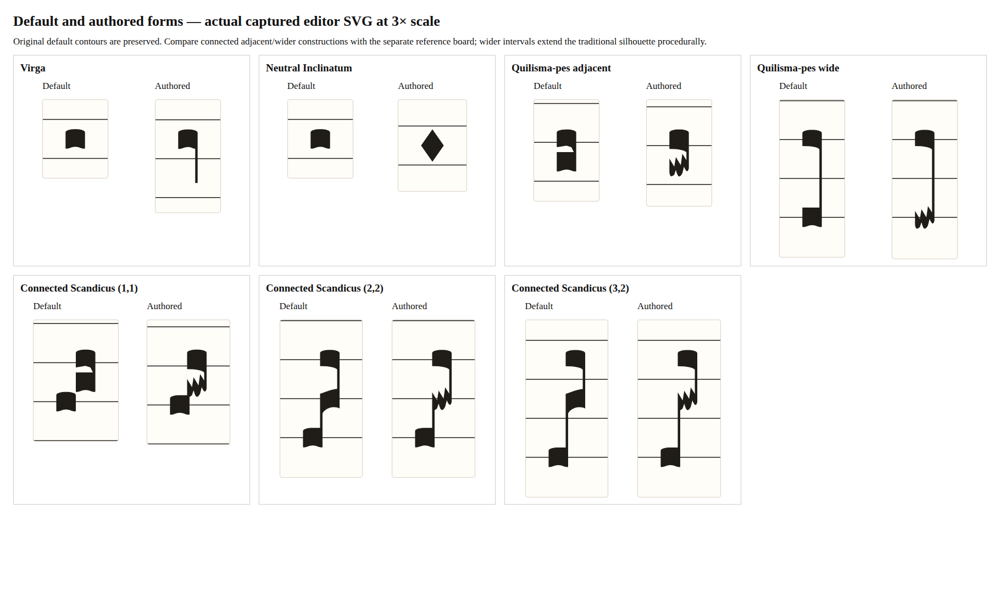

# Stage 8B implementation and acceptance record

2026-11-09. Implemented for review in [PR #65](https://github.com/OceanOSdev/gregorian-chant-editor/pull/65),
not merged. Owner implementation acceptance remains pending.

## Behavior and architectural decisions

- Virga and neutral Punctum inclinatum are preselected one-click forms of the
  existing one-note Punctum semantic unit.
- One Quilisma tool has a compact pre-click Podatus/Scandicus chooser. Both
  complete figures insert atomically, with matching ghosts and remembered I/T
  keyboard entry. There is no after-click dialog.
- Contextual Form edits only the stable selected note: one-note Virga/Inclinatum,
  lower Podatus Quilisma or middle Scandicus Quilisma. Default removes the field.
  Mora scope and selected-note episema remain separate and survive conversion.
- Connected Scandicus uses one original measured SVG silhouette, three nominal
  pitch anchors and partitioned constituent targets. Both rising shafts contain
  actual ink. No fusion flag, new neume kind, font or dependency was added.
- Movement preserves forms. Deletion rejects when a surviving form would become
  unsupported; removing Scandicus's first note can legally retain its middle
  Quilisma as lower Podatus. Invalid edits preserve document/history/cache and
  provide visible nonmodal feedback plus an announcement. Ordinary no-op edits
  retain exact identity. Existing default builders are unchanged.
- Native v3 adds optional note forms. Exact v1/v2 whitelists, incompatible
  draft-v2 source recovery, the single existing cache key, byte conflict checks
  and confirmed replacement remain in force. Older versions cannot be assumed
  to read v3.

These implement [owner-clarified Accepted ADR 0019](../../adrs/0019-authored-note-forms-and-neume-contours.md).
Independent unpreceded quilisma-pes is an intentional editor allowance, not a
claim of conventional historical usage. No cross-neume/syllable/division
restriction was added. The connected traditional Scandicus is deliberate;
Gregorio's ordinary separated initial punctum is not copied.

## Rendered comparisons

[Reference versus editor board](editor-vs-references.png) compares actual
Gregorio output and the primary printed Liber Usualis excerpt with the captured
production editor SVG. The [retained investigation](README.md) supplies source
locations, syntax probes and reference reproduction commands.



The enlarged board uses actual default and authored editor SVG, with identical
scale and individual ink crops. Cases include neutral Inclinatum, Virga,
quilisma-pes intervals 1 and 4, and connected middle-quilisma Scandicus intervals
(1,1), (2,2), (3,2). The wider editor constructions extend the traditional
connected silhouette procedurally; the scan is not claimed to supply an exact
matching specimen for every interval. Paths are independently drawn. Contour
quality remains an owner visual acceptance item, separate from numeric tests.

Selected real-editor evidence:

- [Chromium desktop](editor-chromium.png)
- [Firefox at 320px](editor-firefox-320.png)
- [Form with final-pair mora and episema, Firefox](modifiers-firefox.png)
- [Preselected connected Scandicus ghost, Chromium](ghost-scandicus-chromium.png)
- [Rejected terminal deletion, Firefox at 320px](rejected-delete-firefox-320.png)
- [Importable v3 specimen](editor-cases-v3.chant.json)
- [Chromium SVG measurements](ink-chromium.json), [Firefox SVG measurements](ink-firefox.json)

The measurement drivers independently compare SVG extrema against the expected
geometry metrics, probe the lower and upper shafts for actual filled ink, and
sample painted points at half-unit intervals against real pointer targets.
Chromium sampled 8,631 points; Firefox sampled 8,629. Both found zero unowned
or multiply-owned points across the eight new/default comparison figures.
Small count differences reflect browser curve-boundary precision.

## Automated verification actually run

Against the local production GitHub Pages subpath
`http://127.0.0.1:4173/gregorian-chant-editor/`:

| Check                                     | Result                                          |
| ----------------------------------------- | ----------------------------------------------- |
| `npm run format:check`                    | Passed, including corrected ADR/plan formatting |
| `npm run lint`                            | Passed without warnings                         |
| `npm test`                                | 71 files, 1,516 tests passed                    |
| `npm run build`                           | Passed                                          |
| `git diff --check`                        | Passed                                          |
| New authored-form browser driver          | Chromium and Firefox passed                     |
| Existing Stage 8A modifier browser driver | Chromium and Firefox passed                     |
| Existing local-persistence browser driver | Chromium and Firefox passed                     |

The authored-form driver checks real pointer placement for all four new figures,
pre-click figure choice, actual shaped ghosts, accessible form names, native
keyboard I insertion, exact history/redo, immediate refresh, contextual options,
form/sign retention, rejected deletion, editable pitch, stable score position
on selection/deselection and 320px containment. It also checks actual old-source
hydration/import, native v3 export Blob/import round trips with forms and signs,
unknown/context-invalid imports, protected draft-v2 cache bytes and conflicts.

The existing drivers provide regression coverage for all mora scopes, independent
episemata, mixed clefs/divisions/custodes/wrapping, title/edit/replacement guards,
original-source downloads and multi-tab conflict behavior. Their successful-save
expectations now use v3; the actual historical fixtures remain unchanged. The
new pure layout matrix includes authored forms at intervals 1/2/3/5/12, with
line/space transpositions, simultaneous signs and mixed event wrapping.

### Migration record

| Original input                                                                                                                    | Hydration                                                                    | First committed edit / file round trip                           |
| --------------------------------------------------------------------------------------------------------------------------------- | ---------------------------------------------------------------------------- | ---------------------------------------------------------------- |
| [Actual baseline v1](../note-modifiers/baseline-v1.chant.json), plus [v1 events](../note-modifiers/baseline-events-v1.chant.json) | Original bytes untouched; IDs/values preserved; no form defaults synthesized | Writes v3 in the same cache slot, preserves unaffected data      |
| [Actual Stage 8A v2](../note-modifiers/conventional/editor-cases.chant.json)                                                      | Original bytes, scopes, signs, IDs and order preserved                       | Form commit writes v3; refresh/file import retains semantics     |
| v3 authored figures plus mora/episema                                                                                             | Recovers full authored forms                                                 | Export Blob and file-import paths preserve all forms/signs       |
| Withdrawn draft-v2 count/pattern                                                                                                  | Blocks saving and retains original source                                    | No automatic conversion; existing confirmed replacement only     |
| Malformed/future/context-invalid source or conflicting bytes                                                                      | Leaves active content/cache protected                                        | Original-source and explicit conflict workflows remain available |

### Reproduction

With the production preview and isolated browser profiles running as described
in the existing [persistence record](../local-persistence/README.md):

```sh
node docs/verification/note-shapes/browser-check.mjs
CHANT_FIREFOX_URL=ws://127.0.0.1:9231/session node docs/verification/note-shapes/browser-check.mjs
node docs/verification/note-modifiers/browser-check.mjs
CHANT_FIREFOX_URL=ws://127.0.0.1:9231/session node docs/verification/note-modifiers/browser-check.mjs
node docs/verification/local-persistence/browser-check.mjs
CHANT_FIREFOX_URL=ws://127.0.0.1:9231/session node docs/verification/local-persistence/browser-check.mjs
```

Run drivers sequentially within each browser's shared tab. Each prints its fresh
temporary output directory. The reference/detail boards are reproduced using
its `rendered-score.json` and `rendered-defaults.json`:

```sh
node docs/verification/note-shapes/render-comparison.mjs /tmp/DRIVER-OUTPUT/rendered-score.json /tmp/DRIVER-OUTPUT/rendered-defaults.json
```

## Owner manual acceptance checklist — pending

- [ ] In foreground Chromium and Firefox, use pointer and keyboard to place
      Virga, Inclinatum and both preselected Quilisma figures. Check ghost
      fidelity and absence of a placement popup at line, space and boundary pitches.
- [ ] Inspect the adjacent/wider connected Scandicus and quilisma-pes against
      the comparison boards. Confirm pitch readability and the intended traditional
      silhouette, especially the two thin rising shafts and jagged middle head.
- [ ] Select each head and shaft, tab through targets, and change eligible Forms.
      Check individual identity, focus/selection outlines and unchanged default Climacus.
- [ ] Combine forms with mora scopes and episemata; move notes, remove supported
      constituents and try rejected partner deletion. Undo/redo and refresh immediately.
- [ ] Export an actual `.chant.json` download, import it through the OS picker,
      and compare all forms, lyrics, signs, clefs and divisions. Exercise source
      recovery and conflict confirmations in disposable browser profiles.
- [ ] At desktop, 320px and actual browser zoom, inspect controls, selection
      stability, wrapping, lyrics, clefs, divisions and custodes for clipping/collisions.
- [ ] Check native select/dropdown operation, OS dialogs/file cancellation, IME,
      and spoken screen-reader names/announcements in foreground browsers.

Headless native pointer/keyboard input was exercised. Select changes and file
selection use DOM events; export bytes are captured before the OS download.
Actual browser-menu zoom, OS picker/dialog operation, IME, foreground keyboard
quirks and spoken output are not verified by these drivers. The enlarged board
is a 3× specimen, not proof of browser zoom. Hosted deployment is not verified.
Existing fixed vertical spacing, absent ordinary-note ledger lines and extreme
pitch collisions remain limitations. No manual breaks, playback or interchange
beyond native JSON were added.
