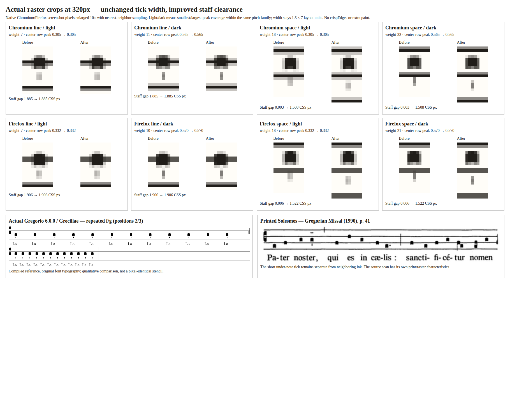

# Stage 8C owner feedback: consolidated properties and tick weight

Closeout: the final Stage 8C engraving and contextual UX were owner-accepted on
2026-11-10, including Accepted ADR 0020 and its narrow qualification to ADR 0007.
This intermediate record preserves its original verification and scope history;
see the [final acceptance record](README.md). Previously unperformed manual
checks remain unperformed, and deferred work remains deferred.

2026-11-09. Implemented for PR #67 review; **not owner acceptance or closeout**.
ADR 0020 was Proposed at this historical review stage. The scope update was committed as `965d2b8`
before implementation, following the [owner comment](https://github.com/OceanOSdev/gregorian-chant-editor/pull/67#issuecomment-6740779436).
It supersedes the earlier instruction to retain the top inspector.

## One note-property editor

The contextual **Selected note properties** panel now contains Form, Mora scope,
Horizontal episema and Vertical episema. The duplicated permanent fieldset and
its CSS are removed. Form uses exactly `allowedNoteForms`, `isNoteForm`, existing
labels and `updateNoteForm`; the modifier callbacks, legal mora patterns,
semantic history and synchronous autosave remain unchanged. There is no new
property state, validation, note form, schema or dependency.

An unsupported note role shows disabled Default plus an associated explanation.
Form-constrained deletion retains its existing rejection and reopens local error
feedback. Tab opens the first enabled field (Form, otherwise Mora); native
select keys, Shift+Tab, Escape/Close, reselecting and Tab exit remain available.
Keyboard reopening also reveals an offscreen focused note, so it does not need
the removed inspector. Opening/dismissing the overlay consumes no score space.

Current screenshots:

- [All four properties in Chromium, lower Pater Noster systems](properties-chromium.png).
- [Firefox at 320px](properties-firefox-320.png).
- Authored [Virga](properties-virga-chromium.png),
  [Inclinatum](properties-inclinatum-firefox-320.png) and
  [Quilisma](properties-quilisma-firefox-320.png).
- [Disabled Form with explanation](properties-disabled-firefox-320.png),
  [short scrollable panel](properties-short-firefox-320.png).

The first contextual record and its three-field/inspector screenshots are
[historical](contextual-editing.md), retained rather than relabeled as this UI.

## Rendered weight investigation

This clearance-only investigation is superseded for optical consistency by the
[screen phase alignment follow-up](rasterization.md). Its placement observations
remain valid; its remaining subpixel variation was not owner acceptance.

The report was reproducible, with two distinct causes. Actual source dimensions
were equal: every sampled tick is a single filled **1.5 × 7** rectangle, opacity
1, no stroke, no duplicate mark and no head overlap. Different horizontal
subpixel phases nevertheless produce different peak darkness when a tick is
less than one physical pixel wide. At 2× SVG scale all sampled center-row peaks
reach full ink, while at 320px the same ink can be distributed across two columns.

There was also a correctable placement problem: staff lines retain a
**non-scaling 1.5 CSS-pixel stroke**, while ticks scale with the SVG. The previous
one-unit staff exclusion band let a space-note tick begin only two layout units
past a staff line. At the narrow score scale that left essentially no rendered
air; close-up raster crops show the tick visually attached to the staff.
This could reinforce the apparent weight difference between line/space notes.

The correction changes **only vertical-tick staff clearance**, from a ±1 to a
±4 layout-unit exclusion band within the existing bounded candidate search.
For the repeated space-note specimen, the first clear candidate moves from
14 to 18 units below its nominal pitch. Tick dimensions, x anchors, source
identities, note heads, horizontal episemata and morae are unchanged. Complete
new tick bounds still participate in the shared geometry pipeline, measurement,
wrapping, focus/reveal bounds and previews. No renderer-only offsets, added
stroke, arbitrary thickening, pixel snapping or crispEdges were introduced.



The native screenshot pixels above are enlarged **10× using nearest-neighbor
sampling**. They show both light/dark horizontal phases and the new staff gap.
This is a raster enlargement, not a newly rendered idealized SVG stencil.
The line-note examples remain unchanged; the space-note ticks gain separation.
**Subpixel darkness differences remain at small scales**: this correction removes
an ink-proximity artifact, not the underlying finite pixel-grid effect.

Selected numeric observations (all repeated line/space notes, not one handpicked tick):

| Browser, 320px | SVG scale | Nominal projected tick width | Peak darkness range, before/after | Integrated width proxy, before/after | Minimum staff gap, before → after |
| -------------- | --------: | ---------------------------: | --------------------------------: | -----------------------------------: | --------------------------------: |
| Chromium       |   0.37637 |                    0.56455px |                       0.305–0.565 |                        0.561–0.574px |                 0.0028 → 1.5082px |
| Firefox        |   0.38056 |                    0.57083px |                       0.332–0.570 |                        0.570–0.578px |        approximately 0 → 1.5167px |

[Chromium measurements](weight-chromium.json) and [Firefox measurements](weight-firefox.json)
include desktop, medium, narrow and explicit SVG 1×/2× scales, plus the selected
native crop coordinates/coverage samples. The diagnostic uses one fully covered
center row and normalizes red-channel darkness from the current background (255)
to ink (32), then sums across columns. This is a width/darkness **proxy**, not a
perceptual stroke model or a golden-image threshold. Equal integrated coverage
with changing peaks supports the subpixel explanation; visual comparison also
exposes the separate staff-attachment problem. Firefox client rectangles have
app-unit rounding; source widths and CTM projection distinguish that reporting
precision from actual authored geometry.

### Traditional and rendering references

The new [GABC probe](weight-cases.gabc), [generated TeX](weight-cases.gtex),
[wrapper](weight-comparison.tex) and [actual Gregorio 6.0.0 / Greciliae output](weight-reference.png)
repeat Puncta at GABC f/g, matching editor staff positions 2/3. The board includes
that output and the existing attributed [Solesmes Pater Noster excerpt](pater-solesmes-excerpt.png).
They support retaining a short separate tick, not converting it into an extension
of the staff. Their typeface, printing and rasterization are not copied pixel
for pixel. No significant conflict with the proposed placement boundary or an
Accepted ADR was found.

The [SVG shape-rendering specification](https://www.w3.org/TR/SVG2/painting.html#ShapeRenderingProperty)
describes rendering hints, including the possibility of adjusting positions and
widths for crisp edges. That is not a reason to impose a blanket hint on the
engraver. The observed evidence supports a measured clearance correction while
retaining the existing thin rectangular mark.

## Actual verification

- `npm run format:check`, `npm run lint`, `npm test` (**77 files / 1,565 tests**),
  `npm run build` and `git diff --check` passed.
- The vertical-episema matrix now checks the four-unit staff band across all
  seven kinds, supported forms, intervals 1/2/3/5/12, line/space offsets,
  horizontal signs and every legal mora scope. Existing unchanged-head/ink,
  measured-bound, ownership, preview and wrapping assertions pass.
- The current contextual driver passed in production Chromium and Firefox at
  1440px/320px and short viewports: one editor/no duplicate; all Form whitelists;
  native Form and vertical-select ArrowDown; marks alongside forms; Form no-ops,
  atomic history and refresh; disabled Form skipping; local error feedback;
  pointer/keyboard reopening and offscreen keyboard reveal; stable selection
  position, Tab exit, scrolling and placement guards. Chromium pinch zoom also
  passed. [Chromium UI report](properties-chromium.json),
  [Firefox UI report](properties-firefox.json).
- Existing vertical-episema, note-modifier, authored-form, local-persistence and
  bundled-example drivers passed in **both** production browsers. Global-action
  helpers dismiss the local panel before pointing at underlying buttons; the
  modifier driver reopens note properties before continuing edits. These are
  adaptations to the intentional removal of permanent controls, not semantic
  exceptions. Original native fixtures and the owner v3 Pater Noster are unchanged.

No commands, history reducer, persistence codec/adapter or note-form rules changed.
ADR 0020 was Proposed at this historical review stage. Local Node was v24.12.0 versus declared v24.18.0;
hosted CI is separate. Native dropdown/file matrices use DOM change events;
closed-select keyboard operations and pointer note/Close actions use browser
input. OS dropdown presentation, screen-reader speech, IME and real browser-menu
zoom remain foreground owner checks. Existing extreme-pitch canvas limitations
and the blocked-autosave-warning follow-up remain separate.

## Reproduction

Build/preview production under `/gregorian-chant-editor/`, and use only disposable
profiles. This run used preview 4180, Chromium/CDP 9246 and Firefox/BiDi 9247:

```sh
CHANT_PREVIEW_URL=http://127.0.0.1:4180/gregorian-chant-editor/ CHANT_CHROMIUM_URL=http://127.0.0.1:9246/json node docs/verification/vertical-episemata/context-browser-check.mjs
CHANT_PREVIEW_URL=http://127.0.0.1:4180/gregorian-chant-editor/ CHANT_FIREFOX_URL=ws://127.0.0.1:9247/session node docs/verification/vertical-episemata/context-browser-check.mjs
```

Run the other five browser drivers sequentially on each shared browser tab using
those overrides. The weight driver additionally needs local ImageMagick:

```sh
CHANT_CHROMIUM_URL=http://127.0.0.1:9246/json node docs/verification/vertical-episemata/weight-browser-check.mjs after-clearance
CHANT_FIREFOX_URL=ws://127.0.0.1:9247/session node docs/verification/vertical-episemata/weight-browser-check.mjs after-clearance
```

It emits full screenshots, native crops and complete `weight-results.json` into
a fresh temporary directory. For a baseline, build `e03aa12` separately via
`git archive` into a temporary directory, using the same locked dependencies;
serve that build at another disposable origin and override `CHANT_PREVIEW_URL`.
The before study used the same one-unit tick recipe, captured before rebuilding
the four-unit correction. The fixture and controlled SVG sizes are in the driver;
no stored score or user profile is involved.

For the Gregorio sample, copy the GABC/TeX to a temporary directory, run Gregorio,
compile the TeX wrapper twice, rasterize with `pdftoppm -scale-to 1800 -png
-singlefile`, and trim the whitespace with ImageMagick. This environment used the
existing extracted TeX tree and variables documented in [the main record](README.md).
Compose actual before/after raster crops with:

```sh
CHANT_CHROMIUM_URL=http://127.0.0.1:9246/json node docs/verification/vertical-episemata/render-weight-board.mjs /tmp/CHROMIUM-BEFORE/weight-results.json /tmp/CHROMIUM-AFTER/weight-results.json /tmp/FIREFOX-BEFORE/weight-results.json /tmp/FIREFOX-AFTER/weight-results.json
```

The source crops stay at native screenshot resolution until the board enlarges
them. Source/reference captures and the retained comparison were visually
inspected; final engraving and UI acceptance were subsequently recorded on 2026-11-10.
