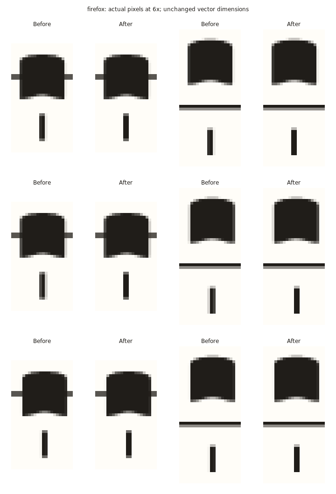

# Vertical episema screen phase alignment — owner-accepted 2026-11-10

2026-11-09. Implements the owner's approved **option 1** following
[the latest PR #67 feedback](https://github.com/OceanOSdev/gregorian-chant-editor/pull/67#issuecomment-6741412693).
The investigation plan was committed as `011ff0f`; the subsequent owner-approved
screen tolerance was recorded in `10dbe04` before implementation.

**Owner-accepted 2026-11-10.** The owner explicitly accepted the final engraving,
contextual editing UX and ADR 0020, including the narrow screen rasterization
qualification to ADR 0007. Stage 8C is completed; PR #67 remains unmerged. The
2026-11-09 automated/browser evidence and unperformed manual checks below are
preserved as recorded; owner visual acceptance does not imply new test runs.

## Normal-size before/after

These are actual production browser screenshots at their original dimensions.
Open/download them at **100%** to judge the pixels; Markdown/browser image fitting
can introduce another resampling step. Each before image uses the same build,
fixture, font and scale, disabling only tick translation to reproduce the prior
vector rasterization. After uses the production adapter, not an injected prototype.
The long-score fixture is a temporary Pater Noster derivative with a vertical sign
on each note; the bundled owner v3 file remains byte-for-byte unchanged.

| Viewing condition                        | Firefox before / after                                                                    | Chromium before / after                                                                     |
| ---------------------------------------- | ----------------------------------------------------------------------------------------- | ------------------------------------------------------------------------------------------- |
| Ordinary desktop, responsive SVG         | [Before](raster-firefox-desktop-before.png) / [After](raster-firefox-desktop-after.png)   | [Before](raster-chromium-desktop-before.png) / [After](raster-chromium-desktop-after.png)   |
| Ordinary approximately 1.33× SVG         | [Before](raster-firefox-ordinary-before.png) / [After](raster-firefox-ordinary-after.png) | [Before](raster-chromium-ordinary-before.png) / [After](raster-chromium-ordinary-after.png) |
| Lower systems: nobis debita / dimittimus | [Before](raster-firefox-lower-before.png) / [After](raster-firefox-lower-after.png)       | [Before](raster-chromium-lower-before.png) / [After](raster-chromium-lower-after.png)       |
| 320px viewport                           | [Before](raster-firefox-320-before.png) / [After](raster-firefox-320-after.png)           | [Before](raster-chromium-320-before.png) / [After](raster-chromium-320-after.png)           |

Enlarged native screenshot crops supplement those normal-size views:



[Chromium phase crops](raster-chromium-phases.png) use the same selection method.
Both boards enlarge existing pixels 6× with nearest-neighbor sampling. They do
not rerender idealized SVGs. Six positions include low/high dark-column counts
from the baseline, matched by stable identity to the after captures.

## What changed

The previous ±4 staff exclusion band correctly improved separation but did not
fix optical weight. It remains unchanged. Identical rectangles can distribute
coverage differently across columns at different x phases; at approximately
1.33× the baseline reproduces the reported **one versus two near-fully-dark
columns at the same scale**, in both browsers.

Experiments with tick-only `crispEdges` on the original rectangle, and a butt-cap
stroke with the same vector extents, fail across scales: at desktop they can
still paint one or two columns; at 320px some signs disappear. These are rejected,
not applied globally or shipped as the fix. The SVG specification explicitly
allows rendering hints to adjust positions/widths; it does not promise uniform
width for this case. [SVG 2 rendering hints](https://www.w3.org/TR/SVG2/painting.html#ShapeRenderingProperty).

Production now tags only vertical-tick rectangles in derived ink. One shared SVG
screen adapter aligns their **left-edge pixel phase**, retaining the exact
**1.5 × 7** vector rectangle, fill, normal antialiasing and all note anchors.
CSS translation is limited to **half a physical device pixel**, also capped at
**1.5 layout units**. The largest sampled translations were approximately
**0.4954px Firefox / 0.4989px Chromium**. No stroke, minimum black-pixel width,
crisp-edge hint or permanent display coordinates are added.

The narrowly accepted qualification to [ADR 0007](../../adrs/0007-share-derived-neume-engraving-geometry.md)
is documented explicitly in [Accepted ADR 0020](../../adrs/0020-vertical-episema-presence-and-derived-placement.md#narrow-screen-rasterization-qualification-to-adr-0007).
Canonical measured bounds, wrapping, selection/hit geometry, note ownership,
commands, history, autosave and v4 semantics are unchanged. Nominal bounds and
screen ink may differ only by the declared horizontal raster tolerance.

The 1.5-unit cap preserves a positive gap to unchanged obstacles behind the
existing two-unit clearance. Equal-width ticks aligning to the same monotonic
grid also retain their ordering and separation (including when both shift).
Canvas/viewport clip boundaries are checked before a shift is applied. Unsafe
clip-edge cases and very small scales retain the canonical rendering, rather
than changing layout or squeezing a sign into the clip. Only tagged ticks move;
all other ink is asserted untagged/untransformed. The adapter reads canonical
parent matrices so shifts cannot accumulate, and updates for React commits,
resize, font completion, scroll, DPR and visual-viewport changes. Preview ink
shares the same renderer. Presentation state never enters document/history.

## Measurements and their limits

The isolated 24-Punctum fixture repeats line/space pitches at varied x phases.
It covers responsive 1440/1024/320px, SVG widths 720/960/1440 and DPR 1/2. The
long-score derivative adds real mixed forms/sign contexts and scrolling. All
source rectangles remain 1.5 × 7; widths track the CTM, without head/staff
intersections. Firefox client rectangles have app-unit rounding, so source
attributes/CTM distinguish geometry from rounded browser rectangle reporting.

| Isolated specimen                 | Dark columns ≥95%, before → after                              | Integrated center-row coverage, after |
| --------------------------------- | -------------------------------------------------------------- | ------------------------------------- |
| Firefox approximately 1.33×       | 1–2 → 2 for every sampled tick                                 | 2.000px                               |
| Chromium approximately 1.33×      | 1–2 → 1 for every sampled tick, with equal antialiased fringes | 2.000px                               |
| Firefox 320px, DPR 1              | subpixel peaks 0.332–0.570 → 0.570 uniformly                   | 0.570px                               |
| Chromium 320px, DPR 1             | subpixel peaks 0.305–0.565 → 0.565 uniformly                   | 0.565px                               |
| Firefox / Chromium desktop, DPR 2 | 2–3 → 3 for every sampled tick                                 | approximately 3.731px                 |

The browsers need not distribute identical ink into identical columns; consistency
is measured **within the same browser and scale**. Chromium's ordinary-scale
fringes differ from Firefox's, while total coverage remains equal within each
sample family. Narrow ticks retain their fractional coverage, rather than being
artificially thickened to a solid black pixel. Small raster quantization changes
in coverage versus baseline are retained in the reports, not treated as changes
to the vector dimensions.

[Firefox full measurements](raster-firefox.json) and [Chromium measurements](raster-chromium.json)
retain all-sample summaries and representative phase/coverage extrema, with
source identities, shifts, scales and coverage rows. The
red-channel coverage calculation is a diagnostic proxy, not a perceptual model.
For isolated Puncta it includes the full antialiased fringe. For densely marked
Pater Noster, a nominal-column window excludes unrelated neighboring ink;
**that truncated window's sum is not a full-width estimate**. Early exploratory
sampling included neighboring ink at 320px and falsely reported excessive
coverage; the retained driver separates those measurements and uses the isolated
fixture for quantitative width regression. Normal-size long-score screenshots
remain the principal visual review evidence.

## Print and vector proof

The CSS translation rule exists only in screen media. Print events also clear
transient shifts. Actual headless print captures in both browsers verified zero
print translation and identical canonical SVG ink attributes before/after.
Rasterizing **both pages** of each before/after PDF at 96dpi produced matching
SHA-256 hashes for every corresponding PNG page. PDF metadata bytes are not used
as a visual equality test.

| Browser  | Before / after, final page at 96dpi                                                   | Actual vector PDF                                          |
| -------- | ------------------------------------------------------------------------------------- | ---------------------------------------------------------- |
| Firefox  | [Before](raster-firefox-print-before.png) / [After](raster-firefox-print-after.png)   | [Unchanged print vector output](raster-firefox-print.pdf)  |
| Chromium | [Before](raster-chromium-print-before.png) / [After](raster-chromium-print-after.png) | [Unchanged print vector output](raster-chromium-print.pdf) |

This is the existing browser print result, including the app's existing print
presentation; no new print/export feature is introduced. Source SVG x/y/width/
height/path attributes are unchanged, and no transform attribute is added.

## Regression verification

- PASS: `npm run format:check`, `npm run lint`, `npm test` (**78 files / 1,568 tests**),
  `npm run build`, `git diff --check`.
- Pure phase tests cover fractional DPRs, visual zoom inputs, horizontal phases,
  physical/unit caps, canonical fallback, clip boundaries and adjacent ticks.
  The all-kind/form/interval/sign engraving matrix also asserts that no
  preexisting ink receives the tick rasterization tag.
- PASS in both production browsers: vertical-episema, contextual-property,
  note-modifier, authored-form, local-persistence/recovery and bundled-example
  drivers. These cover normal/320px editing, native keyboard controls, history,
  refresh, existing marks/forms, guarded recovery and owner fixture compatibility.
  [Retained run summary](raster-regressions.json).
- Both print comparisons pass; normal-size captures, phase crops and print
  raster pages were visually inspected. The unchanged owner source SHA-256 is
  `d25b7b79a011e704d34c475d809b1c90c1fb6682f8cb3f922114b620c2aedfbb`.

Local Node is v24.12.0 versus declared v24.18.0; hosted CI is separate. Native OS
print dialogs, spoken screen-reader output, real monitor changes and interactive
pinch/browser-menu zoom remain foreground checks. Visual viewport scale is
included in the displacement cap, but compositor resampling during pinch is not
a promise of identical pixels. Extremely small scales and clip-edge fallback
can retain phase variation. The owner accepted the final visual result on 2026-11-10; these manual-check
limitations remain unchanged. Manual orientation overrides, blocked-autosave
warning improvements and extreme-pitch layout issues remain deferred.

## Reproduction

Use disposable profiles and production preview under `/gregorian-chant-editor/`.
The driver accepts the existing `CHANT_PREVIEW_URL`, `CHANT_CHROMIUM_URL` and
`CHANT_FIREFOX_URL` overrides; this run used ports 4180, 9246 and 9247. Run each
browser's drivers sequentially on its shared tab.

```sh
CHANT_FIREFOX_URL=ws://127.0.0.1:9247/session CHANT_TICK_HINT=auto node docs/verification/vertical-episemata/raster-browser-check.mjs before
CHANT_FIREFOX_URL=ws://127.0.0.1:9247/session node docs/verification/vertical-episemata/raster-browser-check.mjs after
```

Repeat with `CHANT_WEIGHT_PATER=1` for long-score normal/lower-system captures,
`CHANT_RASTER_PRINT=1` for actual print PDFs and canonical vector snapshots, or
`CHANT_TICK_HINT=crispEdges` / `stroke` for rejected strategies. Each run writes
reports and native crops into a fresh temporary directory. Use the Chromium URL
override instead for the matching runs. ImageMagick measures screenshot rows;
Poppler rasterizes the PDFs. Neither is a new application/test dependency.

`save-raster-evidence.py` accepts the browser label, four raw JSON reports
(repeated before/after, Pater before/after), then two print run directories. It
copies native PNGs without resizing, composes 6× pixel crops, verifies all print
page hashes, and retains numeric JSON with temporary paths removed. See its
usage string. Earlier Gregorio/Solesmes comparisons remain linked from the
[main evidence record](README.md); this follow-up changes screen phase only.
